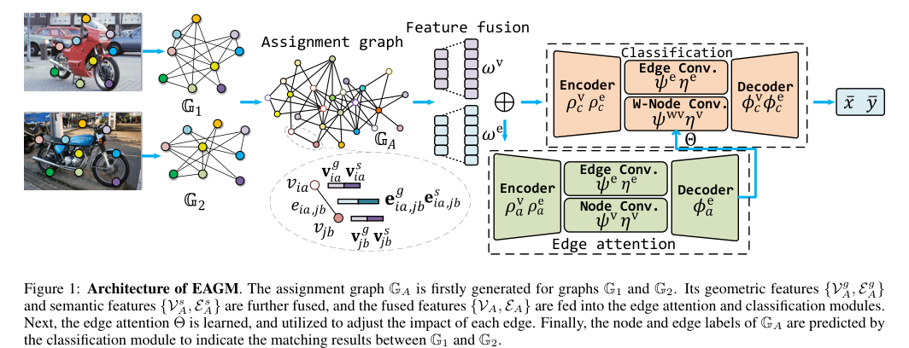

# Adaptive Edge Attention for Graph Matching with Outliers

> **TL;DR:** EAGM learns assignment-graph node/edge scores and adaptive edge weighting, using CNN features pooled along each image edge. It improves the displayed average matching accuracies, while accuracy still drops sharply with Pascal outliers. The released decoder selects at most one candidate per source-node group and does not enforce target exclusivity; a hard bijection must not be assumed from the training constraint loss.

## Motivation

Visual graph edges are often constructed heuristically and represented only through their endpoints, although different edges can have very different usefulness under outliers. EAGM learns which assignment-graph edges should influence correspondence prediction and represents an edge using image evidence along its spatial path, aiming to distinguish inlier–inlier from inlier–outlier relationships (Introduction).

## Contributions

- Semantic edge descriptors pooled from CNN features at pixels traversed by an image edge.
- An assignment graph combining geometric and appearance features for candidate correspondences.
- A learned edge-attention network feeding weighted message passing and node/edge classification.
- Supervised tests on Pascal VOC, Willow and CMU House, including controlled outlier settings.

## Methodology

**Features and assignment graph.** Known keypoint coordinates provide node geometry; concatenated endpoint coordinates provide edge geometry. ImageNet-pretrained VGG16 relu4_2/relu5_1 features supply semantic node features. Bresenham rasterization finds pixels traversed by an edge, whose CNN vectors are pooled to a fixed-size, L2-normalized descriptor. A candidate pair of original nodes becomes an assignment-graph node; pairs of original edges induce assignment edges. Separate MLP geometry embeddings are added to concatenated semantic features (Sections4.1–4.2).

*Original Figure1 and its entire caption, formal PDFp3/printed968; extracted and visually checked.*

**Attention and prediction.** An encoder/convolution/decoder network produces scalar edge parameters after three coupled edge/node layers. Edge updates combine the Hadamard product of endpoint representations with the preceding edge representation; node updates aggregate adjacent edges. A separate ten-layer classification network weights incoming edges by $\exp(-\theta_k)$ and predicts node and edge correspondence scores. These weights are not described by Eq8as a normalized attention distribution. Supervision combines node BCE, edge BCE and an assignment-constraint penalty, with both additional loss weights.1 (Eqs2–12).

**Hard-output boundary.** The formal paper defines a one-to-one QAP and gives classification/constraint losses, but does not explicitly specify a Hungarian final projection. The current official `EAGM_Test.py` imports `GM_Core_featured`: its `greedy_mapping` repeatedly picks the largest positive score and removes candidates with the same **source group only**. The generator maps group1to the first input node and group2to the second. Since the decoder does not exclude group2, different source nodes can choose the same target. Thus the release yields hard source-group correspondences, without a general two-sided matching-feasibility certificate. The training penalty cannot replace that absent hard constraint. This observation concerns the inspected release, not a claim that every historical output had collisions.

**Classification.** This is **specialist / constructive** neural correspondence scoring and hard decoding within visual graph matching. Attention adjusts hidden edge contributions rather than neurally editing a complete feasible incumbent. The work does not establish exact QAP optimization or a shared checkpoint across native optimization tasks.

## Experiments

**Settings.** Delaunay triangulation supplies edges. Adam starts at.001and decays2%each2000iterations. Training uses annotated node matches and edge labels induced by matching endpoints. A GTX1080Ti processes approximately25image pairs/second in the reported setting; the paper does not provide a comprehensive timing breakdown or common-runtime table. Pascal has7020training/1682test images,20classes, cropped/rescaled256×256objects and6–23inliers. The text samples100000training pairs per class (Section5.1).

**Pascal without outliers.** Mean accuracy is **70.5%**, versus CIE68.9and LCSGM68.5. All peer values in Table1are quoted from the cited earlier works, not newly documented common-code reruns. Class negatives remain: bird64.6is below CIE70.1, cat61.3below74.2and sofa60.6below LCSGM65.8. Average improvements therefore do not establish uniform category superiority.

**Willow.** Twenty images per category train the model, with1000pairs from the remaining images tested in each of five categories. Mean accuracy is **96.5%**, versus LCSGM94.9. Duck89.7is below PCA93.5, while motorbike99.3is slightly below LCSGM99.4. The pretrained visual descriptor/keypoint setting remains distinct from raw-image detection (Table2).

**Outliers.** The clean Pascal-trained model is evaluated after adding1–5random-coordinate points to the **second** test image. Accuracy drops **70.5→60.6→53.3→47.6→42.6→38.4%**, while LCSGM drops68.5→36.6. Relative superiority is retained in this controlled test, but substantial degradation remains; it does not show recovery under arbitrary two-sided contamination (Table3).

**CMU House.** This one-house111-frame sequence has30tracked keypoints. Training generates300000random pairs from the sequence, with10–30inliers on one side and30points on the other. Tests vary frame gap or remove0–10points, and the authors report at least97.3%accuracy across their settings. The paper does not supply a held-out-scene protocol or a strict disjoint frame-pair manifest, so this is not evidence of unseen-scene generalization (Figure3).

No component ablation isolating each proposed contribution, objective-gap certificate or multi-seed confidence study appears in the seven-page formal paper. The classification accuracy, quoted peer comparisons and throughput statement should be read under their respective protocols.

## Limitations

The method depends on known keypoints, image CNN descriptors, supervised correspondence labels and heuristic graph edges. Pixel-path pooling can include background context. Synthetic second-image outliers and a single-video CMU test cover narrower conditions than arbitrary clutter, occlusion or distribution changes.

Learned node/edge scores, a one-to-one training loss and the inspected one-sided greedy decoder do not certify a feasible bijection, global QAP optimality or monotone improvement. The hard-decoder limitation is explicitly separated from the empirical matching-accuracy results. Class-level regressions and the large Pascal outlier drop qualify blanket robustness claims.

## Reproducibility

**Identity and date.** Jingwei Qu, Chenrui Zhang, Xiaoqing Lyu and Zhi Tang list the Wangxuan Institute of Computer Technology, Peking University; Haibin Ling lists Stony Brook University. Formal IJCAI2021 pages966–972, DOI[10.24963/ijcai.2021/134](https://doi.org/10.24963/ijcai.2021/134), have **August2021 month precision** in the official BibTeX and identity-matched publisher-deposited metadata. No unverified arXiv record or exact day is added.

**Complete science.** All seven formal pages and28references were read. Original architectures/edge-feature panels, message/loss formulas, all three tables and both CMU curves were rendered and inspected. The publisher page, author publication listing and full official archive were checked; no independent paper-specific scientific appendix is identified. OriginalFigure1 with the complete caption physically exists under public/paper-assets and was actually viewed.

**Code and nested attachments.** Official[bestwei/EAGM](https://github.com/bestwei/EAGM) was checked at commit`c7818bf29325cb619402f2f4b6667037d858cdaf`,60archive members. The full README describes TensorFlow/GraphNets/Sonnet dependencies, data preparation, provided models and benchmark-specific train/test scripts. Two nested dataset ZIPs were enumerated(113/616members), with no scientific documents. Four notebooks identify themselves as **2018 GraphNets generic demonstrations** of graph basics/physics/shortest path/sorting, rather than EAGM scientific supplements; their headers were inspected and they are not counted as read EAGM pages.

Necessary inspection of `EAGM_Test.py`8/85–89, `graph_generator/GM_Core_featured.py`306–355and generator group mappings establishes the exact greedy-decoder boundary above. No substitute Hungarian routine is invented, and no training or benchmark rerun was performed.

**Actual internal references.** The full bibliography directly cites[PCA-GM](learning-combinatorial-embedding-networks-for-deep-graph-matching.md)(Wang2019),[LCS](learning-combinatorial-solver-for-graph-matching.md)(Wang2020),[the graph-matching survey](../studies/learning-for-graph-matching-and-related-combinatorial-optimization-problems.md)(Yan2020),[CIE-H](cie-h.md)(Yu2020a) and[deep learning of graph matching](deep-learning-of-graph-matching.md)(Zanfir2018), all on PDFp7. Other classical graph-matching works are not converted to unrelated neural catalogue edges.
