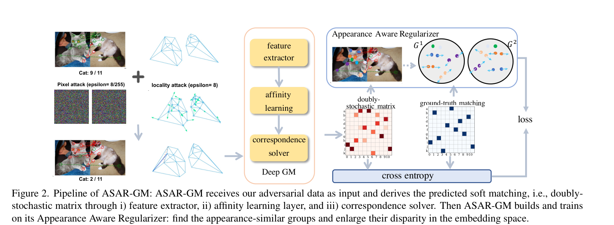

# Appearance and Structure Aware Robust Deep Visual Graph Matching: Attack, Defense and Beyond

> **TL;DR:** ASAR-GM trains a visual matching network on pixel/keypoint-locality adversarial examples with an appearance-aware output regularizer. It improves empirical robustness under the tested attacks; stronger training attacks retain an explicit clean-accuracy tradeoff. Testing constructs a matching through the underlying neural scorer and Hungarian decoder.

## Motivation

Small changes to annotated keypoint positions affect both sampled visual features and Delaunay graph topology. Directly deleting graph edges can be undone by reconstructing the graph from the unchanged coordinates. The paper therefore attacks pixels and coordinates, then trains a matching model to distinguish the visually similar keypoints these attacks confuse (Sections1–4).

## Contributions

- A locality attack on keypoint coordinates, combined with pixel attacks and reconstructed graph topology.
- Appearance Aware Regularization (**AAR**), learned using attack-induced confusion groups and supervised matching labels.
- **ASAR-GM**, combining adversarial training, AAR and an initial weaker-attack burn-in.
- White-box, transfer-based black-box, adaptive-attack, architecture-transfer and clean-dataset generalization evaluations, together with negative tradeoffs and attack-budget details.

## Methodology

**Matching pipeline.** The paper defines bijective keypoint matching as a QAP and uses a doubly-stochastic relaxation during learning. Its principal base model is NGMv2, which extracts visual features, learns affinities through an association-graph network and scores candidate correspondences. The final discrete assignment uses **Hungarian decoding**; this enforces assignment feasibility, not optimality of the full learned quadratic objective (Section3; Figure4; official implementation).

*Original Figure2 and entire caption, formal PDFp4/printed15266; extracted and visually checked.*

**Attack.** VS-Attack performs projected gradient-sign updates on pixels and keypoint coordinates, rebuilding Delaunay connectivity as coordinates change. At256×256resolution, the pixel$\ell_\infty$budget is8/255and coordinate budget8pixels. PGD step sizes are2/255and2respectively. Pixel-only, locality-only and combined attacks are evaluated; locality also has diagnostic variants perturbing only feature-sampling positions, only induced structure, or both. These are specified empirical threat models, not every possible corruption (Algorithm1; AppendixG).

**Regularizer.** Hungarian-decoded attacked matches and ground truth define a reverse correspondence within a graph. DFS identifies cycles/groups of confused landmarks. The matrix$R$places+1on a wrongly predicted row's correct target,-1on specified confusable alternatives and0elsewhere; correctly matched rows are zeroed. Minimizing$-\sum R_{ij}S_{ij}$increases probability on the correct match relative to those alternatives. The training objective adds1.5×AAR to supervised BCE, with burn-in period5. The three reported configurations subsequently use single-step pixel, single-step combined and two-step combined adversarial training respectively (Eqs6–10; Algorithm2).

**Classification.** **Specialist / constructive.** The contribution changes training and constructs fresh visual-graph assignments at test time. Repeated PGD input attacks and parameter training are not neural edits of a complete matching incumbent. Shared Pascal-to-Willow weights demonstrate within-task dataset transfer, not different native optimization tasks. This paper includes a substantive neural defense method as well as an attack/robustness analysis.

## Experiments

**Protocol.** PascalVOC uses7020training/1682test images with Berkeley keypoints. The principal defense uses NGMv2 configurations; attacks also target PCA-GM, CIE-H and BBGM. White-box attacks access the target model, while the reported black-box attacks transfer examples from a pretrained NGMv2 surrogate. Robust accuracy remains **keypoint matching accuracy under a specified attack**, not a certificate that every perturbation in the norm ball is handled (Section6).

**Main tradeoff.** The NGMv2 baseline scores80.40%clean and21.46%under50-step combined PGD. ASAR configurations1/2/3 yield **81.15/79.74/72.56%clean** and **53.79/62.11/69.60%under that attack**. Configuration3 therefore gains robustness with a substantial clean-accuracy reduction. Configuration1 also does not dominate every defense on every attack: pixel-PGD10accuracy66.69is below pixel-PGD5-training's73.20. MainTable2's “Overall” averages the particular clean/attack columns equally; it is not a distribution-independent robustness measure.

**Black-box and adaptive tests.** On transferred10-step combined attacks, configuration1has80.07%versus BBGM44.27%. BBGM's corresponding white-box result64.66%is higher, which the authors interpret as a gradient-obfuscation concern; it is not a proof that all its failures have that cause. The AAR-aware adaptive attack gives69.1%versus69.6%for50-step combined PGD. Supplementary C&W/PGD/MI-FGSM tests provide further empirical checks rather than certified lower bounds on worst-case accuracy (Tables2–3; AppendixA).

**Transfer and ablations.** Pascal-trained ASAR achieves **90.37%clean Willow accuracy**, versus83.22%for Pascal-trained NGMv2; a separately Willow-trained NGMv2 reaches98.20%. On PCA-GM, locality training improves clean accuracy64.78→66.17, whereas the AAR defense row has60.85%clean but44.20%combined-PGD20accuracy versus12.56%baseline. Thus broader applicability includes another clean/robustness tradeoff. Random-location/structure/both training in the supplement yields70.91/79.02/80.43%clean; the last value is slightly above the80.40baseline, so random noise does not uniformly harm accuracy.

**Reporting consistency and cost.** MainTable4's configuration1 “Overall”71.92does not equal the mean of its seven displayed clean/attack values (**69.64**, rounded); its summaries should not be substituted for the individual columns. A configuration2combined-PGD10cell is62.29there versus62.39in Table2. These are recorded reporting inconsistencies, not evidence that all experiments are invalid. AppendixE states configurations1/2require one additional backward pass per minibatch, compared with$n$extra passes for PGD-$n$training. This is a training-pass argument, not a measured universal wall-clock speedup. The paper reports point estimates and selected qualitative pairs, rather than a full multi-seed confidence study.

## Limitations

Supervised keypoint identities and the base visual matching architecture remain necessary. Threat budgets, iterative attack strength, surrogate selection and the Delaunay construction delimit the robustness evidence. Successful finite attacks upper-bound worst-case accuracy; failure of the tested attacks does not certify robustness. The paper supplies no general adversarial or QAP-optimality guarantee.

Stronger training trades clean accuracy for robustness, performance changes across architectures, and transfer to a new dataset remains below its fully trained baseline. Appearance-confusion groups depend on model errors and ground truth during training. One-to-one Hungarian feasibility does not ensure semantically correct matches. No cross-task generalist checkpoint is demonstrated.

## Reproducibility

**Identity.** Qibing Ren, Qingquan Bao, Runzhong Wang and Junchi Yan all list Shanghai Jiao Tong University. Formal CVPR2022 CVF pagination is15263–15272. DOI[10.1109/CVPR52688.2022.01483](https://doi.org/10.1109/CVPR52688.2022.01483)has an identity-matched publisher-deposited publication date of **2022-06**; no unsupported exact day is inferred. DOI pagination may differ from the accepted CVF copy. No unverified preprint identity is introduced.

**Complete science and image.** All ten official main pages,59main references, three official scientific supplement pages and its five references were read. The supplement, linked directly by CVF, retains its anonymous review watermark; its identity is established by the exact title and official attachment relationship, not an invented author byline. Key mathematics, algorithms, tables, confusion heatmaps and all twenty main/supplement qualitative examples were rendered and inspected. OriginalFigure2 with the complete caption physically exists under public/paper-assets and was actually viewed.

**Code.** The paper's official[RobustMatch](https://github.com/Thinklab-SJTU/RobustMatch)archive has120members at commit`27f9f47b7d96d760b5a2c37cb6a60eb269b2d69f`, SHA256`2583f78ea966ac1eba2bba92340a066ded7d0b9b88fab1f42814b1aad4687aed`, with no additional PDF/ZIP/notebook science attachment. Its complete README documents a ThinkMatch Docker environment (PyTorch1.6/CUDA10.1/PyG1.6.3), three experiment configurations, separate black-box evaluation and pretrained-weight links. Necessary inspection confirms `models/NGM/model_v2.py`Sinkhorn-to-Hungarian outputs and the loss module's Hungarian-based grouping path. No training or attack rerun was performed.

**Actual internal references.** Main bibliography entries[16/17]cite[DGMC](deep-graph-matching-consensus.md)/[QC-DGM](deep-graph-matching-under-quadratic-constraint.md);[33/34]cite[IDRGM](idr-gm.md)/[BBGM](deep-graph-matching-via-blackbox-differentiation-of-combinatorial-solvers.md);[42/45]cite[PCA-GM](learning-combinatorial-embedding-networks-for-deep-graph-matching.md)/[LCS](learning-combinatorial-solver-for-graph-matching.md);[48/49/51]cite[CIE-H](cie-h.md)/[DLGM](deep-latent-graph-matching.md)/[deep learning of graph matching](deep-learning-of-graph-matching.md);[55/56/57]cite[deep graphical features](deep-graphical-feature-learning-for-the-feature-matching-problem.md)/[adversarial graph matching](../studies/adversarial-graph-matching.md)/[IA-GM](ia-gm-a-deep-bidirectional-learning-method-for-graph-matching.md). The distinctly titled TPAMI extensions[43–44]are not merged into earlier different-title conference entries.
