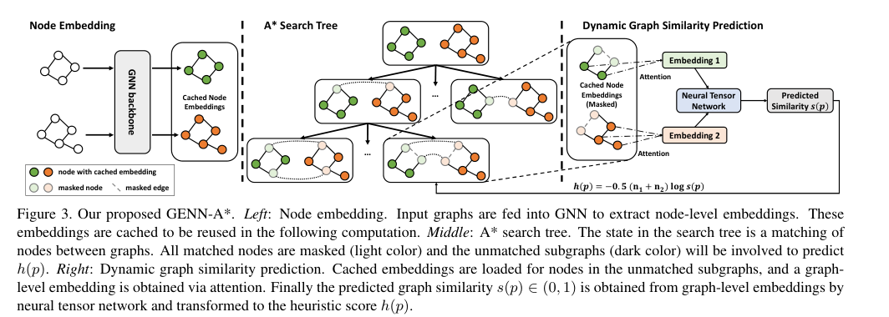

# Combinatorial Learning of Graph Edit Distance via Dynamic Embedding

> **TL;DR:** GENN-A* learns a completion-cost heuristic for A* graph-edit-path search and reuses cached graph embeddings as nodes become matched. It returns an explicit edit path, but the learned heuristic is not admissible: this is an approximate GED solver, with a measured accuracy/time tradeoff rather than an exactness certificate.

## Motivation

Exact graph edit distance (GED) requires searching combinations of node substitutions, insertions and deletions, together with induced edge edits. Classical A* can certify an optimum when its completion heuristic is a valid lower bound, but its search tree can be expensive. Graph-similarity networks avoid this search by regressing a scalar and generally do not recover the edit path. The paper combines a learned scalar completion estimate with explicit combinatorial path construction (Introduction, Section3.1).

## Contributions

- A graph-edit neural network (GENN) predicts the remaining edit cost inside an A* search.
- Cached full-graph node embeddings are masked and pooled to avoid recomputing GNN layers for every partial edit path.
- Two-stage supervision combines whole-graph GED/similarity labels with remaining-cost labels along optimal training edit paths.
- Small chemical/program graphs and attributed image-keypoint graphs expose the accuracy, search-state and CPU-time tradeoffs.

## Methodology

**Search state and discrete output.** A partial path $p$ matches a prefix of source nodes to unused target nodes or a void node; remaining target nodes can be inserted. Edge edits are induced by these node edits. The search prioritizes $g(p)+h(p)$, where $g$ is the exact cost already incurred and GENN predicts the completion term $h$. The first completed path selected by this approximate search yields an explicit correspondence/edit path and its realized cost. The paper explicitly states that learned $h$ breaks the lower-bound/admissibility condition required by exact A* (Algorithm1, Section3.1).

*Original Figure3 and its entire caption, formal PDFp4/printed5244; extracted and visually checked.*

**Features and cached approximation.** Degree one-hot features are supplemented by atom-label one-hots for AIDS. Three GCN layers process ordinary graphs; SplineCNN with16kernels processes 2D Willow graphs, using widths64/32/16. Node embeddings are computed once on each **full graph**. For each partial state, matched nodes are masked out and the remaining cached embeddings are pooled. Unlike the paper's exact-dynamic-GNN comparator, neighboring node embeddings are not recomputed after masking. Thus this efficient reuse is an approximation to residual-graph embedding, not an identity. Its constant-time cache lookup does not make the entire attention/tensor prediction constant time (Section3.2, Figure4).

**Completion estimate.** A mean/tanh global key and sigmoid attention with scale10 produce graph vectors. A neural tensor network with16channels outputs $s\in(0,1)$, corresponding to $s=\exp[-2\,GED/(n_1+n_2)]$. At a partial state, $h(p)=-\tfrac12(n'_1+n'_2)\log s(p)$ uses unmatched-node counts. Attention and tensor operations remain part of each state evaluation (Eqs2–8).

**Training and theorem scope.** Whole-graph mean-squared similarity supervision initializes the model. Fine-tuning samples200graph pairs, solves optimal training edit paths with exact A*, and supervises partial states along those paths. Theorem1 proves $g(p)+h^{opt}(p)=GED(p^*)$ for a partial path belonging to a known optimal path $p^*$. This justifies these training labels; it does **not** prove that the trained network is admissible, that arbitrary search-state labels follow this rule, or that GENN-A* is exact (Algorithm2, Theorem1 and complete proof).

**Classification.** This is **specialist / constructive**: a neural component controls expansion of a partial discrete solution, and classical search completes the edit path. It does not neurally edit a complete incumbent. The datasets all instantiate GED, with separately configured models; they do not demonstrate a shared checkpoint across distinct native optimization tasks.

## Experiments

**Protocol.** Preprocessed AIDS and LINUX graphs have at most10nodes. AIDS uses unit node/edge insertion/deletion costs and unit substitutions for different atom labels; LINUX has unattributed nodes/edges with zero substitution and unit insertion/deletion. Willow-Cars has10known keypoints per image, Delaunay graphs and edge-length-based costs normalized by300; node insertion/deletion is prohibited. Willow's initial labels derive from semantic correspondences and are explicitly **not necessarily optimal GED**. All datasets use60/20/20training/validation/test splits, and testing queries compare test graphs with training graphs. Experiments use a single Intel i7-7820X3.6GHz CPU/64GB RAM without multithreading or GPU parallelism (Section4.1).

**Accuracy.** GENN-A* reports similarity MSE$(\times10^{-3})$/Spearman correlation/precision@10 of **.839/.953/.866** on AIDS, **.324/.991/.962** on LINUX, and **.599/.928/.938** on Willow. These are similarity/retrieval metrics, not relative GED gaps. Regression-only GraphSim has lower MSE on AIDS(.787) and LINUX(.058), and higher LINUX precision@10(.992). Standalone GENN has weak LINUX precision@10(.527). AIDS/LINUX peer regression values were quoted from the earlier study rather than all newly rerun under one implementation (Table1).

**Time and search.** Average complete-solve CPU seconds decrease from Hungarian-A* **30.542/2.332/188.234** to **16.235/2.177/78.481** for AIDS/LINUX/Willow, approximately1.88/1.07/2.40times speedups. Figure5 reports approximately4times fewer search states on challenging AIDS/Willow settings, which is a different quantity from wall-clock acceleration. On LINUX, a heuristic evaluation takes .417ms for GENN, versus2.329ms vanilla GNN and3.145ms exact-dynamic GNN; the classical Hungarian heuristic is still faster at **.358ms** (Tables2–3).

**Nonoptimal outcomes.** Figure7 reports exact-solution fractions76.8%,95.8% and58.3% for the three datasets under the plotted protocol. Figure6 also explicitly contains Willow examples with returned costs1.68versus optimum1.40,1.79versus1.26, and3.10versus3.01. These examples and the learned heuristic's overestimates prevent interpreting the results as guaranteed optimality. Feasible returned edit-path costs are upper bounds; raw similarity regression need not stay on either side of the optimal GED.

## Limitations

Admissibility is deliberately sacrificed, so the exact-A* guarantee does not transfer. Cached embeddings retain context from already matched nodes, and training only optimal-path states does not guarantee accurate predictions on every state reached at test time. The experiments cover small graphs and known image keypoints, not large arbitrary attributed graphs. Exact training-path generation can itself be costly, while Willow requires distinguishing semantic surrogate labels from true edit-distance labels.

The reported time gains vary substantially by dataset, and classical heuristic calls can be individually faster. No new multi-seed confidence intervals or universal dominance result is established. The optimal-partial-cost theorem is a conditional labeling result, not an optimization or generalization guarantee for the neural search.

## Reproducibility

**Identity and dates.** Runzhong Wang, Tianqi Zhang, Junchi Yan and Xiaokang Yang list Shanghai Jiao Tong University; Tianshu Yu lists Arizona State University. Formal CVPR2021 pages5241–5250, DOI[10.1109/CVPR46437.2021.00520](https://doi.org/10.1109/CVPR46437.2021.00520), have publisher-deposited **June2021 month precision**. The separate canonical arXiv[2011.15039](https://arxiv.org/abs/2011.15039) history begins **2020-11-30**, with v2on2020-12-01. The actual reading copy is the ten-page formal CVF PDF, not the arXiv bytes.

**Scientific coverage.** All ten formal pages, the complete Theorem1 proof and all50references were read. Algorithms1–2, Eqs2–8, Figures3–7 and Tables1–3 were rendered and inspected. The official CVF landing page lists the paper/arXiv without an independent supplement. The full official19member repository archive and README were checked; no PDF/ZIP/notebook scientific attachment is identified. OriginalFigure3 with its whole caption physically exists in public/paper-assets and was actually viewed.

**Code.** The official[Thinklab-SJTU/GENN-Astar](https://github.com/Thinklab-SJTU/GENN-Astar) archive was checked at commit`3b3a6989a5616b07f8645a48e0f98b878029e6f2`. The README documents Python3.8.8/PyTorch1.6/PyG1.6.3, Cython compilation, dataset-specific pretraining/fine-tuning/checkpoint commands and a pretrained-model folder. Necessary inspection of `src/astar_genn.py`232–246and375–467confirms Cython edit-path search and masked cached embeddings. The README explicitly warns that printed Willow metrics use surrogate labels and must be recomputed from saved results with correct labels. It names a different CPU(i7-9700K) from the formal experiment(i7-7820X); these are separately attributed source descriptions. No training or benchmark rerun was performed.

**Actual internal references.** The full bibliography directly cites[DGMC](deep-graph-matching-consensus.md)(18,p9),[BBGM](deep-graph-matching-via-blackbox-differentiation-of-combinatorial-solvers.md)(35,p10),[PCA-GM](learning-combinatorial-embedding-networks-for-deep-graph-matching.md)(39,p10),[CIE-H](cie-h.md)(43,p10), and[deep learning of graph matching](deep-learning-of-graph-matching.md)(45,p10). Reference40 is the differently titled NGM hypergraph/multiple-graph journal-lineage preprint, which is not silently merged with an earlier conference paper. A later repository mention of PPO-BiHyb is not a reference in this formal paper and creates no paper-citation edge.
