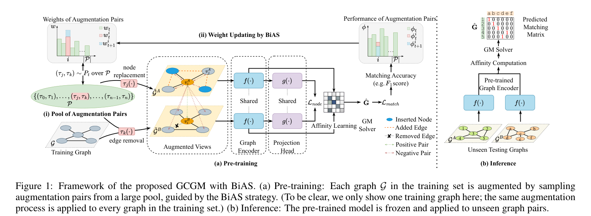

# Contrastive General Graph Matching with Adaptive Augmentation Sampling

> **TL;DR:** GCGM learns graph-matching features from two identity-tracked corruptions of each training graph. BiAS adaptively samples augmentation pairs according to matching difficulty. Its “general” formulation reduces reliance on category side information and image augmentation; the experiments do not demonstrate one trained solver across distinct native optimization tasks.

## Motivation

Ground-truth correspondences are costly, while visual self-supervised matching often assumes categorical information, access to original images or a trainable visual backbone. GCGM instead builds training pairs directly from attributed graphs and preserves the correspondence of surviving original nodes. The target is discrete node matching between two graphs, including the unfiltered setting with outlier keypoints, rather than graph-level similarity regression (Sections1–2).

## Contributions

- A graph-centric self-supervised matching framework coupling node contrastive learning and a matching loss on automatically generated correspondences.
- A diverse pool of structural and feature corruptions, including node insertion/replacement and edge removal.
- BiAS, a momentum-smoothed sampler that favors augmentation pairs on which the current matcher has lower historical F1.
- Evaluation with both BBGM and NGMv2 matching backends on three visual datasets and synthetic point graphs, including component and sampler ablations (Sections3–4; AppendixA–F).

## Methodology

**Encoder and supervision.** Two augmentations produce views of a single graph. A GraphSAGE encoder with skip connections and a projection head produces node representations; a graph readout supplies global features for affinity learning. The contrastive loss combines intra-view negatives and inter-view positive pairs, while the matching loss uses the known surviving-node identities. This does not require manually annotated matching labels for the training gradients. However, visual graphs use frozen **ImageNet-pretrained VGG16** keypoint features, and the current training script uses actual validation correspondences for early stopping. These are distinct from a claim that the entire experimental pipeline uses no prior supervision (Sections3.1–3.2; AppendixA/C; public code).

*Original Figure1 with its complete caption, extracted from formal PDFp3/printed3726 and visually checked.*

**Discrete decoding.** Learned node/edge affinities feed either BBGM's black-box combinatorial solver with a Hamming objective or NGMv2 with a soft permutation objective. The public implementation invokes LPMP's `GraphMatchingModule` for BBGM and applies Hungarian assignment to NGM's Sinkhorn matrix. Neural scores and relaxed matrices are therefore not themselves the final discrete correspondence. This is constructive matching: inference freezes the learned encoder and affinity module and constructs a new matching, without a learned editor modifying a complete incumbent. Neither backbone supplies a claimed certificate of semantic correctness or global QAP optimality here (Section3.2; `model.py`303–356).

**Identity tracking.** Node insertion creates dummy nodes; replacement removes original identities and introduces dummies; edge removal changes structure; feature scaling changes attributes. Additional augmentations are node dropping, edge addition, feature masking and mixup. The printed same-index contrastive positives must be interpreted using surviving original identities when view sizes differ. The code explicitly intersects non-dummy labels for contrastive anchors and constructs matching targets by equal non-dummy identities (`loss_func_gcgm.py`142–175; `model.py`703–723). Thus inserted or removed nodes are not assumed to have genuine cross-view positives.

**Adaptive sampling.** Instantiate a pool of augmentation pairs, excluding the two-no-op pair and the two-mixup pair. BiAS samples proportionally to weights and updates a sampled pair by

$$w_i^{t+1}=\lambda w_i^t+(1-\lambda)\exp\!\left[\alpha(1-\phi_i^t)\right],$$

where $\phi_i^t$ is its historical mean self-generated matching F1. Initialization is $w_i^0=e^\alpha$; default $\lambda=0.8$, $\alpha=3$, temperature0.07. The experiments generally use512 randomly instantiated pairs, or128 on Willow. This is a difficulty-based training heuristic, not a proved boosting convergence or test-accuracy guarantee. For valid F1 in[0,1], the stated convex update with this initialization keeps weights in[1,$e^\alpha$], rather than requiring unbounded exponential growth over iterations (Section3.4; AppendixAlgorithm1).

**Classification.** The visual and synthetic experiments concern variants of graph matching. Separate dataset/backbone configurations, including incompatible visual/synthetic feature widths, do not establish cross-native-task reuse of a single checkpoint. The entry is therefore **specialist / constructive**, irrespective of “general” in its title.

## Experiments

**Protocol.** PascalVOC has20 categories, Willow5, and SPair-71k18. Graphs use Delaunay edges and bilinearly sampled frozen VGG16 features. Visual tests sample1,000 pairs per class on Pascal/SPair and100 per Willow category. Synthetic graphs arise from ten random2D point sets, random scale distortion0.2, Gaussian position noise0.02 and up to two outliers;2,000 training and1,000 testing graphs are generated, with an80:20 training/validation split and1,000 evaluated graph pairs per base set. Intersection removes nonshared keypoints; Unfiltered keeps outliers. The reported F1 equals accuracy/recall only in the Intersection setting (Section4.1; AppendixC/E).

**Training and reference quality.** Tables report five-seed means and deviations. The supplement specifies Adam,10epochs, batch32 except Willow16, one synthetic or two visual encoder layers, and dataset-specific widths/rates. Encoder hyperparameters are selected using Optuna TPE on validation data; the augmentation-tuning comparator runs100 TPE trials. Early stopping uses a0.001 improvement threshold. Hardware is an RTX3090 with AMD EPYC7742 64-core CPU. Supervised baselines have matching labels, while some self-supervised baselines also use category/image information and fine-tune the visual backbone; those input differences matter when comparing accuracy (Section4.1; AppendixA/D).

**Visual results.** GCGM+NGMv2 reports F1 **57.3/37.4** on Pascal Intersection/Unfiltered, **95.0** on Willow, and **62.6/35.4** on SPair. GCGM+BBGM gives56.8/36.2/94.4/60.6/35.9. Its matched-backend improvement is not universal: SCGM+BBGM scores **36.6** on Pascal Unfiltered versus GCGM+BBGM36.2. The supervised BBGM comparison is77.3/55.0/96.2/77.7/48.4, so this is not a claim to close the supervised gap in all settings. The95.0 Willow result exceeds supervised NGMv2's94.5 but remains below supervised BBGM's96.2 (Table2).

**Synthetic results and stronger classical references.** Main Table3 reports **58.1/39.9** for Intersection/Unfiltered, above its self-supervised comparators. AppendixTableC separately shows **RRWM80.9/60.9**, IPFP68.1/48.8 and SM64.3/43.4; all exceed GCGM there. Supervised NGMv2 is82.6/62.5. The main synthetic result therefore supports superiority among the displayed self-supervised learned methods, not across all classical and supervised solvers.

**Ablations and negative cases.** Removing feature scaling yields Pascal Intersection57.5 versus full57.3; removing node replacement gives Willow95.1 versus95.0; removing insertion gives synthetic Unfiltered40.5 versus39.9. BiAS improves the uniform sampler across the five main visual aggregate columns, but Tuning+BiAS gives Willow95.4 and SPair Unfiltered36.0 versus BiAS95.0/35.4. AppendixTableF also has uniform synthetic Unfiltered40.0 versus BiAS39.9. AppendixTableG's frozen-backbone, image-augmentation SCGM+BBGM reaches SPair Intersection62.6 versus GCGM+BBGM60.6. These exceptions qualify prose claims of consistent superiority (Tables4–5; AppendixTablesD–G).

**Timing.** The headline time savings concern **augmentation tuning plus training**, not matching inference: BiAS versus Tuning is0.39 versus23.76hours on Pascal,0.05 versus4.54 on Willow, and0.34 versus31.96 on SPair. BiAS avoids that augmentation-search budget; encoder hyperparameter tuning is still performed. The paper does not establish comparable end-to-end inference speedups from these numbers (Table5).

## Limitations

Difficulty under identity-preserving augmentations is a proxy for real cross-instance matching difficulty. Excessively large $\alpha$ can concentrate sampling and reduce diversity; the supplement's sensitivity study explicitly observes worse performance at large values. Node/edge corruption strength, augmentation-pool coverage, pretrained visual features and downstream solver choice remain consequential. The method does not prove that all sampled augmentations preserve semantic information sufficient for matching, nor that contrastive improvement optimizes the discrete QAP objective.

“Without image augmentation/category information” should not be read as “without image-derived features,” “without supervised ImageNet pretraining,” or “without validation labels.” The reported self-supervised training objective and the inspected validation-based model-selection procedure are separate facts. The full suite also includes classical counterexamples, individual-class losses and component-removal gains, so broad state-of-the-art or uniformly beneficial-component claims would overstate the evidence.

## Reproducibility

**Identity and dates.** Jianyuan Bo and Yuan Fang are at Singapore Management University. Formal IJCAI2024 pp3724–3732, DOI[10.24963/ijcai.2024/412](https://doi.org/10.24963/ijcai.2024/412), is identity-matched to the publisher page and deposited Crossref metadata. The latter records **August2024**, without a supported exact day, so publication precision remains monthly. First arXiv posting[2406.17199](https://arxiv.org/abs/2406.17199) is **2024-06-25**.

**Complete scientific material.** All9 official main pages,6 author-hosted appendix pages,22 author slides and the1-page author poster were read. The author publication page links the matching paper, appendix, slides, poster and code; the repository's complete untruncated tree contains no further PDF/ZIP/notebook science document. AppendixAlgorithm1 and all supplementary result tables/plots, main equations/figures/tables and all slide/poster panels were visually checked. The original Figure1 plus full caption physically exists under the public paper-assets directory and was viewed. Presentation pages are counted as their own actual sources rather than silently equated to the main manuscript.

**Code and execution limits.** Official[jybosg/GCGM-BiAS](https://github.com/jybosg/GCGM-BiAS), inspected at tree`2e04884faf9682988f516ad0f6d50262dca55bf1`, documents an Ubuntu16.04/Python3.7/PyTorch1.6/CUDA10.1/PyG1.6.3 stack plus LPMP compilation, dataset setup and seeds0,1,2,3,123. Its full README and relevant decoder, augmentation, contrastive-loss and training/validation paths were inspected. Code updates augmentation weights with the printed momentum/exponential rule, uses non-dummy identity correspondences for training and measures validation F1 against `gt_perm_mat` before early stopping (`train_eval_gcgm.py`349–392). No historical training, solver installation or benchmark rerun was performed; current-source inspection is not proof of the exact historical runtime environment.

**Actual catalogue citations.** Main References explicitly cite [IA-SSGM](self-supervised-bidirectional-learning-for-graph-matching.md), [SCGM](self-supervised-learning-of-visual-graph-matching.md), [RGM](rgm.md), [BBGM](deep-graph-matching-via-blackbox-differentiation-of-combinatorial-solvers.md), [CIE-H](cie-h.md) and [GMN](deep-learning-of-graph-matching.md). Its GANN-related reference is the differently titled2023 TPAMI extension, and its Wang2020 robust-matching and Wang2021 NGM entries are also journal papers, not automatic aliases for earlier conference papers. Those distinct formal works are not incorrectly attached to conference stable IDs.
