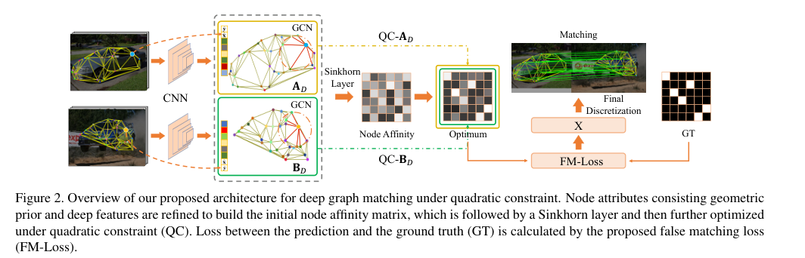

# Deep Graph Matching under Quadratic Constraint

> **TL;DR:** QC-DGM combines learned visual/geometric affinities with an adjacency-discrepancy optimization layer and a false-matching loss. Sinkhorn supports training and Hungarian-based iterations produce discrete inference matches. Its structural refinement is approximate, and the unfiltered Pascal F1 results are substantially below BB-GM despite higher filtered matching accuracy.

## Motivation

Similar visual keypoints can be difficult to distinguish using CNN descriptors alone. Learned message passing encodes structure implicitly, whereas explicit agreement between graph adjacencies can provide another signal. The paper therefore incorporates geometric priors and adjacency consistency into deep graph matching, while addressing the imbalance between true and false correspondence entries in its supervised loss (Introduction).

## Contributions

- CNN descriptors plus normalized keypoint coordinates and deep-feature-weighted graph adjacency.
- A differentiable, modified Frank-Wolfe-style refinement of a relaxed structural matching objective.
- False-matching loss based on aggregate false-positive and false-negative correspondence mass.
- GCN and SplineCNN variants, comparisons on Pascal/Willow, synthetic outlier tests and component/loss ablations.

## Methodology

**Representation.** ImageNet-pretrained VGG16 relu4_2/relu5_1 features are aligned at annotated keypoints and concatenated with normalized2Dcoordinates. Delaunay triangulation supplies graph edges; inner products of node attributes weight adjacency entries. A GCN combines neighbor and self updates, and an exponentiated bilinear metric supplies unary affinity. QC-DGM1 uses two GCN layers; QC-DGM2 substitutes a two-layer max-aggregation SplineCNN (Eqs2–6, Section4).

*Original Figure2 and complete caption, formal PDFp2/printed5070; extracted and visually checked.*

**Objective and optimization.** The printed objective is $g(X)=\|A_D-XB_DX^T\|_F^2-\operatorname{tr}(X_u^TX)$. The paper connects this to Koopmans–Beckmann matching and relaxes binary correspondence to normalized nonnegative matrices. For general continuous $X$, the printed residual-squared expression is not a globally convex objective. Modified Frank-Wolfe-style steps use a gradient-derived score, projection and step size $2/(k+2)$. Sinkhorn projection is used during training; Hungarian projection is used for the discrete inference procedure. The text explicitly acknowledges that only an approximate local solution is sought and gives no global-minimum guarantee (Eqs7–13, Algorithm1).

**Loss.** With ground truth $X^*$, Eq15 sums $\exp[\alpha\sum X\odot(1-X^*)]$ and $\exp[\beta\sum X^*\odot(1-X)]$, using printed settings $\alpha=2,\beta=.1$. These terms penalize false-positive/false-negative mass. The displayed toy loss surfaces and training traces motivate a finite boundary loss, but do not establish universal numerical stability or superiority over every implementation of cross entropy. Under exact equal-size row normalization, the two aggregate error masses are equal; the loss should not be described as independently identifying every type of error beyond the supplied correspondence labels.

**Discrete responsibility and classification.** The network supplies descriptors, weighted structure and affinity; the classical projected optimizer/Hungarian decoder constructs the final correspondence. Iterating classical optimization over a fixed neural score is distinct from feeding complete hard incumbents through a neural editing policy. This entry is **specialist / constructive**. Pascal and Willow are visual graph-matching datasets, and the work does not demonstrate a shared checkpoint across native optimization tasks.

## Experiments

**Settings.** Pascal VOC has7020training/1682testing annotated images in20classes. Objects are cropped/resized to256×256; truncated, occluded and difficult instances are filtered for the primary accuracy setting. Training uses all20classes, supervised ground-truth correspondences, SGD learning rate.001, and printed3outer×5inner optimization iterations. Willow has256images in5classes and smaller appearance/pose variation. The paper does not supply an equally detailed Willow train/test manifest or multi-seed uncertainty study in the text (Section4).

**Filtered Pascal accuracy.** QC-DGM1/2 report mean **69.3/70.3%**, versus CIE1-H68.9 and LCSGM68.5. Adding QC raises PCA63.8→64.8 and GMN57.4→58.8. These means do not imply every class improves against every comparator: QC-DGM2 bird67.1 is below CIE70.1, and plant92.4 below LCS96.1 (Table1).

**Unfiltered Pascal F1.** Without intersection filtering, QC-DGM1/2 obtain **52.0/52.6%**, below **BB-GM61.4%**. Accuracy on filtered correspondences and F1 on the unfiltered protocol measure different behaviors; the former result cannot support an unconditional best-matching claim (Table2).

**Willow.** QC-DGM2 reaches mean **97.7%**, compared with BB-GM96.8 and QC-DGM1 96.0. Class-level counterexamples remain: motorbike98.8< LCS99.4/BB-GM99.2, and duck92.8< QC-DGM1/PCA-QC93.8. Topology is consequential: the ordinary GMN variant76.2is below the same-Delaunay-topology GMND88.4, illustrating why adjacency agreement can mislead under incompatible graph structures (Table3, Section4.3).

**Robustness and ablations.** Figure6 adds Gaussian-coordinate outliers only at inference and reports improved robustness from QC; this is not unrestricted unknown-keypoint detection. The nested QC-DGM1 ablation is67.8raw attributes,68.3with unary geometry,68.5with pairwise structure and69.3with optimization. These are conditional cumulative increments. Figure8 compares loss/accuracy traces and explicitly truncates descending accuracy curves after explosion for visualization; it is not a new formal convergence result. No comprehensive end-to-end runtime or optimality-gap table is given.

## Limitations

The approach assumes useful keypoints, pretrained descriptors and sufficiently compatible graph topology. The relaxed objective is nonconvex, projected iterations are approximate, and hard Hungarian feasibility does not certify globally optimal QAP matching or semantic correctness. Structural agreement can be noisy under outliers or changing topology. Supervised matching labels and filtered data delimit the evidence, while the weaker unfiltered F1 results demonstrate a material protocol-dependent limitation.

The current official implementation differs from the printed recipe in loss normalization/weights and iteration details. These are reproducibility differences, not evidence that the historic tables are invalid. The paper's numerical-stability observations also do not establish that all cross-entropy implementations inevitably fail.

## Reproducibility

**Identity and dates.** Quankai Gao, Fudong Wang, Nan Xue and Gui-Song Xia list Wuhan University; Jin-Gang Yu lists South China University of Technology. CVF identifies CVPR2021 pages5069–5078. Identity-matched DOI[10.1109/CVPR46437.2021.00503](https://doi.org/10.1109/CVPR46437.2021.00503) metadata gives **June2021 month precision**, but deposits a different page range5067–5074; this note's locators follow the actual CVF reading copy. Canonical arXiv[2103.06643](https://arxiv.org/abs/2103.06643) begins **2021-03-11** and has v2onMarch14. The formal ten-page CVF bytes were read.

**Complete science.** All ten formal pages and all48references were read. Key formulas, Algorithm1, loss surfaces/traces, all four tables and qualitative/outlier panels were rendered and inspected. The CVF landing page lists main/arXiv without an independent supplement; the full official51member source archive has no PDF/ZIP/notebook science attachment. OriginalFigure2 plus its entire caption physically exists under public/paper-assets and was actually viewed.

**Code.** Official[Zerg-Overmind/QC-DGM](https://github.com/Zerg-Overmind/QC-DGM), commit`f4ad8ce06e3711434ae44f5e267135972e3c4692`, provides QC-DGM1 configs, dataset paths, training/evaluation commands and checkpoint links. The entire README was read. Necessary inspection of `QCDGM/model.py`98–158, `eval.py`79–88, `utils/qc_opt.py` and `utils/fm_loss.py` confirms soft neural affinity, classical hard-assignment refinement and current loss details. The released model uses3×3inner soft iterations and combines affinity with .5times the refined score; evaluation performs10outer classical QC calls. Its loss normalizes by total source-node count, places alpha2on false-negative mass and beta0on false-positive mass, unlike printed Eq15/settings. These exact differences are kept separate from the formal method. No training or benchmark rerun was performed.

**Actual internal references.** Direct bibliography identities are[DGMC](deep-graph-matching-consensus.md)(13,p9),[GCNN branching](gcnn-branching.md)(14,p9),[BBGM](deep-graph-matching-via-blackbox-differentiation-of-combinatorial-solvers.md)(32,p10),[PCA-GM](learning-combinatorial-embedding-networks-for-deep-graph-matching.md)(39,p10),[LCS](learning-combinatorial-solver-for-graph-matching.md)(42,p10),[CIE-H](cie-h.md)(45,p10) and[deep learning of graph matching](deep-learning-of-graph-matching.md)(46,p10). References40/41 cite differently titled substantive NGM/PCA journal-lineage works; they are not silently substituted for earlier conference targets.
