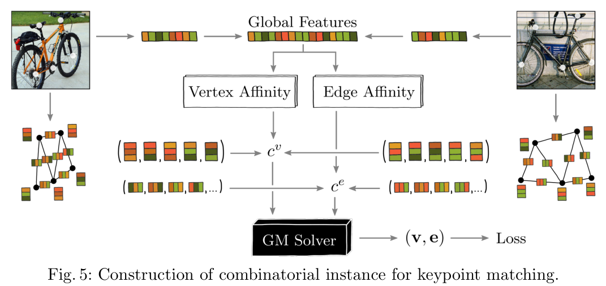

# Deep Graph Matching via Blackbox Differentiation of Combinatorial Solvers

> **TL;DR:** BB-GM learns vertex and edge costs for a classical discrete graph-matching solver. A second solver call on perturbed costs supplies a training gradient. Its strongest empirical gains depend on the evaluation protocol; neither the solver nor the learned model carries a general exact-QAP guarantee.

## Motivation

Replacing a capable combinatorial solver with a smooth relaxation can weaken the inference algorithm and complicate handling unmatched keypoints. This work keeps an existing graph-matching solver in the forward pass and learns its input costs through blackbox differentiation. It also examines how label-dependent keypoint filtering changes the matching task and proposes evaluation with all annotated keypoints retained (Sections1–2,4).

## Contributions

- A trainable image-to-cost pipeline combining local appearance, geometric message passing and global image context.
- Integration of discrete pairwise and optional cycle-consistent multi-image matching through a perturb-and-resolve backward pass.
- Explicit comparison of intersection, inclusion and unfiltered keypoint protocols.
- Pascal VOC, Willow and SPair-71k experiments, with a separate scientific supplement testing global features, VGG fine-tuning, quadratic costs and Sinkhorn replacement.

## Methodology

**Neural costs.** ImageNet-pretrained VGG features are sampled at annotated keypoints. Up to two residual SplineCNN layers propagate information along bidirected Delaunay edges using normalized relative coordinates. Edge features are differences of endpoint features. A global image-pair feature drives coordinate-wise affinity gates, producing unary vertex and quadratic edge costs. The actual solver minimizes these costs; the current repository correspondingly negates learned similarities (Section3.3, Figure5).

*Original Figure5 and complete caption, accepted PDFp8; extracted and visually checked.*

**Forward and backward.** Expanding the output into vertex and edge indicators makes the objective linear in the combined cost vector: $y(w)=\arg\min_{y\in Y}w^\top y$. The forward pass invokes the existing solver. Given the downstream loss gradient, the backward pass solves again at $w_\lambda=w+\lambda\nabla_yL$ and returns $(y(w_\lambda)-y(w))/\lambda$. This is the gradient of a constructed interpolation, rather than the ordinary derivative of the piecewise constant discrete solution map. Training uses vertex Hamming loss, so its direct edge-output gradient is zero, and adds a margin to ground-truth unary matches (Section3.1, Algorithm1).

**What the combinatorial solver guarantees.** The adopted Lagrangian-decomposition algorithm uses dual block-coordinate ascent and primal rounding through minimum-cost flow. Monotone improvement refers to its **dual lower bound**, not necessarily the primal solution quality. The method is not presented here as an exact oracle for every nonconvex graph-matching instance. The optional multi-image variant adds cycle consistency through classical partial-permutation synchronization; it is distinct from neural editing of a complete incumbent (Section3.2).

**Classification.** This is **specialist / constructive**: the neural component supplies costs for discrete graph matching, with classical inference constructing the assignment. The same hyperparameters across datasets do not establish one checkpoint solving multiple native optimization tasks. The conclusion's suggestions of multicut and Max-Cut are future work, not demonstrated shared-model results.

## Experiments

**Protocol matters.** Intersection filtering removes points not present in both images. Inclusion filtering also discards pairs whose visible keypoint sets are incomparable. These use ground-truth information at evaluation. For reproduced DGMC, the two means are close,73.2±0.5 and73.1±0.4%, while several categories change substantially. Unfiltered matching retains all points and requires partial assignments; its F1 must not be compared directly with filtered accuracy (Section4, Figure6, Table1).

**Pascal VOC.** Under intersection filtering, BB-GM obtains **80.1±0.6%** mean accuracy over five restarts, versus reproduced DGMC73.2±0.5. This is not every-category dominance: potted plants score97.4 versus98.0. With no keypoint filtering, BB-GM obtains **61.4±0.5% F1** over ten restarts; forcing maximal matching reduces this to51.9±1.0. Five-image classical multi-matching gives62.8±0.5, but some categories deteriorate, including train78.0→73.4 (Tables2–3).

**Willow.** Table4 separates Pascal-only, Willow-only and Pascal-plus-Willow training, with twenty restarts. Willow supplies only twenty training images per category, and overlapping car/motorbike classes are excluded from Pascal pretraining. In the Willow-only setting, BB-GM scores100/99.2/96.9/89.0/98.8% on face/motorbike/car/duck/bottle; DGMC scores100/98.5/98.3/90.2/98.1. With both datasets, BB-GM is also lower on car, duck and bottle. The authors explicitly caution against claiming superiority from these small, protocol-sensitive comparisons (Section4.2).

**SPair-71k.** On70,958 image pairs, five-restart mean accuracy is **78.9±0.4%** versus DGMC72.2±0.2; hard-viewpoint accuracy is70.6±0.9 versus61.3±0.5. These are benchmark matching accuracies, not certificates of the optimal graph-matching objective (Tables5–6).

**Ablations and cost.** Supplement TableS1 gives80.1±0.3 for the unmodified model, versus77.9±0.7 with fixed affinity gates,78.9±0.5 with frozen VGG,78.6±0.4 with unary costs only and77.9±0.5 with the tested Sinkhorn replacement. These are separate ablations, not cumulative removals. The Sinkhorn implementation required increasing an internal epsilon from1e-8 to1e-4; this supports the reported implementation comparison, not universal inferiority of Sinkhorn. Training uses Adam.002, a0.01 VGG learning-rate multiplier, batch8 and perturbation80. The stated approximately30image-pairs/s on a Tesla V100 is attributed mainly to the VGG bottleneck; it is not a full common-hardware solver comparison (Sections3.3–4, supplement).

## Limitations

The loss interpolation assumes an appropriate discrete optimization formulation; applying the procedure to an approximate solver does not turn its output into a certified global optimum. Learned costs are trained from supervised correspondences. Partial matching and filtering substantially change the meaning of the metric, and small Willow samples limit comparative certainty. Global features, message passing, quadratic costs and backbone tuning each contribute empirically, but their isolated removals do not establish necessity for every matching distribution. No demonstrated cross-native general-purpose solver or neural incumbent-repair policy is inferred from the generic blackbox framework.

## Reproducibility

**Identity and dates.** The six authors are Michal Rolínek, Paul Swoboda, Dominik Zietlow, Anselm Paulus, Vít Musil and Georg Martius. The byline lists Max Planck Institute for Intelligent Systems, Max Planck Institute for Informatics and Università degli Studi di Firenze. Springer records **2020-11-03** as first online publication for DOI[10.1007/978-3-030-58604-1_25](https://doi.org/10.1007/978-3-030-58604-1_25). Canonical arXiv[2003.11657](https://arxiv.org/abs/2003.11657) first appeared **2020-03-25**. The actual reading copy is the official nineteen-page ECVA accepted PDF; Springer's proceedings pagination407–424 describes a different layout, not byte identity.

**Scientific coverage and assets.** All nineteen accepted pages, all66references and the one-page scientific supplement were read. The supplement obtained from ECVA is byte-identical to the independently downloaded Springer scientific attachment, with both retrieval locations recorded. Algorithms, equations, filtering diagram, result tables, qualitative examples and the complete supplement table were rendered and inspected. Original Figure5 and its full caption physically exist in public/paper-assets and were actually viewed.

**Code.** The paper-linked[official repository](https://github.com/martius-lab/blackbox-deep-graph-matching) was inventoried at commit`cda346e2cba59baafdf210e1bb0878a395d99a86`, resolved using git after an unauthenticated API limit. Its44-member pinned archive contains no independent PDF, ZIP or notebook scientific attachment. The README and necessary model implementation were read: neural unary/quadratic costs feed LPMP's GraphMatchingModule or MultiGraphMatchingModule. The README specifies the historical PyTorch1.4/Python3.6/CUDA10.1 environment, dataset download and training configurations, including Willow warm-start settings. No model retraining, solver compilation or independent benchmark reproduction is claimed.

**Actual internal references.** The bibliography cites [Bello et al.](neural-combinatorial-optimization.md) as the2017workshop version[7], [Learning a Heuristic](learning-heuristic.md)[17], [DGMC](deep-graph-matching-consensus.md)[23], [GCNN branching](gcnn-branching.md)[25], [learning CO over graphs](learning-co-over-graphs.md)[29], [Attention Model](attention-model.md)[32], [blackbox differentiation](../studies/blackbox-backprop.md)[56], [SATNet](satnet.md)[58], [PCA-GM](learning-combinatorial-embedding-networks-for-deep-graph-matching.md)[59], [CIE-H](cie-h.md)[61], [deep graph matching](deep-learning-of-graph-matching.md)[62] and [deep graphical feature learning](deep-graphical-feature-learning-for-the-feature-matching-problem.md)[64]. The distinct-title neural graph/hypergraph/multigraph reference[60] is not silently merged into an earlier conference paper merely because it shares lineage.
