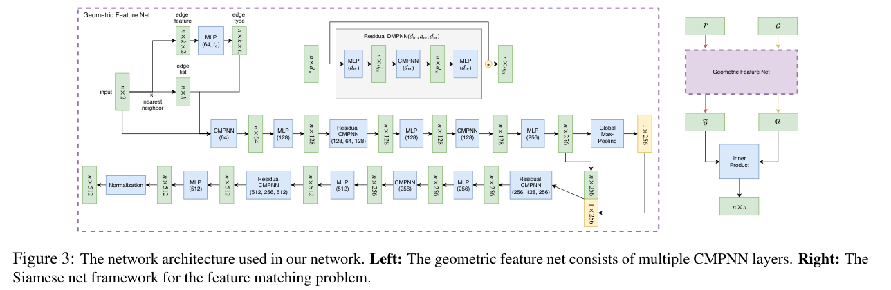

# Deep Graphical Feature Learning for the Feature Matching Problem

> **TL;DR:** A compositional message-passing network converts point coordinates into contextual descriptors. Inner-product similarities then feed Hungarian linear assignment. Synthetic training transfers to geometric matching benchmarks, but the learned linear objective is a replacement for the original quadratic/higher-order objective, not an exact polynomial solution to that NP-hard objective.

## Motivation

Coordinate-only feature matching lacks the strong appearance descriptors that make simple assignment effective. Classical approaches encode geometric relations through pairwise or higher-order matching costs, making inference difficult. The paper instead learns geometry-aware local descriptors, aiming to move structural reasoning into feature extraction and leave a linear assignment problem at inference (Sections1–2).

## Contributions

- A Siamese coordinate-to-descriptor model whose features include local geometry and propagated graph context.
- Compositional Message Passing Neural Networks (CMPNN): edge-conditioned mixtures of a global kernel collection avoid materializing a full dense convolution matrix for every edge.
- Synthetic supervised training followed by evaluation on synthetic points, CMU House and PF-Pascal.
- Architecture, graph-neighborhood and runtime analyses, including a separate two-page scientific supplement.

## Methodology

**Graph encoder.** A directed8-nearest-neighbor graph is built from coordinates. Relative-coordinate edge vectors pass through a two-layer MLP and softmax over16edge types. Each message combines those weights with shared kernel components. Factoring the operation into node transformations and weighted aggregation reduces per-edge tensor storage. The implementation described in the paper uses max aggregation, residual blocks, batch normalization, ReLU and global max pooling, ending with unit-normalized512-dimensional descriptors (Section3.2).

*Original Figure3 and complete caption, formal PDFp5/5091; extracted and visually checked.*

**Training and discrete decoding.** Pairwise descriptor inner products form a similarity matrix. Training uses row-wise softmax cross-entropy against correspondence labels. At test time, Hungarian/Munkres finds a one-to-one assignment maximizing the sum of learned similarities. Thus global assignment constraints are enforced by the classical decoder, rather than by the independent training softmax. The selected assignment is exact for this learned **linear** score, with no guarantee of preserving an optimum of the earlier quadratic/higher-order score (Equations3–8, Section3.2).

**Relation to MPNN.** Section3.3 rewrites an edge-kernel generator whose last layer is linear as a weighted combination of global kernels. This is a representation/reparameterization argument under that construction. It is not a theorem of universal rotation invariance, matching accuracy or optimization approximation ratio.

**Classification.** This is **specialist / constructive**: a neural geometric feature component and a classical linear-assignment decoder construct correspondences for one native matching task. Transfer from synthetic to real point sets is meaningful distribution transfer, but does not demonstrate one neural checkpoint solving distinct native optimization problems. There is no neural complete-incumbent editing loop.

## Experiments

**Training.** The model and adapted PointNet baseline train on9million generated pairs, containing30–60reference points, random rotations, Gaussian perturbations and0–20outliers. Adam uses learning rate.001 for one pass through that generated stream. The real benchmarks are evaluated with the synthetic-trained model. The traditional solvers use their own handcrafted edge or triangle costs, so the comparison evaluates full learned pipelines versus those particular geometric models, not only interchangeable optimizers of one common score (Section4).

**Synthetic points.** One hundred trials per setting vary noise and outlier count. The learned method is usually more robust as corruption increases. BCAGM is slightly stronger when noise is absent and outliers are fewer than five, and FGM/BaB can be comparable in easy cases. These counterexamples qualify any blanket superiority statement (Section4.1, Figure4).

**CMU House.** The dataset contains111frames with30annotated landmarks each; pairs are evaluated at frame separations10through100. The model retains strong matching under larger viewpoint change, while several methods are perfect for small separation. The stated hundreds-fold advantage concerns harder cases against the selected FGM and BaB implementations, not all comparators at every separation. No common held-out-scene conclusion follows from this single toy-house sequence (Section4.2, Figure6).

**PF-Pascal.** Across1,351image pairs in20classes with6–18annotated matches, mean accuracy is **88.5%** without an extra random rotation, versus adapted PointNet69.7, BaB61.3, FGM58.3 and BCAGM55.0. With random rotation it falls to **69.9%**, versus41.5/61.3/57.2/55.0. The rotated setting is not every-category dominance: bus53.6is below BaB64.4, dining table45.9below FGM53.2, and potted plant36.7below FGM43.5 and BCAGM48.2. Rotation robustness is therefore empirical and incomplete (Table1).

**Ablations.** Global pooling gives little benefit in the displayed no-outlier case, but improves rotation robustness with outliers. Shallower/narrower networks deteriorate under noise; making the model deeper/wider increases memory and runtime without a consistent accuracy gain. The normal model uses76MB inference memory at batch1, compared with20MB for the narrower and297MB for the wider model. Output dimension4096does not uniformly beat64or512 (Figures7–8).

**Scientific supplement.** A model trained with k=8is tested with k=2/4/12. Synthetic performance transfers relatively well to4/12, but CMU k=4fails some large-viewpoint pairs and k=2degrades strongly. Runtime is decomposed into coordinate preprocessing/graph construction/GPU transfer, neural inference and Hungarian assignment. Figure10shows approximately30–40ms total CMU runtime, while Figure11shows the neural stage dominating and LAP time increasing for poorer features. A small isolated network timing must not be reported as the full pipeline cost. Hardware and repeated-training uncertainty are insufficiently specified for a universal speed comparison (supplement SectionsA–B, Figures9–11).

## Limitations

The method requires annotated feature coordinates and supervised correspondence pairs; it does not discover image keypoints or directly optimize arbitrary QAP instances. Synthetic transformations and small keypoint sets do not establish scaling to much larger partial correspondence problems. Noise, severe rotation and outliers still reduce accuracy. The learning loss uses independent row probabilities while the final Hungarian decision is globally coupled. The paper's equivalence argument concerns message-passing parameterization, rather than a guarantee that learned descriptors preserve all higher-order matching structure.

**Printed versus current preprocessing.** Rendered Equation16 divides each centered point by that point's own norm. In the pinned repository, `data/utils.py::pc_normalize` divides the entire centered cloud by its maximum point radius. These are different normalizations. This is a reproducibility distinction between the printed expression and current code, not evidence that the reported historical experiment is invalid.

## Reproducibility

**Identity and date.** Zhen Zhang's byline lists the Australian Institute for Machine Learning/University of Adelaide, with a footnote that the work was done at National University of Singapore; Wee Sun Lee lists NUS. The formal ICCV2019paper is5087–5096, DOI[10.1109/ICCV.2019.00519](https://doi.org/10.1109/ICCV.2019.00519). Identity-matched deposited metadata supplies **2019-10 month precision**. No verified canonical arXiv first-submission date was identified, so this entry does not invent one.

**Scientific coverage.** All ten formal pages,31references and both official CVF scientific-supplement pages were read. The loss, normalization expression, full architecture, benchmark table, qualitative correspondences and all architecture/neighborhood/runtime plots were rendered and inspected. Original Figure3 and its entire caption physically exist in public/paper-assets and were actually viewed.

**Code.** The paper links the[official repository](https://github.com/zzhang1987/Deep-Graphical-Feature-Learning). Its pinned archive at`bf1981342ce5bd1aa004c53bb6d3274661158b7c`, resolved with git, has524members including CMU dataset files and no additional PDF, ZIP or notebook scientific attachment. The complete README describes Python3.6, PyTorch/CUDA dependencies, on-the-fly training and synthetic/CMU/PF-Pascal tests. Necessary preprocessing and decoder code were checked: `test_cmu_house.py`negates descriptor similarity before SciPy linear_sum_assignment. No training, inference benchmark or environment installation was executed.

**Citation audit.** All31bibliography entries were compared with the catalogue. The cited2017Data-driven Approximations to NP-hard Problems, action-recognition graph matcher and classical methods do not have matching active internal identities here; no related-title or topic-only relationship edge is invented.
