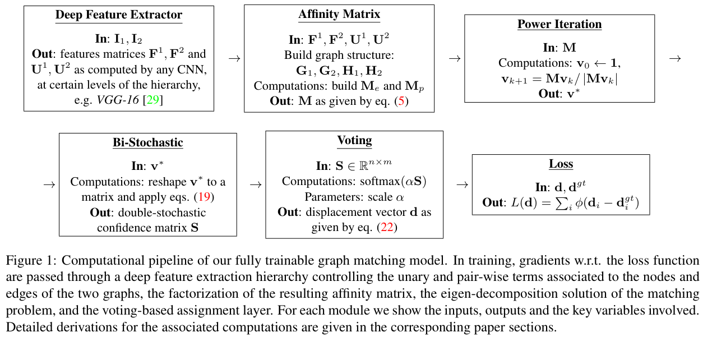

# Deep Learning of Graph Matching

> **TL;DR:** GMN learns image features and unary/pairwise affinities through a differentiable spectral matching pipeline. Its main output is a soft-voted correspondence location; the explicitly evaluated discrete variant uses row-wise maximum indices. These original2018decoders should not be replaced in the description by later repositories' Hungarian decoding.

## Motivation

Graph matching can exploit both local appearance and structural relations, but fixed features trained for another task may not suit the matching objective. This paper joins deep feature extraction, affinity construction, spectral relaxation, normalization and a displacement loss into one trainable computation graph. Its central technical concern is efficient backpropagation through matrix-valued operations (Section1).

## Contributions

- End-to-end learning of unary and pairwise feature hierarchies for graph matching.
- A factorized affinity representation and explicit matrix-backpropagation derivations.
- Differentiable finite power iteration, row/column normalization and soft voting layers.
- Geometric and semantic correspondence experiments with trained/untrained and voting/no-voting comparisons.

## Methodology

**Features and affinity.** ImageNet-pretrained VGG16relu4_2features provide unary descriptors, while relu5_1features provide edge endpoint descriptors. Features are unit-normalized. Unary similarities use descriptor inner products; pairwise similarities use concatenated endpoint features and a learned block-structured matrix. Node–edge incidence matrices factor the full matching affinity, exposing structure for more efficient backward computations (Sections2.2–3.1).

*Original Figure1 and complete caption, formal PDFp4/2687; extracted and visually checked.*

**Spectral relaxation.** The initial binary one-to-one quadratic formulation is relaxed by dropping both binary and mapping constraints and retaining a unit-L2norm constraint. The leading eigenvector solves that Rayleigh relaxation for the assumed symmetric affinity, not the original integer matching problem. The implementation description runs a finite number of normalized power iterations, initialized by ones. The matrix factorization avoids a dense full-gradient representation in the backward pass; stated complexities depend on graph edge counts and sparsity (Sections2–3.2).

**Normalization, loss and actual outputs.** Alternating row/column scaling encourages matching structure. A voting layer applies a sharp row-wise softmax, typically scale200, and returns a weighted average of candidate positions. A robust displacement loss supervises this continuous output. The paper's GMNwVGG-T without Voting variant instead assigns the index of each row maximum. **Neither soft coordinate voting nor independent row maxima certify a one-to-one discrete assignment.** Hungarian is not specified as the original decoder here. Rectangular semantic matching uses up to15source landmarks and256target grid points, so a square-permutation interpretation would also misdescribe the evaluated task (Sections3.3–4).

**Classification.** This is **specialist / constructive**, with learned structured correspondences and an explicitly evaluated discrete candidate-selection variant. The main semantic-localization results use continuous soft voting; the Sintel variant is many-to-one geometric correspondence and disables the bi-stochastic layer. No demonstrated common neural checkpoint across distinct native optimization tasks or neural editing of a full feasible incumbent is inferred.

## Experiments

**MPI-Sintel.** The23video sequences are split into18training and5test folders, reported as796and245image pairs. Images are processed in4×4blocks padded for large displacement. Because optical flow may be many-to-one, this experiment omits the bi-stochastic layer. PCK within10pixels is **92.6%** for trained GMN, versus88.03untrained GMN,87.01trained nearest-neighbor VGG and91.5UCN. The reported approximately2seconds on a3.2GHz Xeon/Titan X Pascal system is a **complete forward and backward pass**, not inference-only latency (Section4, Table1).

**CUB.** Evaluation uses5,000image pairs chosen close on a pose graph, with up to15source landmarks and a16×16target candidate grid. A separately described CUB training procedure samples training-set pairs. Trained soft-voting GMN obtains **17.02pixels EPE and0.86PCK@0.05**, compared with18.22/0.83for the row-maximum discrete variant,41.63/0.63for untrained GMN and59.05/0.46for untrained nearest-neighbor VGG. The0.3second figure again includes forward and backward computation. The restricted pose-pair construction matters when comparing broader semantic matching results (Table2, Figure3).

**Pascal VOC.** Objects are cropped to bounding boxes and resized256×256. The paper reports approximately7,000training and1,700test annotations, and trains one category-agnostic network across20classes. Class-average PCK@0.1is **40.6%**, versus29.8untrained GMN,25.4nearest-neighbor VGG and38.9UCN. Under class-frequency-weighted averaging the corresponding GMN/UCN values are45.3/44.0. These averaging rules and geometric thresholds are separate metrics; they are not the hard permutation accuracies reported by some later graph-matching papers (Table3).

**Observed boundary.** End-to-end tuning improves the displayed comparisons, and voting improves localization over hard candidate indices. However, all main reported numbers measure spatial correctness rather than certified integer objective quality. Confidence intervals, broad out-of-distribution optimization tests and shared-checkpoint transfer among Sintel/CUB/Pascal are not established. Qualitative examples illustrate correspondences but do not add an exactness guarantee.

## Limitations

The spectral relaxation drops the combinatorial constraints that made the original optimization hard. Subsequent normalization and voting do not restore a certified optimum or a hard bijection. Finite power iterations and rectangular scaling need their actual numerical conventions, rather than an unconditional claim of exact doubly stochastic convergence. Soft averaging can interpolate positions and need not choose one target candidate. The source landmarks, candidate grids, pose-restricted CUB pairs and bounding-box preprocessing define a more specific task than unrestricted graph matching.

**Printed derivative detail.** Rendered Equation11prints the Y-gradient without transposing the p-by-qedge-gradient matrix; that multiplication is dimensionally incompatible for general p≠q. The preceding variation in Equation10contains the transpose. This is a narrow printed-formula discrepancy, not a claim that the implemented historical training used the wrong derivative or that all experimental results are invalid.

## Reproducibility

**Identity and date.** Andrei Zanfir lists the Institute of Mathematics of the Romanian Academy; Cristian Sminchisescu lists both that institute and Lund University's Faculty of Engineering/Department of Mathematics. The formal CVPR2018paper is2684–2693, DOI[10.1109/CVPR.2018.00284](https://doi.org/10.1109/CVPR.2018.00284). Identity-matched Crossref and the proceedings support **2018-06 month precision**. No verified canonical arXiv history was identified, so no first-submission day is invented.

**Scientific coverage.** All ten formal pages and38references were read. The affinity factorization, matrix derivatives, complete computation diagram, normalization/voting equations, all three tables, comparison plot and qualitative figures were rendered and checked. CVF links the main PDF and an ordinary presentation video; the Lund primary publication record was also inspected. No independent scientific supplement or original author code repository was identified, and no explicitly delegated scientific appendix remains unread. The presentation is not counted as PDF reading. Original Figure1 and its full caption physically exist under public/paper-assets and were actually viewed.

**Implementation provenance.** The original paper says its framework uses MatConvNet. Later ThinkMatch provides another group's GMN implementation; its model-specific README was checked in the already pinned293-member ThinkMatch archive at`9f669cb22916f3e06c214f058daa5ac349bd7e15`, which contains no additional scientific PDF/ZIP/notebook. That later reproduction is not labeled as original author code or used to overwrite the formal voting/row-maximum decoder. No environment installation, training or experimental reproduction was performed.

**Citation audit.** The complete38-entry bibliography was compared with the catalogue. Its OptNet, correspondence-network and classical matching citations have no matching active internal identities for this entry; no topic-only internal relationship edge is added.
