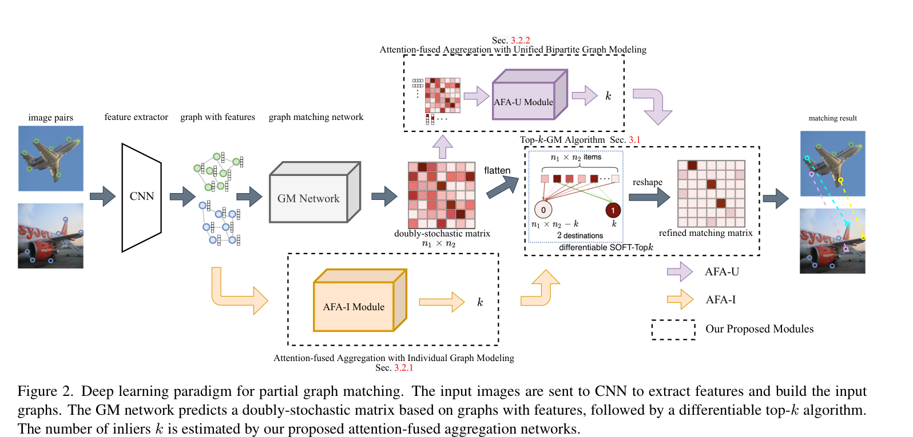

# Deep Learning of Partial Graph Matching via Differentiable Top-K

> **TL;DR:** AFAT adds a differentiable confidence-selection layer and a learned inlier-count predictor to graph-matching networks. Training uses the true inlier count; testing uses its prediction, then Hungarian assignment and subset selection enforce a discrete partial matching. The paper also releases IMC-PT-SparseGM and a memory-efficient sparse NGMv2 implementation.

## Motivation

An injective matcher may force unrelated nodes to match when both graphs contain outliers. Hand-set thresholds and dummy scores can be inflexible, and hard rejection blocks learning gradients. AFAT treats deciding how many correspondences to retain as a learned, supervised component of the matching pipeline. It addresses partial pairwise graph matching; it does not substitute graph-level similarity regression for the required discrete correspondence output (Sections1–2).

## Contributions

- A differentiable top-k module based on entropically regularized optimal transport, integrated into matching training.
- Two Attention-Fused Aggregation designs, AFA-I and AFA-U, for predicting the number of inlier matches.
- Demonstrations with the quadratic NGMv2 and linear GCAN backbones, including training and count-error ablations.
- IMC-PT-SparseGM-50/-100 benchmarks, plus a sparse NGMv2 implementation that reduces the tested memory footprint (Sections3–5; AppendixA–C).

## Methodology

**Soft Top-K.** A backbone yields a relaxed matching-confidence matrix$S$. Flatten its$n_1n_2$entries and transport each entry to a reject or retain bin with capacities$n_1n_2-k$and$k$. Costs measure separation from minimum/maximum confidence. Add entropy regularization and alternate marginal normalizations; the retain-bin mass reshapes into$S_r$, a differentiable training output with total mass$k$. The paper explicitly states that this relaxation **does not ensure one-to-one matching** (Eqs1–4; Algorithm1).

*Original Figure2 with its complete caption, extracted from formal PDFp2/printed6273 and visually checked.*

**Hard decoder.** At test time, first compute a Hungarian assignment on$S_r$, then retain the$k$highest-confidence selected pairs. A subset of an injective assignment is a feasible partial matching, subject to a valid rounded count and selection implementation. This is a constructive pipeline producing a new assignment. It is not a learned editor of a complete incumbent, and the soft transport problem is not a certified solution of the original quadratic assignment problem (Algorithm1; AppendixAlgorithm2).

**Predicting the count.** AFA-I uses within-graph message passing, cross-graph attention, attention pooling and a neural tensor similarity network. AFA-U instead treats$S$as a weighted bipartite graph and uses multi-head cross-set attention, max pooling and an MLP. The two graph-side predictions are averaged. A sigmoid predicts a proportion, scaled by$\min(n_1,n_2)$and rounded. AFA-U starts one node set at zero vectors and the other at one-hot vectors so that confidence-edge information drives aggregation (Sections3.2.1–3.2.2).

**Supervision and schedule.** Ground-truth correspondences provide both permutation supervision and the inlier-count target. AFA is trained with MSE. The GM network uses **ground-truth$k$ during training**, while testing substitutes predicted$k$. Stage1 trains CNN/backbone, stage2 warms up AFA, and stage3 jointly trains them. The count-error study therefore evaluates the effect of a genuine train/test difference, rather than proving an oracle count is available in deployment (Sections3.2.3–3.3).

**Scope.** “General” describes a plugin for matching networks with compatible relaxed outputs. BBGM's discrete black-box output is expressly outside the demonstrated plugin interface. Distinct backbones and dataset-specific checkpoints in the released configurations do not establish a shared trained solver across native tasks. Classification is **specialist / constructive**.

## Experiments

**Data and splits.** PascalVOC uses7,020training/1,682test images across20categories, cropped/resized to256×256 with unfiltered semantic keypoints. Willow originally has ten keypoints and no outliers; the experiment adds1–10random background outliers per image and uses20training images per category. IMC-PT-SparseGM contains25,765images from16attractions, with13training and3test attractions. Its50/100anchor versions average21.36/44.48visible nodes and57.3/55.5%partiality. The supplement also tests SPair-71k's18categories and70,958pairs, with53,340training and12,234test pairs (Sections4–5; AppendixA–B).

**Benchmark construction.** Reconstruct/project3D scene points using the original IMC-PT camera/point labels, select sufficiently frequent and spatially separated anchors, judge visibility and project back into images. Delaunay edges are precomputed. Anchor counts are universe sizes, not fixed observed graph sizes. The new benchmark is sparse correspondence prediction with known annotation construction, rather than an end-to-end claim of improved SfM reconstruction (Section4; AppendixA).

**Metric and uncertainty.** Report pairwise F1, balancing precision and recall of the predicted subset against annotated matches. Close peer configurations are run with five random restarts and displayed **95% confidence intervals**, not simply standard deviations. The testbed is AMD3970X, RTX3090 and128GBRAM. Multi-graph methods are deliberately excluded from direct comparisons because they use additional graph information; EAGM is evaluated under its own published random-outlier protocol rather than silently ported from TensorFlow into the main PyTorch setup (Section5.1).

**Pascal and class-level exceptions.** NGMv2-AFAT-U reports **60.2±0.4% F1**, versus no-PMH58.8, thresholding59.4±0.4 and dummy58.6±0.5. GCAN-AFAT-U reaches **62.0±0.2**, versus dummy59.7±0.3. Gains are aggregate: GCAN car F1 falls57.5→49.6 and person49.7→46.3 when comparing dummy with AFAT-U. NGMv2-AFAT-U boat44.9 is below thresholding48.6. These examples prevent an every-class superiority interpretation (Table2).

**Other datasets.** GCAN-AFAT-I achieves **83.7±0.3** on noisy Willow and **72.9±0.6** on IMC50; GCAN-AFAT-U reaches **71.5±0.2** on IMC100. AFA-I is not uniformly better than AFA-U: NGMv2 gives IMC100 70.1versus70.3, while GCAN gives70.9versus71.5. SupplementSPair means are NGMv2-U56.3±0.4/I56.4±0.6 and GCAN-U/I55.7±0.4, versus GCAN dummy54.2±0.3. Individual-class losses remain, including GCAN-AFAT-U TV89.0 versus dummy91.9. The highest displayed mean depends on backbone, dataset and AFA choice (Table4; AppendixTable9).

**Random-outlier and learning ablations.** In EAGM's filtered-Pascal protocol with0–5extra target outliers, NGMv2-AFAT-U gives72.2→50.3F1, compared with EAGM70.5→38.4. This direct evaluation reuses a pretrained model and should be distinguished from the main unfiltered setting. Table6 supplies **true$k$**to isolate training integration: NGMv2 Pascal improves60.7→62.3 when differentiable Top-K is used during training; IMC100 improves70.7→71.8. Applying Top-K only to RRWM instead lowers20.3→19.4 on Pascal and39.6→39.1 on IMC50. This supports the tested learned integration, not a theorem that Top-K always helps any solver.

**Memory and count error.** For batch1/110nodes, Table3 lists dense NGMv2 **26.06GB** versus sparse **2.78GB**, with the dense version exceeding the stated24GB3090limit. These are memory comparisons, not equivalent speedup measurements. Figure5 studies Gaussian perturbations of true$k$and shows an empirical tolerance region; learned AFA errors do not lie exactly on that noise curve. The plot supplies no worst-case guarantee for arbitrary count errors or data shifts.

## Limitations

Performance depends on the backbone confidence matrix, estimated count, supervised correspondences and a compatible relaxed-output interface. Correct cardinality alone does not identify correct correspondences; training with an oracle count does not eliminate prediction errors at test time. The soft transport marginal constraint does not impose matching row/column exclusivity, so inference must retain its separate assignment and filtering stages.

The final Hungarian-then-subset procedure need not solve a global cardinality-constrained QAP. The paper reports empirical gains rather than an approximation ratio, semantic correctness guarantee or universal outlier-robustness theorem. Known semantic keypoints, synthetic Willow outliers and scene-specific anchor construction constrain extrapolation to arbitrary detected features. The sparse implementation reduces tested memory but does not establish constant memory/time at unrestricted graph size. No end-to-end runtime superiority is inferred from the memory table.

## Reproducibility

**Identity and dates.** Runzhong Wang, Ziao Guo, Shaofei Jiang, Xiaokang Yang and Junchi Yan list Shanghai Jiao Tong University; the correspondence footnote also lists Shanghai AI Laboratory for Yan. Wang and Guo contribute equally. Formal CVPR2023 pp6272–6281, DOI[10.1109/CVPR52729.2023.00607](https://doi.org/10.1109/CVPR52729.2023.00607), is matched by title/byline to CVF and publisher-deposited Crossref metadata. The latter records **June2023**, without a supported exact day, so publication and available-paper date retain monthly precision. No independent arXiv identity is invented.

**Complete scientific coverage.** All ten official CVF main pages, all53references and both official supplement pages were read. The supplement includes full IMCconstruction details, statistics, SPair per-class results and GreedyTopKAlgorithm2. All architectures, algorithms, mathematical definitions, plots, tables and qualitative panels were rendered and inspected. Original Figure2 with the complete caption physically exists under the public assets directory and was viewed. The primary CVF page's scientific supplement was fetched directly.

**Official repository and inventory.** The paper links[Thinklab-SJTU/ThinkMatch](https://github.com/Thinklab-SJTU/ThinkMatch) and its[IMCPT-SparseGM dataset generator](https://github.com/Thinklab-SJTU/IMCPT-SparseGM-dataset). The complete ThinkMatch293-member source ZIP identifies commit`9f669cb22916f3e06c214f058daa5ac349bd7e15`and contains no PDF/ZIP/notebook scientific attachment. Its full general README and full AFAT README were read, along with the dataset README. The AFAT page lists separate three-stage configurations and pretrained-model links for each dataset/backbone/AFA combination. The documented manual stack is Ubuntu16.04/Python3.7/PyTorch1.6/CUDA10.1/PyG1.6.3, with native LPMP requirements; no installation or model evaluation was run.

**Necessary decoder check.** The released NGMv2 code applies Hungarian, sorts its selected confidences, resets the output and calls `greedy_perm`; the corresponding GCAN path also uses Hungarian before filtering. The helper additionally checks row/column exclusivity. Current count discretization has dataset/model-specific floor/ceil branches for Pascal/SPair rather than uniformly using the prose's rounding. This is a concrete reproduction detail, not an unsupported allegation about historical experiment validity. The exact ZIP/hash and inspected paths are recorded; failed GitHub API inventory requests were resolved by complete archive inspection.

**Actual internal citations.** The bibliography directly cites [GLSearch](glsearch.md)[3], [DGMC](deep-graph-matching-consensus.md)[11], [quadratic-constraint GM](deep-graph-matching-under-quadratic-constraint.md)[13], [tracking-oriented learnable GM](learnable-graph-matching-incorporating-graph-partitioning-with-deep-feature-learning-f.md)[15], [GCAN](graph-context-attention-networks-for-size-varied-deep-graph-matching.md)[17], [MatNet](matrix-encoding-networks.md)[21], [EAGM](adaptive-edge-attention-for-graph-matching-with-outliers.md)[28], [BBGM](deep-graph-matching-via-blackbox-differentiation-of-combinatorial-solvers.md)[29], [dynamic-embedding GED](combinatorial-learning-of-graph-edit-distance-via-dynamic-embedding.md)[47], [CIE-H](cie-h.md)[51], [GMN](deep-learning-of-graph-matching.md)[52] and [IA-GM](ia-gm-a-deep-bidirectional-learning-method-for-graph-matching.md)[53]. References44–46 are differently titled TPAMI papers, not automatic aliases of the older PCA/NGM/GANN conference records. Mentions in the shared code README do not create additional paper-citation edges.
