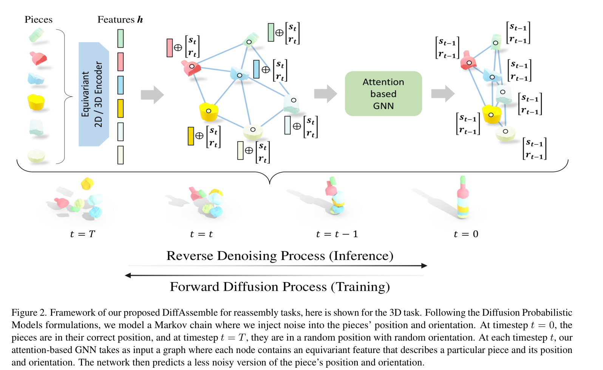

# DiffAssemble: A Unified Graph-Diffusion Model for 2D and 3D Reassembly

> **TL;DR:** DiffAssemble generates fragment poses by graph-conditioned diffusion. For square jigsaws, continuous predictions are discretized into grid positions and quarter-turn rotations; 3D fragments instead retain continuous poses. A shared design across modalities is demonstrated, rather than one trained checkpoint solving both tasks.

## Motivation

Reassembly methods often separate 2D image puzzles from 3D fractured-object assembly. DiffAssemble models both as pose generation for a set of pieces, using appearance or shape features and relations between pieces. Its combinatorial application is the 2D puzzle's discrete piece-to-cell/rotation output. The 3D experiment is continuous translation/rotation estimation and should not be presented as an evaluated discrete graph-assignment optimum (Sections 1–3).

## Contributions

- A graph-based diffusion formulation that predicts piece translations and rotations from noisy poses and modality-specific equivariant features.
- An attention-based message-passing network, with an Exphormer sparsification option for larger puzzles.
- Joint position-and-rotation evaluation for 2D jigsaws, missing-piece experiments, and continuous 3D fractured-object reconstruction.
- Ablations of equivariant features, diffusion, rotation representations, Chamfer loss and attention, plus empirical memory/runtime comparisons (Sections 3–4 and Supplement A–E).

## Methodology

**Graph and feature representation.** Represent every piece as a node, initially with all-to-all connectivity. Concatenate a piece descriptor with its current translation and rotation representation. For 2D use a Z4-equivariant ResNet18 and a sine/cosine angle representation; for 3D use equivariant VN-DGCNN point-cloud features and unit quaternions. Each 3D fragment is sampled to 1,000 points. These are different encoders and model instantiations (Sections 3–4).

**Pose generation.** Train the GNN to recover clean poses from a forward noising process, using squared translation error and a rotation-matrix discrepancy; the 3D study also tests Chamfer distance. The SO(3) version uses logarithm/exponential maps, rotation composition and an isotropic distribution on SO(3), rather than treating unconstrained Gaussian quaternion coordinates as valid rotations. At test time, start from noise and iteratively denoise. The paper describes an attention-based UniMP backbone and sparse expander/global-node connections (Section 3, Supplement B–C).

*Original Figure 2 and complete caption, extracted from formal PDF p3, printed p28100, and visually checked.*

**Discrete decoder responsibility.** The paper describes snapping each 2D position to the nearest grid cell and each angle to a multiple of pi/2. Independent nearest-cell rounding by itself need not be injective. The inspected public implementation instead computes a global list of pairwise distances and greedily takes the closest remaining piece/cell pair, deleting its row and column. That procedure constructs an injective assignment, without guaranteeing the minimum total-distance assignment or the correct puzzle. Rotation correctness is separately tested within pi/4, and visualizations explicitly round rotations (Section 4.2; `spatial_diffusion.py`180–216/931–955/1032–1042).

**Scope and paradigm.** This is specialist / constructive: neural denoising optimizes a continuous candidate representation before the discrete puzzle decoder; it does not edit a complete feasible discrete incumbent. Training scripts instantiate separate CelebA, WikiArt and 3D models. Shared architecture and within-puzzle size flexibility are positive generalization evidence, but do not establish a shared trained checkpoint across native 2D/3D tasks.

## Experiments

**Data, metrics and training.** PuzzleCelebA uses 30,000 face images with an 80/20 split and 6,000 test puzzles; PuzzleWikiArt uses approximately 63,000 paintings with the same split. Main puzzle sizes are 6×6 through 12×12, with discrete direct-comparison accuracy requiring both correct cell and rotation. This is piece accuracy, not the fraction of entire puzzles solved perfectly. Breaking Bad uses the everyday-object subset, training/testing on 2–20 fragments; metrics are rotation RMSE, translation RMSE and part accuracy under a Chamfer-distance threshold of 0.01. The supplement specifies Adagrad, learning rate 0.0001, up to 1,000 epochs with early stopping, and V100/RTX4090 machines (Section 4; Supplement A/E).

**2D results and negative cases.** CelebA piece accuracies for 6/8/10/12 grids are **99.51/87.66/99.30/97.76%**. Huroyan's classical method reaches **97.45% at 8×8**, above DiffAssemble's 87.66, so the paper's broad CelebA superiority prose has an explicit exception. WikiArt results are **90.65/72.79/63.33/53.08%**, below the Yu and Huroyan baselines across all listed sizes; Yu reaches 94.62/92.95/90.99/89.88. The strong face prior therefore does not imply equally strong performance on diverse paintings. With 30% missing pieces, the printed DiffAssemble rows are 96.92/76.49 on CelebA 6/12 grids and 51.21/27.09 on WikiArt, exceeding the listed classical rows for those tests (Tables 3–4).

**3D results and limits.** Main rotation/translation RMSE and part accuracy are **73.3 degrees / 0.148 / 27.5%**, versus DGL's 81.4/0.149/25.4 and SE(3)-Equiv's 77.9/0.167/8.1. These aggregate improvements still leave most parts below the correctness criterion. Removing diffusion lowers PA to 3.1%; removing equivariant features gives 18.3%. Chamfer loss raises PA from 24.10 to 27.48 while slightly worsening both RMSE metrics. In the separate missing-fragment study, no retraining is performed; DiffAssemble wins rotation/PA but not translation RMSE, with 30%-missing PA10.43 and RMSE(T)0.1984 (Tables 1–2; Supplement Table 5).

**Scaling and budget.** The paper reports a 900-piece CelebA puzzle in about five seconds at approximately 95% piece accuracy, versus Gallagher's 55 seconds/58%, and memory reduced from roughly 50GB to 20GB by sparsity. The stated configuration removes 80% of edges and adds eight global nodes. These are empirical results on the stated hardware/tasks, not a proof of size-independent runtime or exponential complexity for every classical baseline. Supplement Table 7 contains substantial nonmonotonic size behavior and reversals against ordinary edge dropout, such as 18×18 degree80% sparse97.80 versus dropout98.14 (Figures 5–6; Supplement D.1).

## Limitations

**Continuous and discrete feasibility.** Denoising does not enforce a nonoverlapping, globally correct assembly at every step. A final greedy injective cell assignment guarantees a structural 2D correspondence, not semantic accuracy or optimality. The 3D pose estimator does not supply an assignment certificate, exact reconstruction guarantee or collision-free physical assembly. The authors identify high memory use and real-scan generalization as limitations; qualitative video examples also retain imperfect 3D fragment alignment.

**Reporting differences.** Main Table 3 gives CelebA8×8=87.66, while Supplement Table 6 calls its base row the same implementation but prints **84.94**. Table 4's parenthesized changes do not all reconcile with Table 3; for example 76.49−97.76=−21.27 percentage points rather than the printed −32.81. Its Yu/Huroyan reference numbers are also swapped relative to the bibliography. The missing-3D prose specifies 10–20 original parts while the caption says 8–20. The supplement mentions five seeds and standard deviations, but its displayed missing-part table provides only single values. This note retains the actual labeled numbers and records these discrepancies without inventing corrected benchmark results.

**Evaluation scope.** Synthetic square grids, face/painting semantics and simulated 3D fractures do not establish performance on arbitrary eroded archaeological fragments or real scanned artifacts. Dataset-specific training remains distinct from transfer of a fixed model. Main claims of being first/SOTA are the authors' claims within their contemporaneous comparisons, not a current exhaustive ranking.

## Reproducibility

**Identity and dates.** The five authors are Gianluca Scarpellini, Stefano Fiorini, Francesco Giuliari, Pietro Morerio and Alessio Del Bue, all at PAVIS, Istituto Italiano di Tecnologia; the first three share equal contribution. The formal CVPR paper occupies pp28098–28108. Identity-matched IEEE-deposited Crossref metadata for DOI [10.1109/CVPR52733.2024.02654](https://doi.org/10.1109/CVPR52733.2024.02654) records publication-print/issued **2024-06-16**, distinct from the conference schedule. `date` records [arXiv2402.19302](https://arxiv.org/abs/2402.19302) v1, **2024-02-29**.

**Complete scientific inventory.** All eleven official CVF PDF pages, including all fifty references, and all four pages of `3975_supp.pdf` were read. The downloaded official 7,071,935-byte ZIP contains exactly that PDF and `3975_suppl_video.mp4`. The video is 60.48 seconds with no audio stream; sixty one-second frames covering the whole clip were visually inspected in five contact sheets, including all title panels, 3D comparisons, 2D examples and 30×30 demonstrations. This is explicitly sampled visual inspection of a qualitative video, not a claim that video frames are PDF reading pages. The complete untruncated author repository tree has no additional scientific PDF/ZIP; its README and Blender usage document were read. All key equations/tables were rendered. Original Figure 2 and its complete caption physically exist in the public paper directory and were actually viewed.

**Official code and protocol boundaries.** The paper links [IIT-PAVIS/DiffAssemble](https://github.com/IIT-PAVIS/DiffAssemble), inspected at tree `256df64d4e5465e690b5b84e6024c60e21c3f3c8`. Separate dataset/model entry points and job scripts support the specialist classification. The current 2D model's `configure_optimizers` uses **Adafactor**, while the supplement specifies Adagrad; this is a code/version difference, not proof of the historical run configuration. The scripts provide 300-step DDIM defaults and an inference-ratio option, which should not automatically be equated with the exact setting of every reported five-second run. The 2D training entry uses the test dataloader as validation and monitors its `overall_acc` for checkpoint selection; it does not supply a distinct validation split in that entry point. Environment definitions, data splits and source are public, but the README retains a promised-release sentence and a WIP image link; no benchmark or full training rerun was performed.

**Relations.** The complete bibliography was manually checked against the 527-paper catalogue, aided by the reference-candidate scanner. It contains no confirmed direct reference to another currently catalogued paper; no relation is created from topical similarity to later puzzle papers.
