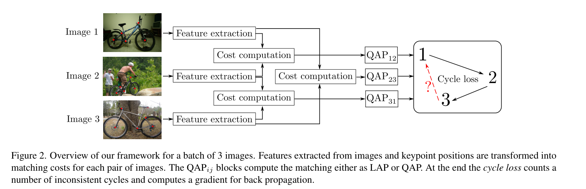

# Discrete Cycle-Consistency Based Unsupervised Deep Graph Matching

> **TL;DR:** CLUM learns visual matching costs from discrete consistency of image triplets, differentiating through classical assignment solvers. The neural network supplies costs; the solver supplies a hard pairwise assignment. Cycle consistency is a training signal, not a test-time multi-image constraint or a certificate of correct semantic correspondences.

## Motivation

Supervised semantic keypoint matching needs annotated correspondences. CLUM instead uses three images from the same object category and penalizes pairwise matches that fail to close a cycle. It targets one-to-one, possibly incomplete graph matching, with unary node costs and optional quadratic edge costs. The task is discrete visual correspondence; it is not continuous geometric registration or generic graph similarity regression (v5 Sections 1–4).

## Contributions

- A symmetric discrete cycle loss for three binary matchings, usable without ground-truth correspondences.
- Black-box differentiation through assignment solvers, avoiding a requirement that every decoder be a differentiable Sinkhorn relaxation.
- Experiments with BBGM's feature network/LPMP solver, a modified attention network with a fusion-moves QAP solver, and a LAP alternative.
- Complete and incomplete matching evaluations on Pascal VOC, Willow and SPair-71K, including the benefits and limitations of replacing quadratic matching with linear matching (v5 Sections 3–6).

## Methodology

**Discrete decoder.** Equation 4 minimizes unary plus quadratic costs over binary correspondence variables, with at-most-one assignment in every row and column. These inequalities permit outliers and unmatched nodes. Dropping the quadratic term yields LAP; introducing product variables yields the finite ILP representation needed by the black-box learning rule. A network does not replace the discrete assignment solver. The tested QAP algorithms are approximate optimization methods, so their output should not be called a globally optimal QAP certificate (v5 pp3–5).

**Cycle-loss training.** For binary links a, b, c around a triplet, the partial loss is ab+bc+ac−3abc: it penalizes exactly the configurations containing two links. Sum it over all keypoint triples. Its derivative with respect to a is b+c−3bc. For each pairwise solver, solve once at the predicted costs and again at costs perturbed by lambda times the loss derivative; use the difference of assignments divided by lambda as the black-box surrogate gradient. Only unary costs are perturbed here because the loss has no explicit dependence on the lifted pairwise variables. This is differentiation of a surrogate/interpolation, not the ordinary derivative of a hard assignment map everywhere (v5 Equations 1–7, Algorithm 1).

*Original Figure 2 and its complete caption, extracted from arXiv v5 PDF p3 and visually checked.*

**Features and costs.** The described CLUM architecture uses ImageNet-pretrained VGG16 features aligned to annotated keypoints, Delaunay graphs, two SplineCNN layers, self-attention with relative position encoding, and cross-attention for node/edge features. Normalized inner products and a tunable unary offset produce the matching costs. The offset regulates the number of unmatched points. Read the attention formula together with the reproducibility qualification below: the printed value index and the public implementation differ (v5 Sections 5–6).

**Scope.** This is specialist / constructive matching: learned costs feed a solver that constructs the hard pairwise assignment, without neural edits of a complete incumbent. Multiple architectures, solvers, object categories and visual datasets demonstrate flexibility within visual graph matching. They do not demonstrate one checkpoint solving distinct native combinatorial tasks. At inference the paper explicitly does **not** enforce multi-graph cycle consistency (v5 p2).

## Experiments

**Protocol and metrics.** Experiments use an A100 GPU and 32-core CPU, five runs, Adam with initial learning rate 0.002, a 0.01 multiplier for VGG16, batches of twelve image triplets, lambda=80, and flips/rotations. Images come from the same category and share at least three keypoints. Filtered Pascal VOC removes unmatched keypoints and reports accuracy; unfiltered Pascal VOC retains outliers and reports F1. Willow is fine-tuned after Pascal VOC pretraining. SPair-71K is a more difficult semantic matching benchmark. These are correspondence metrics, not QAP objective gaps or exact-solve rates (v5 p7; v3 p7 gives the longer dataset descriptions).

**Reported main results.** Table 1 reports CLUM at **62.4%** filtered-Pascal accuracy, **43.5%** unfiltered-Pascal F1, **95.6%** Willow accuracy, and **43.1%** SPair accuracy. Corresponding CLUM-L results are 59.7/40.3/93.4/41.6. CLUM leads the listed unsupervised aggregate comparisons, but remains below the supervised BBGM/NGMv2 references; for example SPair supervised accuracies are 82.1/80.2. Results also mix reproduced runs and italicized values copied from prior work/ThinkMatch. The paper trains previously missing GANN/SCGM SPair baselines and evaluates filtered-trained SCGM on unfiltered Pascal, so these protocols should not be treated as identical training conditions (v5 pp7–8).

**Ablations and counterexamples to universal superiority.** Removing RPE changes filtered-Pascal/SPair accuracy from 62.4/43.1 to 60.1/41.4; removing cross-attention as well gives 58.1/40.4. CL-BBGM without SCGM pretraining is below GANN on Willow in the main table, and category-level rows contain further reversals: CLUM's SPair bus 48.7 is below GANN's 49.8. Thus the aggregate empirical claim should not become “best for every object category” (v5 Tables 1–2 and 6).

**Version and table differences.** The independently read July 2023 v3 has an older network without the later self-attention/RPE block, different ablations and a semi-supervised experiment; its main CLUM values are 60.1/40.4/92.7/41.4. They must not be merged with v5 results. Within v5 itself, several main/appendix numbers differ: CL-BBGM filtered-Pascal is 58.4 in Table 1 but 55.3 in Table 4; CLUM-L unfiltered F1 is 40.3 versus 40.9, and its Willow value is 93.4 versus 94.1. The printed Willow CLUM class entries also average to 97.36 under an unweighted five-class mean, rather than the printed 95.6. This note preserves the reported main values and identifies the mismatch instead of silently recomputing a replacement benchmark (v3 Tables 2–7; v5 Tables 1/3–6).

## Limitations

**Consistency is not correctness.** A consistently wrong permutation can have zero cycle loss. With incomplete matching, the all-zero assignment satisfies the displayed at-most-one constraints and also has zero loss. Therefore consistency alone cannot identify the ground-truth correspondence; visual features, cost calibration and the data distribution matter. This is a curator observation from the displayed feasible set and loss, not an assertion that every trained model collapses (v5 Equations 4–7).

**Optimization and generality.** The framework accepts different finite assignment formulations and solvers, but an approximate QAP solver and a surrogate gradient do not imply globally optimal inference, globally optimal training, or zero inconsistency. The empirical task remains category-conditioned keypoint matching with supplied keypoint locations. No end-to-end detection of arbitrary unannotated points or cross-native-task checkpoint is established.

**Printed attention boundary.** In rendered v5 Equation 8 the value term is g_i^1 W^V+p_is^V. For the stated cross-attention call all positional terms are zero, so a normalized sum over s leaves g_i^1 W^V, independent of the second graph. Consequently that literal equation does not implement the claimed cross-graph information transfer. The current public implementation instead passes the second graph as both key and value. This is a specific formula/implementation discrepancy; it does not invalidate the empirical usefulness of conventional cross-attention or establish which historical implementation produced the tables.

## Reproducibility

**Formal identity and dates.** The publisher's four-author byline is Siddharth Tourani, Muhammad Haris Khan, Carsten Rother and Bogdan Savchynskyy, affiliated with Heidelberg University's Computer Vision and Learning Lab/IWR and Mohamed Bin Zayed University of Artificial Intelligence. The formal paper is AAAI 2024, 38(6):5252–5260, DOI [10.1609/aaai.v38i6.28332](https://doi.org/10.1609/aaai.v38i6.28332), published **2024-03-24**. `date` records the first arXiv posting, **2023-07-18**. The canonical arXiv abstract retains the older title/order, while the actually read **v5, 2024-02-11**, uses the formal title/order. The author's repository explicitly links this formal DOI and its BibTeX. The separately read **v3, 2023-07-22**, is retained as an older, different scientific version, not mislabeled as v5 or formal-identical bytes.

**Scientific materials.** All fourteen v5 pages were read, including all 51 bibliography entries and all four detailed-result appendix pages. All twelve v3 pages were independently read, including its bibliography and complete integrated supplement. Key equations, Algorithm 1, result tables and figures were actually rendered and checked. The formal text refers readers to the technical report for detailed results/ablations, which are integrated in v5. Publisher access was restricted; its extra galley is labeled Video/Poster, and attempted author poster links were unavailable. No additional scientific appendix was identified in the complete untruncated author-repository tree. The unattained presentation link is disclosed rather than claimed read. The original Figure 2 asset exists in the public paper directory and was actually viewed.

**Official software and gaps.** The paper links [skt9/clum-semantic-correspondence](https://github.com/skt9/clum-semantic-correspondence), inspected at tree `b98f6b8ae31811e85a69b3c9549e5447fc08c570`. The README requires an external fusion-moves QAP solver and warns about torch_geometric version-related NaNs. Its command names `train.py` and a JSON configuration, but the complete tree provides `train_dino.py`, no `train.py`, and no JSON configs. The inspected entry point selects `SupervisedNet`, Hamming loss, two-image data and the test dataloader as its optimization loop; it is not the displayed unsupervised triplet training recipe. Its alternate `CycleLoss` computes a matrix-product-versus-identity loss, differing from the partial-matching loss in Equation 6. `UnsupervisedNet` supplies a conventional second-graph value to cross-attention, and unary similarities are negated before minimization; these are further differences from the displayed equations. These concrete current-code limitations do not prove that the paper's historical experimental runs used this entry point. No benchmark was rerun.

**Actual internal references.** The v5 bibliography directly cites [Deep Graph Matching Consensus](deep-graph-matching-consensus.md) [16–17], [the comparative graph-matching study](../studies/a-comparative-study-of-graph-matching-algorithms-in-computer-vision.md) [19], [SCGM](self-supervised-learning-of-visual-graph-matching.md) [27], [BBGM](deep-graph-matching-via-blackbox-differentiation-of-combinatorial-solvers.md) [32], [black-box differentiation](../studies/blackbox-backprop.md) [41], [GANN](gann.md) [42], [joint multi-graph/3D geometry learning](joint-deep-multi-graph-matching-and-3d-geometry-learning-from-inhomogeneous-2d-image-c.md) [47], [CIE-H](cie-h.md) [49], and [GMN](deep-learning-of-graph-matching.md) [50]. The separately titled TPAMI NGM extension [43] is not silently mapped to a different conference paper.
