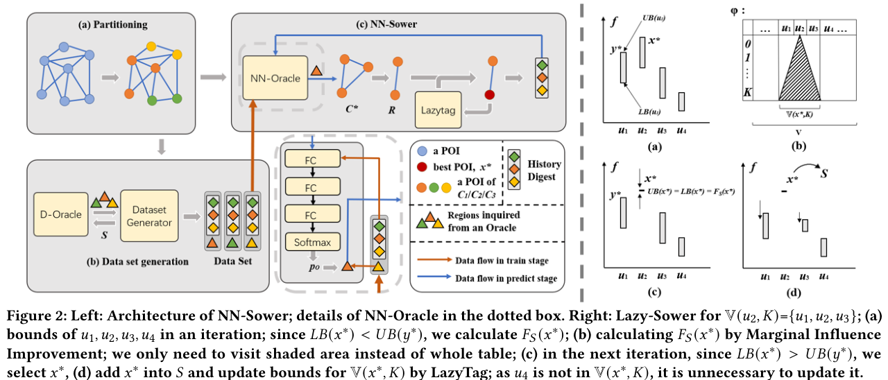

# Geodemographic Influence Maximization

> **TL;DR:** NN-Sower learns which geographic region to search, samples locations there, and adds the best affordable candidate by classical marginal influence calculation. It accelerates budgeted advertisement placement at an empirical quality cost. The fixed approximation factor belongs to exact Greedy/Lazy-Sower, while the neural variant has a bound conditional on its realized marginal-gain ratios.

## Motivation

Outdoor advertisement placement should maximize expected audience reach under a cost budget. Dense, long individual trajectories are often unavailable; aggregate short-range movements are more realistic. Geodemographic Influence Maximization (GIM) models those transitions and the population's starting positions/trip lengths, rather than assuming person-to-person social diffusion or counting complete recorded trajectories. Digital signage motivates fast repeated online decisions (Sections 1–3).

## Contributions

- A budgeted POI selection problem with a finite-horizon movement-based reach objective, NP-hardness, monotonicity and submodularity.
- Lazy-Sower, combining local marginal calculations with upper/lower-bound maintenance to preserve exact greedy choices.
- NN-Sower, a learned regional oracle within a randomized constructive selection framework.
- Experiments on two large urban mobility datasets, including quality/time tradeoffs, component ablations, disabled locations and scaling tests.

## Methodology

**Problem and objective.** A directed POI graph has transition probabilities summing to one at each node, positive location costs, and nonnegative spectator counts spec(u,k) for starting location u and movement length k≤K. Let f(u,k,S) be the probability that a spectator's trajectory, including its start, hits the selected location set S. It is one if u∈S, zero for an unselected start with k=0, and otherwise the transition-weighted continuation probability. The objective F(S)=ΣuΣk spec(u,k)f(u,k,S) maximizes expected reached audience subject to Σv∈S cost(v)≤L. Repeated exposure is not counted as an independent new spectator (Definition 3.1).

**Classical component.** Greedy repeatedly considers the highest marginal-gain-per-cost location, accepts it if affordable, and finally compares the accumulated set with the best affordable singleton. Theorem 3.3 gives the familiar ½(1−1/e) bound for this monotone submodular knapsack procedure. The best-singleton safeguard matters. Lazy-Sower restricts gain calculations to the K-step relevant neighborhood and maintains LazyTag upper/lower bounds. It commits a location when its lower gain-per-cost bound dominates the remaining upper bounds, or recomputes a gain to resolve the ordering. Section 5.3 attributes the same greedy quality/factor to this deterministic method. These are not guarantees of global optimality.

**Neural role.** A geographic grid partitions the graph into m regions. At each iteration the neural oracle outputs a distribution over regions; r draws sample POIs within the chosen region with probability proportional to cost. Classical gain/cost evaluation and LazyTag select the sampled candidate, while a budget test controls acceptance. This is constructive set building, rather than neural editing of a complete incumbent. The MLP has ReLU hidden layers of sizes 512, 256, 128 and an m-way softmax. Its input flattens a min–max-normalized m×16 digest of recent selected marginal-gain-per-cost values in each region (Sections 6–7).

**Training.** The offline D-Oracle calculates each region's expected best sampled gain/cost using exact per-location marginal values, chooses the best region, and provides a one-hot imitation label. The generator stores partial-selection histories and those labels. A separate model is trained for each city; Appendix A.5 reuses it across budgets/sample counts. This supports **specialist / constructive**, not a shared model across native optimization tasks.

*Original Figure 2 with complete caption, PDF p4; extracted and visually checked. The left separates offline teacher generation and neural region selection; the right illustrates classical bound maintenance.*

**Neural guarantee boundary.** Theorem 6.2 gives F(S)≥(1−exp(−u))F(O), where u=L⁻¹Σi cost(ai)ξi and ξi is the realized selected marginal-gain-per-cost divided by the best such ratio. This bound depends on actual choices and consumed costs; it does not prove a uniform positive approximation factor for the learned oracle or derive one from classification accuracy. Its product argument is in Appendix A.2. The printed last step says 1−x≥exp(−x), whose direction is reversed; replacing it with the correct ≤ recovers the displayed exponential lower-bound step. This local printing error does not by itself refute the conditional result.

## Experiments

**Data and costs.** The Beijing graph contains 686 k POIs/2,334 k edges and 626 m movements; Chengdu contains 564 k POIs/2,086 k edges and 420 m movements, collected September 2–21,2018. Default K=5 reflects short trips. Actual advertisement prices are unavailable: costs use traffic-dependent estimates with a random multiplicative factor in[0.8,1.2] plus a fixed 100 term. Thus the geographic inputs are real, while prices are modeled (Table 2/Section 8).

**Training and measurement.** Each city uses 60 generator runs yielding roughly 17 k history records, split randomly by record into 80% training/10% validation/10% test. Data generation takes approximately 12 hours and MLP training 1,000 seconds per city; those costs are separate from online selection plots. The reported setup uses a 2.0 GHz Xeon Gold 5117,198 GB RAM, C++ for the non-neural components and Python for the oracle. Experiments average 10 runs. Fixed grids are 144 regions for Beijing and 64 for Chengdu. Training uses budget 400 k and r=200; varying L/r subsequently tests reuse within the same problem/city, not unseen-city transfer (Section 8; Appendix A.4–A.5).

**Quality/time tradeoff.** Over the reported budget sweep, Lazy-Sower matches CELF influence while using up to 20% of its runtime. NN-Sower is reported to attain up to 91% of that influence at approximately 2% of CELF's runtime. **This percentage is relative to CELF, not the unknown global optimum.** Against the adapted RandomGreedy baseline, the budget experiment reports 1.8%–6.4% higher influence at about 25% of runtime. The sample-count experiment reports matching RandomGreedy influence at 1/55 of its runtime under the compared settings; it is not a universal 55× speedup at identical every-parameter configurations (Figures 4–5).

**Components and counterexamples.** Removing the learned oracle reduces influence, while removing LazyTag mainly increases time. Oracle use improves influence roughly 1%–5% over uniform-region selection in the sample-count sweep. However, for K<3 the neural variant can be slower than RandomGreedy because neural overhead dominates. Larger sample counts raise both influence and runtime. Randomly disabling POIs lowers every method's influence; a smaller relative decline for already approximate randomized methods is not proof of better absolute influence (Figures 5–7).

**Scaling and deployment.** Enlarged graphs are disjoint duplicates of the original graph, retaining costs, coordinates and population statistics; this tests size scaling without establishing generalization to newly structured urban networks. Appendix A.6 describes planned deployment in Baidu Juping: deterministic Lazy-Sower first, then NN-Sower for real-time bidding. The future-tense plan is not evidence of an already completed online deployment or measured business lift.

## Limitations

The model assumes finite-horizon Markov movement and aggregate spectator statistics; expected reach is not a measured advertisement conversion outcome. Empirical evidence covers two cities and modeled costs. The random record split does not by itself establish independence between entire generated selection trajectories or generalization to another city. The neural component sacrifices quality for speed and has no certified per-instance optimality gap. Offline exact-teacher generation is substantial, and scalability by graph duplication preserves the original local structure.

**Printed training loss.** Equation 2 is rendered as−Σi pOi log pDi, although pD is the one-hot teacher distribution and pO is the softmax prediction. As printed, nonzero predicted mass on a zero teacher entry encounters log 0; it is not the usual finite categorical imitation loss−Σi pDi log pOi. The surrounding classification description suggests the latter intent, but no identified public implementation establishes the executed expression. This is a precise source-level discrepancy, not a claim that the reported experiments used the malformed expression. The separate exponential-inequality sign typo and its limited repair are recorded above.

## Reproducibility

**Identity and dates.** The six authors are Kaichen Zhang, Jingbo Zhou, Donglai Tao, Panagiotis Karras, Qing Li and Hui Xiong. The byline lists Baidu Research, Aarhus University, Baidu Inc., the National Engineering Laboratory of Deep Learning Technology and Applications, Beijing University of Posts and Telecommunications, Tsinghua University and Rutgers University. Zhou/Xiong are corresponding authors; Zhang was an intern at Baidu Research. The exact-title/author DOI [10.1145/3394486.3403327](https://doi.org/10.1145/3394486.3403327) is formally published in KDD 2020 pp 2764–2774. Publisher-deposited Crossref metadata records **published-online 2020-08-20**, distinct from published-print 2020-08-23 and the August 23–27 conference dates. No matching arXiv identity was identified, so the earliest verified online publication date supplies date as well as publication.date.

**Scientific coverage and retrieval.** The actual reading copy is the corresponding author's 11-page ACM-layout PDF with its DOI and full six-author byline. All pages,31 references and Appendix A.1–A.6 were read. Objective recurrences, greedy and bound algorithms, the neural training expression, main dataset/results, all scaling/ablation plots and appendix proofs were rendered and inspected. Original Figure 2 with its whole caption physically exists and was actually viewed. The ACM landing page returned 403; no challenge was bypassed. The accessible author publication entry, KDD paper entry/list and university record were checked. No separate scientific supplement is identified; the explicitly referenced appendix is integrated and fully read.

**Artifacts.** Exact-title and NN-Sower code searches, the author's linked paper entry and accessible official conference entry did not identify an author-endorsed public code/dataset release. Third-party paper lists were not treated as implementations. Consequently no code, model training, proprietary mobility data or solver experiment was executed or independently reproduced. The available pseudocode and training settings improve method transparency but do not resolve the printed training-loss discrepancy.

**References.** All 31 bibliography entries were checked against the active catalogue. They concern classical influence/submodular optimization, mobility/advertising and the generic ResNet architecture. None establishes an actual reference to an active neural combinatorial article in this catalogue; no topic-only internal edge is added.
