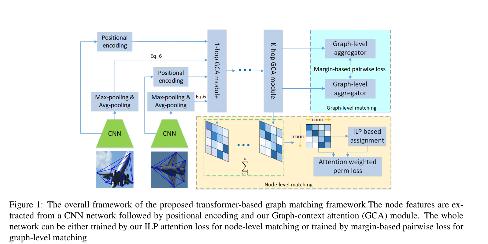

# Graph-Context Attention Networks for Size-Varied Deep Graph Matching

> **TL;DR:** GCAN combines spatial positional encoding, cross-graph attention and neighborhood self-attention. A dummy-node linear assignment model supports unmatched landmarks on both sides; supervised training uses an ILP-derived attention mask. A separate graph-pair-supervised regime studies correspondence learning without node labels.

## Motivation

Intersection-filtered visual benchmarks remove landmarks missing from either image, turning matching into an equal-size bijection. Real image pairs can instead contain outliers on both sides with an unknown common subset. The paper addresses this partial matching setting while learning node representations that use both within-graph structure and cross-graph evidence. Its second question is whether graph-level similarity supervision can support correspondence learning without labeled node matches (Sections1–3).

## Contributions

- Graph-context attention modules combining cross-graph comparison and within-graph aggregation.
- A linear integer assignment formulation with dummy row/column for unmatched nodes.
- An ILP attention loss emphasizing ground-truth matches and hard predicted matches.
- Equal-size, size-varied and graph-pair similarity experiments, with separately trained node-supervised and graph-supervised regimes.

## Methodology

**Features and attention.** VGG16 relu4_2/relu5_1 features are sampled at keypoints. A B-spline-kernel neighborhood message adds spatial positional information based on coordinate differences. Cross-attention uses channel-weighted feature inner products and aggregates differences from nodes in the other graph. Multihead self-attention aggregates local neighbors, followed by a residual update. The main implementation has three GCA modules; node similarities from successive modules are aggregated and normalized (Eqs1–8; Algorithm1).

*Original Figure1 with its complete caption from formal PDFp3/printed2345; extracted and visually checked.*

**Partial assignment.** A dummy row and column absorb unmatched real nodes. Every real source and target node must have exactly one assignment, possibly to the dummy; the dummy itself may receive multiple assignments. The objective minimizes the sum of selected negative-log neural match scores. The paper applies **branch and bound**, and the released implementation uses Gurobi. This is a **linear assignment objective over learned scores**. An optimal ILP solution establishes optimality for that objective and its constraints, not for an arbitrary original quadratic affinity model or ground-truth semantic matching. Although the paper calls its dummy-inclusive setting “non-injective,” the real-to-real part remains a partial one-to-one matching (Eqs10–14).

**Supervised loss.** A binary cross-entropy term is masked by$\max(a_{ii'},Y_{ii'})$, where$a$is the hard ILP prediction and$Y$ground truth. It retains positive labels and the current hard selected assignments instead of all negative entries. This changes training emphasis; it does not make neural features semantically correct by construction. The decoder constructs a new assignment without editing a complete incumbent (Eq15).

**Graph-level regime.** A channel-attention aggregator pools graph representations. A pairwise Euclidean-margin loss pulls positive graph pairs together and separates negative pairs. This regime uses **graph-pair labels** but no node-correspondence labels, so “unsupervised” in the paper means correspondence-unsupervised, not absence of all supervision. It is separate training rather than proof of one checkpoint jointly solving unrelated optimization tasks (Eqs9,16).

**Classification.** **Specialist / constructive.** The neural component learns fresh graph-matching scores and a classical decoder produces correspondences. Graph-pair similarity classification is an auxiliary studied regime; multiple visual datasets and object categories do not demonstrate a shared neural checkpoint across native optimization problems.

## Experiments

**Protocol.** PascalVOC uses7020training/1682test images with6–23inlier landmarks; SPair-71k uses58,724training/12,234test pairs. Willow uses the first20images per class for training and the remainder for testing. The reference graph uses Delaunay edges and target graph full connectivity. Adam learning rates are2e-5for VGG16 and2e-3for other modules; hardware is RTX2080Ti,32GBRAM and XeonW-2245 (Section4.1–4.2).

**Filtered matching.** With intersection filtering, mean keypoint accuracy is **82.3%Pascal**, versus80.4%NHGM-v2; **81.3%SPair**, versus79.1%NGM-v2; and **98.6%Willow**, versus97.8%NHGM-v2. Aggregate gains do not imply every-class wins. Pascal cat80.4is below NHGM-v2 81.8, cow80.8below81.3and sheep77.5below77.8. SPair boat77.5is below NGM-v2 80.5, cat73.2below BBGM74.6and motorbike78.1below79.3 (mainTable1; supplementTables1–2).

**Size-varied matching.** The unfiltered evaluation reports **F1**, accounting for false positives as well as missing correct matches. GCAN's mean is **64.6%**, versus BBGM61.4%and NHGM-v2 54.8%. There are class regressions against BBGM: bike66.7versus70.9, horse62.5versus63.4and motorbike63.5versus69.0. In the20,000test graph pairs,29%have equal sizes, size differences are at most14, and16,445pairs have at least one invisible node. This is evidence for that benchmark distribution, not arbitrary outlier counts or large graphs (mainTable3/Figures4–5).

**Ablations.** Baseline inner-product matching gives58.1%Pascal accuracy; adding cross-attention yields70.2, positional encoding79.4and self-attention82.3. With GCAN fixed, ILP attention loss82.3compares with BCE81.3and Hungarian attention81.2; some individual categories favor another loss. The cost-margin row40.2is a result for this substituted-loss experiment, not a universal assessment of BBGM (mainTables2,4; supplementTable3).

**Graph-level and correspondence-unsupervised results.** Positive/negative pairs reflect same/different category or subject identity. Bosphoros vessel data are split into600images from50subjects for training and600from another50for testing. ROC/AUC evaluates **pair classification**; the Pascal training curves separately show node F1 increasing with graph-level training. Bosphoros has **no node-level matching ground truth**, so supplementary node correspondences are qualitative and omit low-confidence matches. All supplementary panels were inspected. These plots do not establish numerical vessel-node matching accuracy or certify correspondence correctness.

## Limitations

The strongest keypoint results use annotated landmarks and node supervision, while graph-level training still needs pair labels. Graph-level AUC and node matching F1 measure different outcomes. Filtered accuracy and unfiltered F1 must remain separate, and displayed class/loss regressions qualify broad superiority statements. Point-estimate tables lack a full seed-confidence study, and no complete runtime comparison substantiates a universal speed claim.

The learned score and dummy calibration determine semantic quality even if a classical solver optimizes the resulting linear objective. This does not certify QAP optimality or guarantee valid semantic correspondences. Larger graphs increase attention, training and solver cost, a limitation explicitly acknowledged by the authors. The public implementation's correspondence-unsupervised training release remains incomplete according to its README.

## Reproducibility

**Identity.** Zheheng Jiang, Hossein Rahmani, Plamen Angelov, Sue Black and Bryan M.Williams all list Lancaster University. Official CVF CVPR2022 pagination is2343–2352. Identity-matched publisher-deposited metadata for DOI[10.1109/CVPR52688.2022.00238](https://doi.org/10.1109/CVPR52688.2022.00238)gives **2022-06**, with no unsupported exact day. No unverified arXiv identity is added.

**Complete science and figure.** All ten formal pages,31main references and all five official scientific supplement pages/nine references were read. All key equations, algorithms, tables, ROC/F1 plots and size-equal/size-varied/unsupervised visual examples were rendered and inspected. OriginalFigure1 plus its entire caption physically exists in public/paper-assets and was actually viewed.

**Official code inventory.** The paper links[ZhehengJiang/GCAN](https://github.com/ZhehengJiang/GCAN). The full148-member archive at commit`4785cc2e58a646893626f8a76abeb8c5c48e54b8`contains no additional PDF/ZIP/notebook science attachment. Its entire README specifies PyTorch≥1.6, PyG≥1.6, Gurobi≥9.1.2, NetworkX≥2.6.3and equal/size-varied configurations. It explicitly says **“Unsupervised training code is coming soon.”** Necessary inspection of `GCAN_model.py`and the complete `src/lap_solvers/ILP.py`confirms the Gurobi binary negative-log assignment, real-node constraints and dummy relaxation. No Gurobi/benchmark rerun or exhaustive implementation audit was performed.

**Actual internal references.** Main entries[1/6/7/8/9/23]explicitly cite [deep learning of graph matching](deep-learning-of-graph-matching.md), [PCA-GM](learning-combinatorial-embedding-networks-for-deep-graph-matching.md), [CIE-H](cie-h.md), [BBGM](deep-graph-matching-via-blackbox-differentiation-of-combinatorial-solvers.md), [QC-DGM](deep-graph-matching-under-quadratic-constraint.md)and [LCS](learning-combinatorial-solver-for-graph-matching.md). CIE-H's2019preprint-year citation maps to its identical-title/four-author formal work. The supplementary table's bare DGMC label has no corresponding full bibliography entry and is not turned into a citation edge. Distinct-title TPAMI extensions[14/26]are not merged into earlier conference IDs.
