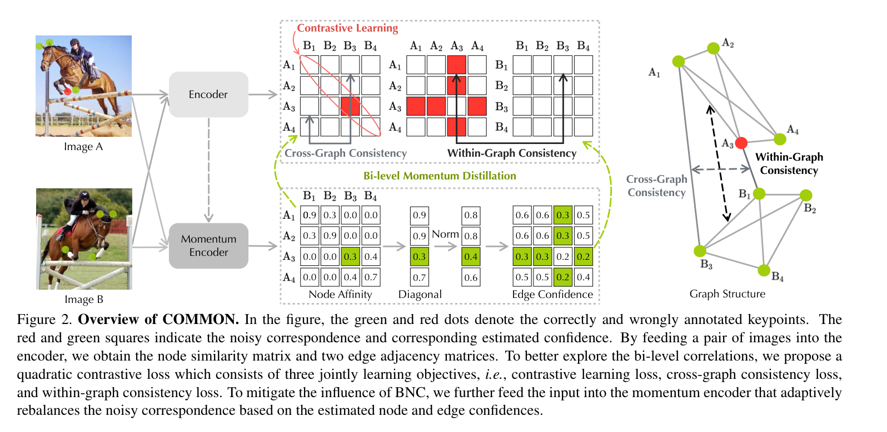

# Graph Matching with Bi-level Noisy Correspondence

> **TL;DR:** COMMON trains visual graph-matching features with contrastive and graph-consistency objectives, using a momentum teacher to soften noisy node labels and reweight edge penalties. Testing uses the base encoder and Hungarian assignment. Robustness is evaluated for noisy training annotations, separately from detecting arbitrary unmatched test nodes.

## Motivation

Manual keypoint annotations can be displaced or confused, corrupting both node-to-node labels and edge relationships derived from those nodes. The paper calls this bi-level noisy correspondence (BNC). This differs from correctly annotated graphs containing outlier nodes, or adversarial perturbations at test time. A model that learns every noisy correspondence as certain can contaminate its node representations and structural affinities (Sections1–2).

## Contributions

- A study of node-level annotation noise and its induced edge-level correspondence noise in visual graph matching.
- A quadratic contrastive objective combining node alignment, within-graph Gram-matrix consistency and cross-graph consistency.
- Momentum distillation that blends teacher soft targets with annotated node targets and reweights structural penalties.
- Three-dataset experiments, controlled coordinate noise, viewpoint-difficulty comparisons and objective ablations (Sections3–4; supplement).

## Methodology

**Representation and decision.** ImageNet-pretrained VGG16 features from relu4_2/relu5_1 are concatenated into1024-dimensional keypoint features. Delaunay edges with relative-coordinate attributes feed SplineCNN; a1024→256projection head and L2 normalization produce final node features. At test time the base encoder's cross-graph feature similarities feed **Hungarian assignment**. The introduced QAP formulation motivates structural learning, but the deployed decoder is linear assignment over neural similarities, not an exact optimizer of the entire quadratic objective (Section3.1/4.1; supplementArchitecture).

*Original Figure2 with its complete caption, extracted from formal PDFp4/printed23365 and visually checked.*

**Quadratic contrastive loss.** Training first aligns the annotated corresponding keypoints, retaining those with counterparts. Symmetric row/column contrastive cross-entropy encourages matched features to agree. Within-graph regularization compares$P_AP_A^\top$with$P_BP_B^\top$; cross-graph regularization compares$P_AP_B^\top$with$P_BP_A^\top$. Both are squared Frobenius penalties. These act on the aligned features during training and do not impose multi-graph cycle consistency or guarantee test-time semantic correctness (Eqs5–9).

**Momentum teacher.** An encoder with the same architecture tracks the base parameters by exponential moving average, coefficient0.995. The node loss mixes annotated identity targets with teacher soft alignment; mixing weight$\alpha$ramps from0to0.4during the first epoch, then stays0.4. Teacher-derived confidence on the annotated node pairs induces edge weights, reducing structural penalties associated with low-confidence endpoints. The final objective sums robust contrastive and robust graph penalties. The teacher supplies training targets and is removed for testing (Eqs10–14; supplementBroader Impact).

**Theoretical scope.** Theorem1 and its supplementary proof first relax injective assignments to independently selected one-hot rows and then smooth each row maximum with log-sum-exp. The resulting expression is the temperature-scaled contrastive cross-entropy objective, with normalization depending on the chosen sum/mean convention. This algebraic relation concerns the **row-relaxed, smoothed loss**; it does not make ordinary contrastive training an exact solver for the original column-constrained assignment or QAP. Noise resistance from an EMA teacher is motivated by empirical early-learning behavior, rather than a universal noise-identification theorem.

**Classification.** This is **specialist / constructive**: the neural model learns matching features and constructs a fresh assignment. EMA parameter updates and training-time feature consistency are not neural edits of a complete incumbent. Reusing architecture/hyperparameters across visual datasets does not demonstrate one checkpoint across native optimization tasks. The formal conference work and the differently titled later COMMON+ journal extension are distinct publications.

## Experiments

**Protocol and training.** PascalVOC uses7,020training/1,682test images across20classes and standard intersection filtering before matching. SPair-71k contains70,958pairs and follows the cited cropping/resizing and keypoint protocol. The paper states Willow has256images in5classes, ten landmarks per object and first20images per class for training; that stated count should be checked against the actual downloaded benchmark manifest when rerunning. Results measure **keypoint matching accuracy**, rather than F1 of a learned outlier subset. The main setup uses PyTorch1.10/Ubuntu20.04/RTX3090, Adam, learning rate3e-4, VGG fine-tuning rate2e-5 and batch8image pairs (Section4.1–4.2).

**Aggregate results.** Accuracy is **82.7% PascalVOC,84.5% SPair and99.1% Willow**. The strongest shown comparator means are ASAR81.1/83.1 on Pascal/SPair and QC-DGM97.7 on Willow, yielding1.6/1.4/1.4**percentage-point** improvements. These are aggregate displayed comparisons, not a claim of every-class superiority. Pascal bus is92.3 versus SCGM94.1; SPair horse is74.1 versus ASAR77.0, chair72.2 versus74.2, and sheep84.4 versus85.2. Willow car97.6 is below DGMC98.3 (Tables1–3).

**Controlled annotation noise.** On Willow training keypoints, displacement magnitude is sampled uniformly from0.1–0.2of bounding-box scale with uniform angle; selected-noise fractions range0–0.5. The plotted COMMON curve is highest among shown comparators throughout that sweep, while accuracy still declines as noise increases. At noise fraction0.3, the authors report average learned similarity about0.95for uncorrupted pairs and0.6for corrupted pairs. The overlapping score distributions do not establish perfect noise classification. These tests corrupt training coordinates, not arbitrary label permutations or missing-node patterns (Section4.3.1; Figure3).

**Viewpoint and ablations.** SPair easy/medium/hard accuracy is86.6/81.4/76.4, compared with ASAR86.5/79.1/72.5. Full-objective ablations report82.67/84.54on Pascal/SPair; removing graph consistency yields81.95/83.83 and removing distillation81.77/83.94. Plain InfoNCE gives81.33/83.38. The default$\alpha=0.4$has Pascal82.67, while0.2gives82.69, so the default is not the unique best displayed value. The tables report point estimates without a complete multi-seed confidence-interval study (Tables4–6).

**Cost and qualitative evidence.** The supplement reports about**1.4× training cost**relative to a base encoder and unchanged inference architecture, since only the base encoder remains at test time. This is not a claim of faster inference than all twelve baselines. The official repository README additionally states approximately9hours for Pascal and4hours for SPair on a3090. SupplementFigures5–6 show selected comparisons, with correct/incorrect counts; their successful examples do not replace the aggregate accuracy limits.

## Limitations

Training still needs annotated correspondences, known keypoints and ImageNet-pretrained visual features. The momentum teacher can inherit model biases; early memorization of clean patterns is an empirical motivation, not a guarantee that every mislabeled pair receives lower confidence. The synthetic displacement model covers one corruption mechanism and does not exhaust annotation errors.

The main filtered matching results do not establish performance for arbitrary test-time outliers, unseen task families, joint multi-graph cycles or hypergraph matching. These extensions are discussed as future directions. A feasible Hungarian assignment can be semantically wrong; neither its one-to-one constraints nor the smoothed-loss identity provides a correctness/optimality certificate. Additional training overhead, point-estimate reporting and protocol-specific comparisons should remain visible when judging the reported gains.

## Reproducibility

**Identity and dates.** Yijie Lin, Mouxing Yang, Peng Hu and Xi Peng list Sichuan University; Jun Yu lists Hangzhou Dianzi University; Changqing Zhang lists Tianjin University. Formal ICCV2023 pp23362–23371, DOI[10.1109/ICCV51070.2023.02135](https://doi.org/10.1109/ICCV51070.2023.02135), has identity-matched publisher-deposited `published` date **2023-10-01**. First[arXiv2212.04085](https://arxiv.org/abs/2212.04085)posting is **2022-12-08**; the cached v1/current primary pages have the same exact title and six-author identity, with current v3 dated2023-08-05. Scientific reading here uses the official conference and supplement, not an uninspected later extension.

**Complete science and figure.** All ten official CVF main pages, all60main references and all three official supplement pages were read. The supplement contains the complete row-relaxed loss proof, architecture dimensions/normalization, training-overhead discussion,19references and qualitative Figures5–6. Key mathematics, tables, architectures, noise plots and every qualitative panel were rendered and checked. The original Figure2 plus entire caption physically exists under the public paper-assets directory and was actually viewed.

**Code and inventory.** The paper links[XLearning-SCU/2023-ICCV-COMMON](https://github.com/XLearning-SCU/2023-ICCV-COMMON). Its complete76-member archive at commit`9db3bbeda7a14f60f2f27e19d18365239a3d36f7`contains no additional PDF/ZIP/notebook science attachment. The full README documents Docker/PyTorch1.10/CUDA11.3/PyG2.0.3, OR-Tools dependency, dataset setup, separate experiment configurations and pretrained-weight links; its older manual environment is expressly not guaranteed by the authors. Necessary model-path inspection confirms Hungarian evaluation and a training-only momentum network. Current ThinkMatch also includes the method, but unrelated papers named in that repository are not treated as this paper's bibliography. No training or benchmark rerun was performed.

**Actual internal references.** The full bibliography cites [DGMC](deep-graph-matching-consensus.md)[11], [QC-DGM](deep-graph-matching-under-quadratic-constraint.md)[13], [SCGM](self-supervised-learning-of-visual-graph-matching.md)[30], [SIGMA](sigma-matching.md)[33], [EAGM](adaptive-edge-attention-for-graph-matching-with-outliers.md)[37], [ASAR](appearance-and-structure-aware-robust-deep-visual-graph-matching-attack-defense-and-be.md)[39], [BBGM](deep-graph-matching-via-blackbox-differentiation-of-combinatorial-solvers.md)[40], [PCA-GM](learning-combinatorial-embedding-networks-for-deep-graph-matching.md)[47], [LCS](learning-combinatorial-solver-for-graph-matching.md)[51], [CIE-H](cie-h.md)[58], [DLGM](deep-latent-graph-matching.md)[59] and [GMN](deep-learning-of-graph-matching.md)[60]. CIE-H's preprint-year citation maps to its same-title/four-author formal representative. References48–49 are distinct journal expansions and are not merged with different conference papers.
