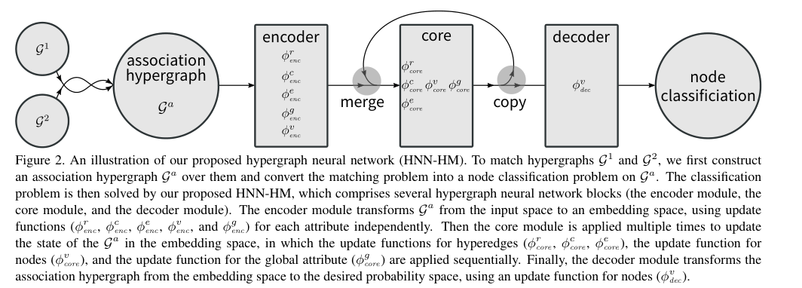

# Hypergraph Neural Networks for Hypergraph Matching

> **TL;DR:** HNN-HM predicts correspondences by recurrent message passing on an association hypergraph, incorporating higher-order geometry and row/column competition. Row-softmax scores are projected by Hungarian at test time. The evidence concerns supervised, sampled third-order geometric matching, not exact higher-order assignment or an image-feature CNN trained by this method.

## Motivation

Pairwise graph matching captures relations between two nodes, while triangles/higher-order structures can encode richer geometric relationships. Classical hypergraph solvers usually optimize handcrafted affinities. HNN-HM instead learns both representation and correspondence scoring on an association hypergraph built from candidate node pairs, extending association-graph neural matching to higher-order structure (Introduction, RelatedWork).

## Contributions

- A hypergraph network with hyperedge, node and global attribute updates.
- An association-hypergraph representation of candidate correspondences, including explicit row and column hyperedges.
- Recurrent encode–process–decode computation with directed or permutation-insensitive hyperedge variants.
- Experiments on synthetic points, CMU House, Willow and Pascal VOC using third-order geometric matching.

## Methodology

**Combinatorial problem.** Given two hypergraphs, a partial permutation matrix indicates one-to-at-most-one node correspondence. A higher-order affinity tensor defines the multilinear assignment objective in Eq5. Association node $(i,j)$ represents a candidate correspondence; association hyperedges connect tuples of candidates induced by hyperedges from the two inputs. Row/column hyperedges join candidates sharing an original node, exposing assignment competition to the network (Sections3,5.1).

*Original Figure2 and its complete caption, formal PDFp2/printed1267; extracted and visually checked.*

**Neural computation.** MLP encoders independently embed node, hyperedge, row, column and global attributes. The same core block runs ten times, concatenating its preceding state with encoder output. It updates hyperedges from incident nodes, nodes from incident hyperedges, and global attributes from the collection. Directed hyperedges use ordered endpoint features and sum aggregation. The undirected variant uses multihead attention in node–association-hyperedge aggregation; other reductions remain sums. Averaging encoded features over six triangle permutations supports an order-insensitive, more memory-efficient third-order representation (Eqs6–27, Figure3).

**Discrete decoding and learning.** A node MLP and row-wise softmax produce correspondence scores. Row normalization alone does not impose column exclusivity, so the **Hungarian algorithm** projects scores to a hard partial assignment in testing. Binary cross entropy against annotated assignments trains the network using AMSGrad and learning-rate decay. Hungarian solves this score-based linear projection; it does not certify the original arbitrary higher-order objective. Recurrent hidden-state processing is not neural editing of a complete hard incumbent (Sections5.4–5.5).

**Input and scope.** The reported experiments use **point coordinates only**, not learned image CNN descriptors. Unary affinities are zero for classical comparators; triangle-angle descriptors define their higher-order affinities, while HNN-HM directly consumes merged point-coordinate attributes. TM-style sampling prunes association hyperedges. The abstract network permits different graph sizes with fixed hyperedge order, but the reported task family remains geometric hypergraph matching. This supports **specialist / constructive**, without a cross-native shared-checkpoint claim.

## Experiments

**Synthetic/CMU protocols.** Synthetic noise tests use20inliers and noise parameter0–.2; outlier tests use10inliers,1.5scale,.03noise and0–100outliers. Curves average100problem runs, which is not a100-independent-training-seed confidence analysis. CMU House has111frames/30keypoints;23uniformly sampled frames train the method. Tests vary temporal gaps or remove points from one graph. The text describes averaging all eligible frame pairs but does not provide a strict disjoint frame-pair manifest; this should not be presented as independently verified unseen-sequence generalization. Figure5 accuracy is near100% on this single-object sequence.

**Willow.** Twenty images per class train the model;1000test pairs per class evaluate it. Ten labeled landmarks are used, with a separate setting appending five SIFT-detected outliers. Mean accuracy is **96.8% without outliers**, versus the strongest displayed classical mean87.1, and **85.2% with five outliers**, versus61.9. Individual exceptions qualify universal superiority: with outliers, wine-bottle93.3is below BCAGM94.6/BCAGM394.5. Undirected96.8and directed96.5have comparable clean means; the preferred undirected variant reduces representation memory (Table1).

**Pascal.** The filtered dataset has7020training/1682test images,20classes and at least three shared points per selected test pair;1000pairs are sampled per class. Mean accuracy is **68.0%**, versus44.1for the strongest displayed classical mean. Bottle accuracy **87.3** remains below TM93.2 and several alternatives. These comparisons concern the seven listed classical third-order solvers using the stated geometry protocol, rather than every contemporary visual deep matcher under different descriptors/splits (Table2).

**Evidence limits.** Figures4–5 show robustness curves but no objective-gap certificate, comprehensive wall-clock scaling table or rigorous multi-seed confidence intervals. Association-hyperedge sampling and triangle-permutation merging change computational cost; the paper does not establish scalability to arbitrary dense high-order tensors or equally strong performance for every hyperedge order.

## Limitations

The assignment objective is combinatorial, and learned classification plus Hungarian score projection has no reported exactness, approximation-ratio or monotonic-improvement guarantee. Row/column hyperedges encode competition but do not themselves prove hard feasibility. Sparse sampled hyperedges, known points and supervised labels delimit the experiments. Changing point distributions, hyperedge order or native optimization task is not validated by the architectural ability to accept different graph sizes.

**Printed/code distinctions.** Rendered Eq28 prints a positive distance exponent for classical affinity, whereas the current official `utils/create_tensor.py`47–50uses `exp(-distance/scale)`. Synthetic prose prints noise$N(\sigma,1)$, whereas the current generator uses zero-mean standard-normal noise multiplied by the deformation parameter. The note preserves these source differences instead of silently changing the formula or inferring that historical comparison tables are invalid.

## Reproducibility

**Identity/date.** Xiaowei Liao and Yong Xu list South China University of Technology/Peng Cheng Laboratory; Yong Xu additionally lists the Communication and Computer Network Laboratory of Guangdong. Haibin Ling lists Stony Brook University. ICCV2021 DOI[10.1109/ICCV48922.2021.00130](https://doi.org/10.1109/ICCV48922.2021.00130) metadata gives **October2021 month precision**. CVF's actual reading pages1266–1275differ from the DOI/repository citation's1246–1255. No unverified arXiv identity or exact publication day is added.

**Complete science and assets.** All ten formal CVF pages and all45references were read. The association formulation, recurrence/update equations, hard-decoding statement, both tables and all robustness plots were rendered and inspected. CVF lists only the main PDF; the author publication page lists that paper and official code without an independent supplement. The full268member source archive contains no PDF/ZIP/notebook scientific attachment. OriginalFigure2 plus the entire caption physically exists under public/paper-assets and was actually viewed.

**Code.** Official[xwliao/HNN-HM](https://github.com/xwliao/HNN-HM), commit`44732bc18d479295940056649518069c2586d743`, includes separate dataset training/evaluation targets. Its full README documents data download, Docker environment/TITAN-V12GB, compilation and pretrained testing commands. Necessary inspection of `utils/hungarian.py`9–18and `utils/eval_hypergraph_matching.py`39–54confirms score-based Hungarian projection; `utils/create_tensor.py`and `utils/make_matching_problem_synthetic.py`clarify the two printed-code discrepancies. No training or benchmark rerun was performed.

**Actual internal references.** Full bibliography identities are[DGMC](deep-graph-matching-consensus.md)(12,p9),[BBGM](deep-graph-matching-via-blackbox-differentiation-of-combinatorial-solvers.md)(30,p9),[blackbox differentiation](../studies/blackbox-backprop.md)(35,p10),[PCA-GM](learning-combinatorial-embedding-networks-for-deep-graph-matching.md)(36,p10),[LCS](learning-combinatorial-solver-for-graph-matching.md)(39,p10),[CIE-H](cie-h.md)(41,p10) and[deep learning of graph matching](deep-learning-of-graph-matching.md)(42,p10). Reference37 is the different-title NGM journal extension and is not merged into an earlier conference-paper target.
