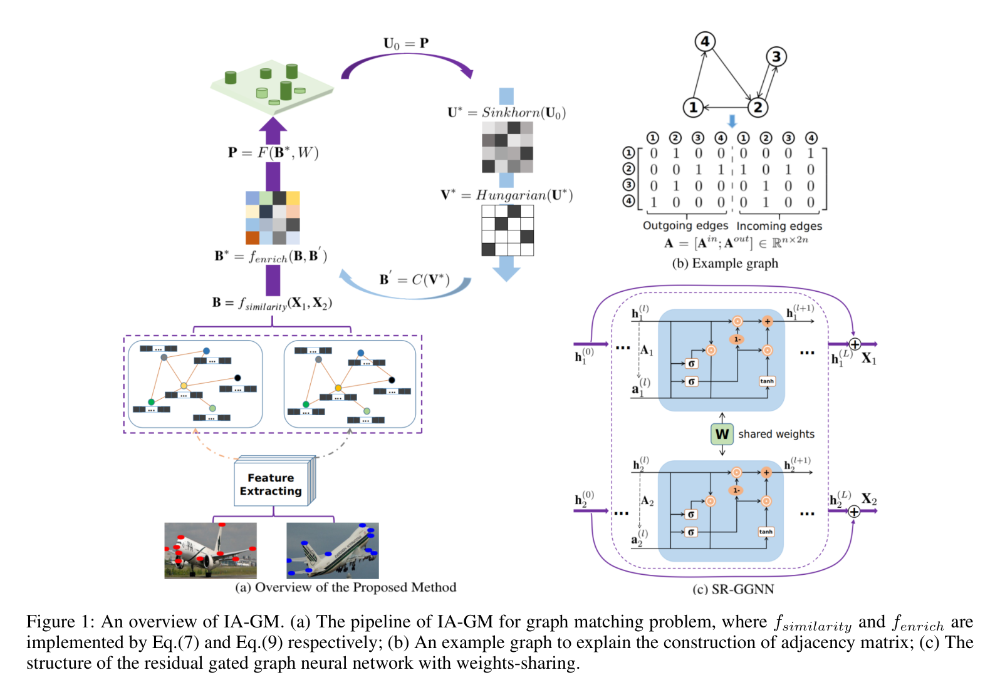

# IA-GM: A Deep Bidirectional Learning Method for Graph Matching

> **TL;DR:** IA-GM constructs a discrete graph matching, feeds its hard permutation back into learned affinity fusion and repeats Sinkhorn/Hungarian decoding. The method supports supervised or self-consistency training. Hard-assignment refinement is real; monotone objective improvement and exact QAP optimality are not guaranteed.

## Motivation

Feedforward matching systems learn affinities and then decode correspondences, with optimization influencing learning mostly through gradients. IA-GM explicitly feeds the current combinatorial solution back into its learned similarity representation. The aim is to combine local graph embeddings with global correspondence information, including when correspondence labels are unavailable (Introduction/Methods).

## Contributions

- Bidirectional alternation between learned graph affinities and discrete Sinkhorn/Hungarian matching.
- Feature enrichment by mixing the original similarity with similarity after reordering features using the current hard assignment.
- A shared residual gated GNN incorporating incoming, outgoing and self-node messages.
- Supervised Pascal/directed-graph tests, unsupervised CMU tests and cumulative component ablations.

## Methodology

**Features and representation.** CMU House/Hotel uses shape-context descriptors; Pascal uses interpolated pretrained VGG16 relu4_2/relu5_1 features. A Siamese residual gated GNN shares parameters between the two graphs. Incoming, outgoing and self-node linear messages are concatenated/projected into a GRU update, followed by a residual connection from initial features. One propagation layer is used in the reported setting to limit oversmoothing. Learned transforms and inner-product/cosine comparison produce similarity matrix$B$(Eqs2–7).

*Original Figure1, all three panels and the complete caption, formalPDFp4/printed3477; extracted and visually checked.*

**Discrete feedback.** The first round constructs a matching from learned similarities. Subsequent rounds use hard permutation$V$to reorder each graph's features into the other's order, recompute similarity$B'$and form$B^*=\alpha_1B+\alpha_2B'$. A learned weighted softmax, Sinkhorn normalization and **Hungarian** projection generate the next complete discrete assignment. The released supervised/unsupervised forward passes both perform this process for four rounds, with the first round using only$B$and the next three explicitly consuming the preceding hard matching (Eqs8–14).

**Learning regimes.** Supervised training minimizes permutation BCE against annotated matches. The unsupervised alternative maximizes log probability on the current hard Hungarian assignment plus parameter regularization: this is self-consistency/pseudolabel learning, not additional human correspondence supervision. It can also be combined with the supervised loss. A self-consistent wrong assignment is not ruled out, and the paper does not prove convergence to true matches (Eqs15–16).

**Optimization scope and classification.** Hungarian optimizes a linear assignment derived from the current neural score. It does not solve the original arbitrary Lawler QAP exactly, nor does the feedback loop prove that every round improves a fixed objective. **Specialist / constructive-improvement** is supported by both the paper and actual forward code: a first fresh assignment is followed by neural refinement of a **complete hard incumbent**. This classification reflects that discrete feedback, not merely the presence of iterative continuous embeddings. Separate models/protocols for directed and undirected image matching do not show a shared checkpoint across native optimization tasks.

## Experiments

**Pascal protocol.** The paper describes3510training and841test annotated image pairs across20semantic classes. Its“cross-class”setting samples training/testing pairs from the collection of classes; this should not be read as an explicit held-out-category evaluation. The“in-class”setting trains/tests within each class. Graphs use Delaunay edges, temperature.05, softmax scale40, four IA rounds and fusion weights.75/1.25. The paper does not present a comprehensive unknown-outlier benchmark or full multi-seed confidence study (Supervised Learning).

**Accuracy.** Cross-class mean accuracy is **66.58%**, versus PCA-GM63.90and SR-GGNN PIA-GM63.60; in-class68.84versus PCA-GM65.24. These gains are percentage points, not universal dominance: cross-class car68.01is below PCA68.88, chair38.88below39.86, bike66.60below SR-GGNN66.92, and in-class bottle80.28below PCA80.82/plant87.39below88.38 (Table1).

**Directed graphs.** Cars/Motorbikes comprise30/20image pairs,60%training/40%testing and15–52inliers. Fusion weights1.25/.75favor original features. Accuracy is **94.8%cars and92.6%motorbikes**, mean93.7versus FGM-D92.6. The motorbike result remains below FGM-D95.5; the method's mean advantage does not imply every dataset wins (Table2).

**Unsupervised CMU.** House/Hotel contain111/101images and use fusion weights.5/1.5. Accuracy is **99.5/97.8%**, reported mean98.7, versus the cited unsupervised comparator99.8/94.8, mean97.3. House is therefore a regression, while Hotel improves. Comparator values are taken from the cited earlier study rather than a newly documented common implementation rerun. This protocol still supplies matching graph pairs/descriptors; it does not demonstrate training from arbitrary unrelated images without pairing information (Table3).

**Ablations.** The cumulative sequence yields58.95%for a simple feature baseline,63.04with SR-GGNN,66.10with feedback,66.32with learned similarity and66.58with the probability mapping. Feedback's3.06-point gain is measured conditional on the already added SR-GGNN, not an independent leave-one-component-out estimate. Point estimates, one propagation layer and fixed four-round execution delimit the evidence. No common end-to-end runtime table establishes a universal speed advantage (Table4).

## Limitations

Known keypoints and visual descriptors/pretrained features remain necessary; supervision regimes and graph-pair assumptions differ across datasets. Hard assignments can be feasible but semantically wrong, and self-consistency can reinforce errors. Neither Sinkhorn sharpening nor Hungarian feasibility certifies general-QAP optimality, and no accept-only-improving rule is specified for the neural feedback rounds.

The datasets are relatively small, directed and undirected models use different settings, and class/dataset regressions qualify broad superiority statements. The paper mentions extending feedback to other QAP networks as a possibility, rather than reporting one universal shared checkpoint. The later differently titled **IA-NGM** journal work is a distinct publication and is not silently substituted for this conference paper.

## Reproducibility

**Identity and date.** Kaixuan Zhao, Shikui Tu and Lei Xu list Shanghai Jiao Tong University/its CMaCH center. Formal AAAI2021 is35(4),3474–3482, DOI[10.1609/aaai.v35i4.16461](https://doi.org/10.1609/aaai.v35i4.16461). Identity-matched publisher-deposited metadata gives **2021-05-18**, distinct from the February conference. No unverified arXiv identity is added.

**Complete science.** All nine formal CDN pages and their entire bibliography were read. Key formulas, architectural panels, all tables and qualitative examples were rendered and inspected. The paper, author-lab publication listing and complete official source archive were checked; no explicit additional scientific appendix or repository science PDF/ZIP/notebook is identified. OriginalFigure1 with every panel and the complete caption physically exists under public/paper-assets and was actually viewed. A separate conference-talk listing does not supply extra read pages and was not counted as scientific coverage.

**Code.** The official[CMACH508/2021-IA-GM](https://github.com/CMACH508/2021-IA-GM)archive has1236members at commit`ca3c93dba88703ff19d4b5a3eee36ad25a7c9d95`, including bundled data but no PDF/ZIP/notebook science attachment. Its entire README documents PyTorch1.1+, SciPy, ninja/tensorboardX, dataset setup, supervised/unsupervised configurations and evaluation. Necessary inspection of `BIIA/model_IA.py`95–110and `model_unsup.py`68–84confirms the first learned construction and later hard-Hungarian feedback rounds. These are current source facts; no training or benchmark rerun was performed.

**Actual internal references.** The full bibliography cites[PCA-GM](learning-combinatorial-embedding-networks-for-deep-graph-matching.md)(Wang2019a,p8),[LCS](learning-combinatorial-solver-for-graph-matching.md)(Wang2020,p9),[CIE-H](cie-h.md)(Yu2020,p9), and[deep learning of graph matching](deep-learning-of-graph-matching.md)(Zanfir2018,p9). The separately titled NGM hypergraph/multiple-graph preprint is not merged into an earlier different-title conference entry. Other general graph-neural, Sinkhorn and classical matching references are not converted into unrelated catalogue edges.
