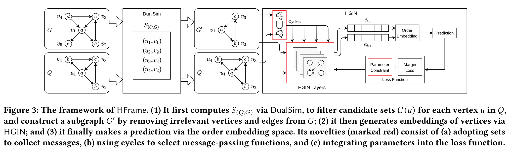

# Improving Subgraph Matching by Combining Algorithms and Graph Neural Networks

> **TL;DR:** HFrame combines a dual-simulation candidate filter with a learned pivot-conditioned homomorphism classifier. It trades exact decision/enumeration guarantees for speed and tested accuracy; its neural filtering must not be described as preserving an exact solver's recall.

## Motivation

Directed, labeled **subgraph homomorphism** permits several query vertices to map to the same data vertex, while preserving labels and directed labeled edges. This is distinct from one-to-one graph alignment and from the paper's induced-isomorphism definition. Exact search can be costly; local simulation is fast but may admit false positives. HFrame combines these approaches with learning. Its primary output is a decision about whether a pivot correspondence extends to a homomorphism, rather than an explicit certified full map (Sections 1–3).

## Contributions

- Filter query-to-data candidates with DualSim and remove irrelevant data-graph vertices before learned evaluation.
- Introduce HGIN: identity-aware, relation/direction-sensitive message passing with duplicate-message removal and cycle-conditioned root treatment.
- Analyze idealized expressivity and state a bounded-parameter Rademacher-complexity result, subject to the proof limitations below.
- Evaluate approximate decisions, dataset transfer, neural filtering before enumeration, and support estimation for frequent-pattern mining (Sections 3–5; Appendix A).

## Methodology

**Candidate filter.** Initialize candidates by vertex labels and iteratively remove candidates lacking compatible incoming/outgoing neighbors. Full dual simulation is a necessary relaxation, not a sufficient homomorphism test. The experiments use **two iterations**, which should not be confused with running the displayed algorithm to its maximum fixed point. HGIN checks candidates for a selected query pivot, for example a maximum-degree vertex (Sections 2–3).

**Learned decision.** Construct local query/data ego graphs. Remove duplicate received messages to accommodate many-to-one mappings; use separate transformations for edge relations and incoming/outgoing directions, and distinguish a root through identity-sensitive messages. Query cycle lengths affect whether root-specific transformations are used. The paper compares embeddings using the squared positive-part discrepancy M(a,b)=‖max(0,a−b)‖² and a threshold, with an additional parameter-gap regularizer in training. This is supervised classification of candidate extendability, not an exact reconstruction certificate (Section 3, Equations 1–8).

*Original Figure 3 and complete caption, extracted from arXiv v2 PDF p5 and visually checked.*

**Scope and downstream search.** This is specialist / constructive decision and solver-control learning. There is no neural edit of an incumbent complete map and no demonstrated cross-native-task shared checkpoint. In the enumeration application, the learned classifier removes pivot candidates before classical PJ searches the survivors. False negatives can remove genuine solutions; subsequent exact checking does not restore those discarded candidates. Synthetic-to-real transfer remains positive evidence within homomorphism decision (Section 5).

## Experiments

**Labels and protocol.** For each source graph, sample 20,000 query/ego-graph pairs: 5,000 positives and 15,000 negatives, with an 8:1:1 train/validation/test split. Queries typically have 3–20 vertices; positives include copied vertices/edges to exercise noninjective semantics. The authors use Neo4j to confirm ground truth, rather than assuming every edge perturbation is negative. Six real source graphs plus synthetic graphs are evaluated; large source-graph sizes should not be mistaken for every neural input being the entire graph. Some comparisons remove edge labels because baselines do not support them (Section 5).

**Approximate accuracy.** HFrame's printed accuracies are **0.954/0.982/0.969/0.963/0.969/0.921/0.974** for Citation/Citeseerx/DBLP/IMDB/DBpedia/YAGO/Synthetic. They exceed the listed learned/simulation baselines, while exact algorithms are separately described as accuracy one. D2Match has out-of-memory entries on three datasets. These are classification accuracies on the stated imbalanced test distribution, not percentages of certified optimal or fully reconstructed solutions (Table 1).

**Time comparison.** HGIN runs on Tesla V100 GPU while classical exact algorithms run on Xeon CPU; DualSim runs on CPU. A thirty-second limit applies to exact search, with a separate positive-only experiment returning one match. The reported 101.91× comparison is against EJ under this protocol, not a guarantee of that speedup for every query or an equal-accuracy comparison. HFrame is slower than NeuroMatch in the main timing table. A separate CPU-only table reports mean matching time 0.074 s versus 0.026 s for GPU HFrame; timing domains and denominators must remain distinct (Tables 2–4).

**Transfer and difficult regimes.** Synthetic-trained models reach **0.821/0.892/0.874/0.872/0.853/0.824** on the six real datasets. These Table 6 entries contradict prose saying all exceed 0.860; the introduction also associates some values with different datasets. This note uses the actual labeled table. Query size, graph density and large embedding dimensions can reduce accuracy: the dimension sweep reaches 0.758 at d=512, versus 0.954 at d=64 in that experiment (Tables 5–6).

**Downstream tradeoff.** On Citation/DBLP, adding HFrame to PJ changes F1 from **1.000/1.000 to 0.832/0.835**, while time changes from 1.681/1.926 s to 0.762/0.780 s. This is an explicit loss of exact enumeration coverage, even though the remaining candidate checks are exact. Frequent-pattern support estimates for the printed eight patterns agree with the exact row, at 159.35 s versus SPMiner's 151.89 s; agreement on those patterns is not a global exactness result (Tables 7–8).

## Limitations

**Theory versus deployment.** The expressivity arguments idealize injective/monotone functions and root-sensitive message behavior; learned finite networks and two filtering iterations do not automatically realize every such construction. Theorem 4.4 assumes bounded parameter/feature norms and states a Rademacher bound. Appendix A.4 supplies only a five-step outline and explicitly omits details; it is not a complete checked derivation for every implementation component or a graph-matching optimality guarantee.

**Curator mathematical boundaries.** Subtracting the constant alpha from a loss does not change its Lipschitz constant, so that operation alone cannot establish the printed 1-Lipschitz claim for the squared discrepancy. The reciprocal message/parameter-gap term also needs separation from a zero denominator; upper norm bounds alone do not supply that separation. Those conditions are not established in the displayed proof. Separately, for two nonnegative unit-L2 vectors, coordinatewise a≤b implies equality, so the paper's normalized zero-threshold order relation cannot encode a strict order between distinct such vectors. The implemented positive threshold is an approximate classifier, and the archived implementation differs from that normalization description. These observations limit the printed theory/interpretation; they do not assert that empirical results disappear (rendered pp5–7/12).

**Scope of neural filtering.** Approximate homomorphism decisions may contain false positives and negatives. Stronger learned classification does not imply a safe pruning rule for an exact enumerator. A fixed collection of cycle features and finite message depth also provides no general polynomial-time solution to the full decision problem.

## Reproducibility

**Identity/dates/version.** The eight-author primary byline, affiliations at Beihang University and TravelSky/Beijing Engineering Research Center of Civil Aviation Big Data, and DOI [10.1145/3711896.3737006](https://doi.org/10.1145/3711896.3737006) match the publisher deposit. Formal KDD 2025 publication is **2025-08-03**. `date` records the first [arXiv2507.20226](https://arxiv.org/abs/2507.20226) posting, **2025-07-27**. The actual main reading copy is **v2, 2025-12-17**, twelve pages, including all 92 references and Appendices A.1–A.5; its bytes are not asserted identical to the separately paginated formal proceedings version.

**Scientific material and figure.** All twelve source pages were read, including complete proof text, the omitted-proof statement, and the complex-query example. Key equations, algorithms, theory and all result tables were rendered and checked. The paper's official availability link is [Zenodo15572826](https://zenodo.org/records/15572826). Its 2,186,935-byte v1.0.0 ZIP was downloaded, its published MD5 verified, and every archive member inventoried: code, a short README, dependency/license files and example graph binaries, with no additional scientific PDF or appendix. The current author GitHub tree at `dc09f0f69fc610b7e4db7874d229a27cf8bd21b6` is untruncated and likewise has no separate scientific PDF/ZIP. The original figure asset exists under the correct public directory and was actually viewed.

**Implementation differences.** The archived `model.py` lines399–421 implement the squared hinge discrepancy and optional reciprocal **parameter-norm** difference; lines388–397 expose optional absolute/nonnegative transforms, without the displayed final unit-L2 normalization. Archived defaults use four layers, margin 1.0 and threshold 0.5, versus five/1.5/0.1 in the paper. These are concrete configuration/version differences, not proof of how every reported run was launched. The short archived example command also expects input artifacts beyond the bundled query/target binaries, including `graph.dgl` in the selected raw directory; full real-data preparation/checkpoints are not supplied by that command. No training or benchmark rerun was performed.

**Actual internal references.** The complete bibliography explicitly cites [D2Match](d2match.md) [51], used as a learned baseline, and [Interpretable Neural Subgraph Matching for Graph Retrieval](interpretable-neural-subgraph-matching-for-graph-retrieval.md) [58], in related work. Internal edges reflect these exact identities, rather than general topical relatedness.
