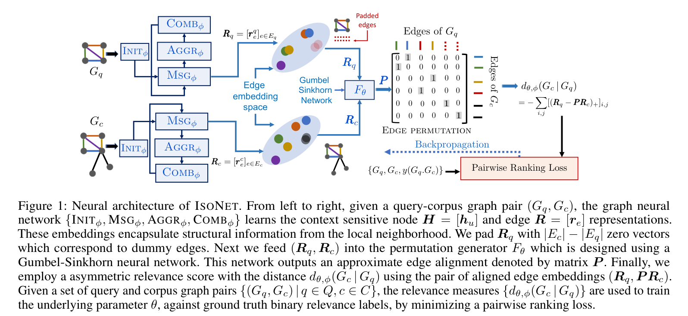

# Interpretable Neural Subgraph Matching for Graph Retrieval

> **TL;DR:** ISONET learns an asymmetric subgraph-retrieval score by matching context-sensitive edge embeddings with Gumbel-Sinkhorn. Hungarian decoding provides illustrative hard edge correspondences. Retrieval quality and these correspondences are distinct from certified node-subgraph isomorphism.

## Motivation

A query graph can be contained in a larger corpus graph despite extra corpus structure. Symmetric whole-graph distances can penalize precisely that extra structure, while independently matched nodes can ignore edge relationships. The paper therefore learns a directional coverage score using binary graph-pair relevance labels, without annotated node or edge alignments (Sections1–3).

## Contributions

- A neural edge-alignment architecture with a directional positive-part embedding discrepancy.
- End-to-end graph-pair ranking through a Gumbel-Sinkhorn relaxation, trained using coarse relevance labels.
- Feature-agnostic subgraph-retrieval experiments on six sampled graph datasets, ablations of alignment/scoring, and qualitative Hungarian edge correspondences.
- Additional 300-query experiments, per-query gains and losses, training details and stored reproducibility notebooks in the scientific appendix and official repository.

## Methodology

**Representation.** All nodes begin with the same scalar feature1; chemical attributes are not used. A linear initialization produces10-dimensional node states. Message passing uses20-dimensional messages, summation and a GRU, repeated five times. Contextual edge representations concatenate endpoint information. Query edges are padded with dummy zero rows to the corpus edge count (Section3; AppendixD.1).

*Original Figure1 and its entire caption, extracted from formal PDFp4/printed8118 and visually checked.*

**Soft assignment and score.** A shared linear-ReLU-linear transform produces16-dimensional features for the alignment module. Pairwise transformed similarities feed20 Gumbel-Sinkhorn iterations at temperature0.1. The resulting soft edge-permutation matrix$P$ aligns the original edge embeddings. The score is the negative sum of coordinatewise positive parts of$R_q-PR_c$: a query feature exceeding its aligned corpus feature is penalized, while extra corpus evidence need not be. A positive/negative graph-pair hinge ranking loss trains the encoder and alignment module jointly (Eqs6–10,19).

**Discrete output and its responsibility.** Ranking uses the **soft** alignment score. AppendixE.3 additionally applies **Hungarian assignment** to that matrix and displays hard edge-to-edge correspondences for graph pairs with planted isomorphisms. This is a genuine discrete matching component, but a permutation of edges alone does not enforce an injective, adjacency-consistent node mapping. The paper's node-consistency diagnostic counts such violations; neither the differentiable relaxation nor its ranking loss is an exact subgraph-isomorphism certificate. AppendixB's optimization derivation motivates the learned assignment costs; it does not establish that a trained network recovers the combinatorial optimum on arbitrary graphs.

**Classification.** **Specialist / constructive.** The model constructs an edge alignment for graph retrieval, including a hard decoder for explanations, rather than editing a complete incumbent. Six graph datasets remain one native graph-matching/retrieval task; no shared checkpoint across distinct optimization problems is demonstrated.

## Experiments

**Protocol.** PTC-FR/FM/MM/MR, MUTAG and AIDS supply graphs from which BFS-based induced subgraphs of7–15nodes are sampled. Each original experiment uses100queries and800corpus graphs, with NetworkX VF2 generating binary relevance labels for80,000pairs. Queries split60/15/25 for training/validation/test against the same corpus pool. This is a held-out-query ranking protocol, not a held-out-corpus or exact-solver benchmark. Mean average precision (**MAP**) and mean reciprocal rank (**MRR**) measure ranking. Baselines use the same constant features and ranking loss; NeuroMatch receives no anchor-node annotations, which differs from its anchored setting (AppendixC–D).

**Main results.** In FR/FM/MM/MR/MUTAG/AIDS order, ISONET's MAP is **.857/.901/.906/.894/.920/.894**; GMN-match yields.774/.783/.837/.805/.909/.835. ISONET MRR is.960/1.000/.980/.970/.940/1.000. It does not win every metric: GMN-embed scores **.947 versus.940 on MUTAG MRR**. Symmetric ISONET slightly exceeds the asymmetric version on FR MAP (.858 versus.857), and symmetric ISONET has better MR MRR (1.000 versus.970). Node alignment with node loss also exceeds ISONET on MR/MUTAG MRR (1.000/.980 versus.970/.940). Thus the asymmetry and edge-alignment trends have explicit exceptions (main tables; AppendixTables10–11).

**Additional evaluation.** The already-trained models are also evaluated with300queries and800corpus graphs. MAP is.91/.92/.92/.92/.93/.92, with displayed standard errors about.01 **across queries**, not training seeds. Welch tests report MAP significance except MUTAG, and MRR significance except MR/MUTAG. ISONET improves per-query AP over GMN-match on84.0%,94.7%,83.0%,81.0%,51.0%,84.3% of the queries in FR/FM/MM/MR/MUTAG/AIDS order; the remaining cases include losses or ties. The histograms and planted-alignment examples illustrate behavior without guaranteeing valid alignments for every pair (AppendixE; Tables13–14/Figures12,15).

**Training and cost.** Adam uses learning rate1e-3, weight decay5e-4 and validation-MAP early stopping with50epochs patience. Margins are selected over1to.001 per model/dataset, generally.5 (.1for GOTSim). The2028-parameter ISONET is close to several comparator sizes, but not all: GOTSim has304parameters. MainFigure3 plots validation MAP against **training hours**, with authors reporting at least5× faster training progress than GMN-match on AIDS/PTC-FR. This is not a universal end-to-end inference speedup or exact-QAP runtime comparison.

## Limitations

The task is feature-agnostic, graph-level supervised retrieval over small sampled subgraphs. Learned edge compatibility does not impose all node consistency constraints. A high MAP or MRR does not mean the method outputs a valid subgraph witness, correctly solves every binary decision, or certifies optimality. Supplementary violation distributions include nonzero violations.

The shared corpus, limited node sizes, query-level standard errors, hyperparameter selection and modified anchor-free baseline protocol constrain generalization claims. Aggregate gains coexist with metric, dataset and individual-query regressions. The larger-query experiment increases the number of retrieval pairs rather than demonstrating matching of much larger graphs. The scientific appendix and repository notebooks supply extra evidence, not independent replications.

## Reproducibility

**Identity.** Indradyumna Roy, Venkata Sai Baba Reddy Velugoti, Soumen Chakrabarti and Abir De all list IIT Bombay. The formal AAAI2022 publication is36(7),8115–8123, DOI[10.1609/aaai.v36i7.20784](https://doi.org/10.1609/aaai.v36i7.20784). Its identity-matched publisher-deposited publication date is **2022-06-28**, distinguished from conference timing. No unverified arXiv identity is introduced.

**Complete material.** All nine formal pages and all nine author-hosted appendix pages (printed8–16) were read, including references, dual derivation, complete protocols and supplementary results. Key formulas, all principal tables/plots and qualitative panels were rendered and checked. OriginalFigure1 with its complete caption physically exists in public/paper-assets and was actually viewed. The supplement is explicitly linked from the formal bibliography.

**Official artifacts.** The paper links[Indradyumna/ISONET](https://github.com/Indradyumna/ISONET). The complete136-member source archive at commit`74e26fb5b2e7bfbf7839fdce01d7b4e7536f6724`was inventoried. Its full root README specifies dataset downloads, commands, requirements and two result notebooks. All notebook scientific narratives and stored text/table outputs were read, and all30stored PNG plots were visually checked across eight labeled contact sheets; notebooks were not executed and their full implementation was not exhaustively audited. The sole vendored PDF is an identified SIGIR2021 GraphOTSim baseline slide deck, not an additional ISONET scientific supplement. Necessary inspection of `subgraph/iso_matching_models.py`confirms the soft edge-alignment forward score. Reported infrastructure is Python3.9.6/PyTorch1.9.0, XeonE5-2620 and RTX8000/TitanXp GPUs. No benchmark rerun was performed.

**Actual internal citations.** Complete bibliography identities support [DGMC](deep-graph-matching-consensus.md), [SIGMA](sigma-matching.md), [Gumbel-Sinkhorn](../studies/gumbel-sinkhorn.md), [constrained GED](../studies/graph-edit-distance-learning-via-modeling-optimum-matchings-with-constraints.md) on formalp8, and [adaptive edge attention](adaptive-edge-attention-for-graph-matching-with-outliers.md), [proxy matching](https://ojs.aaai.org/index.php/AAAI/article/view/17179), [PCA-GM](learning-combinatorial-embedding-networks-for-deep-graph-matching.md), [CIE-H](cie-h.md), [DLGM](deep-latent-graph-matching.md), [deep learning of graph matching](deep-learning-of-graph-matching.md), [IA-GM](ia-gm-a-deep-bidirectional-learning-method-for-graph-matching.md) onp9. Same-paper preprint identities are preserved; no different-title journal extension is silently merged.
