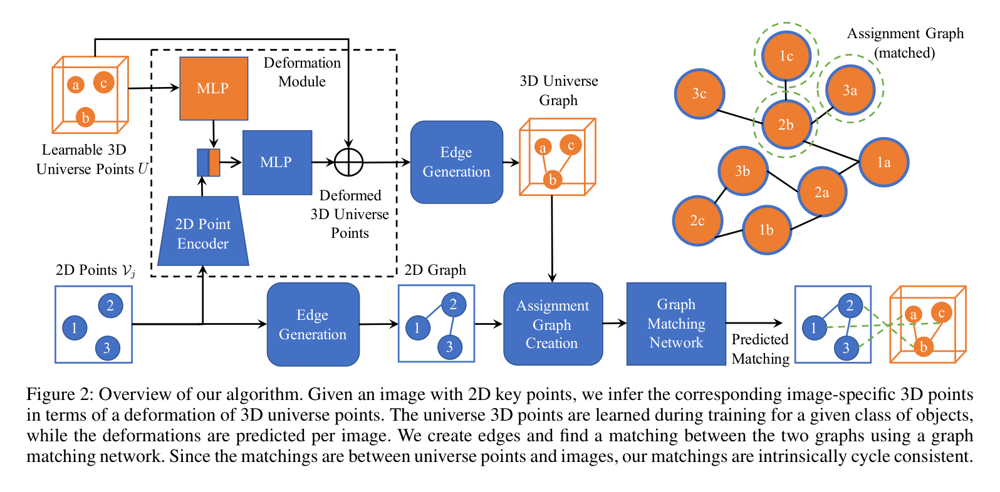

# Joint Deep Multi-Graph Matching and 3D Geometry Learning from Inhomogeneous 2D Image Collections

> **TL;DR:** A shared graph-matching network assigns 2D keypoints to category-specific learned3D universe points, with per-image deformation. Composing these assignments gives multi-image correspondences; sparse3D reconstruction is a coupled continuous objective, not a second combinatorial task.

## Motivation

Pairwise image matching can ignore underlying3D geometry and yield inconsistent correspondences around graph cycles. Conventional reconstruction often assumes a3D template or multiple views of the same object. Here the inputs instead depict **different instances within a category**, and the model learns a deformable sparse3D reference while matching their2D landmarks (Introduction/Related Work).

## Contributions

- Joint supervised graph matching and category-specific sparse3D universe learning from inhomogeneous2D collections.
- A neural per-image deformation module regularized by reconstruction error and offset magnitude.
- Image-to-universe assignments whose compositions support cycle-consistent multi-matching under the stated partial-permutation conditions.
- Willow/Pascal matching evaluations, component ablations, cycle-consistency measurements and synthetic-view facial3D evaluation.

## Methodology

**Universe representation and assumptions.** For image$j$, the target assignment$X_j$maps its keypoints injectively into$d$category-specific universe points. Lemma1 states that row-complete partial-permutation maps yield pairwise maps$X_{jk}=X_jX_k^\top$ satisfying identity, transpose symmetry and the partial-cycle inequality$X_{jk}X_{kl}\le X_{jl}$. This concerns structurally valid universe assignments; it does not establish semantic correctness or QAP optimality. For partially observed graphs the statement is an inequality, not unconditional equality through every intermediary (mainp3).

*Original Figure2 and its complete caption from author-hosted accepted-copy PDFp5; extracted and visually checked.*

**Continuous geometry.** A weak-perspective approximation absorbs depth scaling into the projection matrix. Differentiable pseudoinverse reconstruction learns the initial universe points; the displayed right-inverse identity presumes the corresponding full-row-rank condition. The deformation module encodes observed2D coordinates with MLPs and max pooling, combines this with universe-point features and predicts per-point3D offsets. Reprojection loss and a squared-offset penalty regularize this underdetermined geometric model. This is sparse deformable reconstruction, not recovery of unique calibrated3D geometry (Eqs1–8).

**Neural discrete matching.** Delaunay edges are constructed for the observed2D graph and deformed3D universe graph, with coordinate-based attributes. Their product assignment graph represents potential node matches. Alternating edge/node graph convolutions produce binary match classifications. Training uses ground-truth image-to-universe correspondences, squared matching error and a **soft one-to-one regularizer**. The paper describes binarization and composes universe assignments for pairwise evaluation; the available documents do not specify an additional Hungarian implementation, so none is asserted here. The cycle-consistency lemma requires actual partial-permutation outputs, rather than arbitrary soft scores merely encouraged by a penalty (Eqs9–13).

**Training and classification.** One network handles categories with separate learned universe points and category-specific linear operators. A warm start fits universe points, followed by150,000iterations, batch16, initial learning rate.008 with.98decay every3000steps. Matching/deformation/offset/one-to-one weights are1/.5/.05/.1. **Specialist / constructive:** the neural procedure predicts fresh landmark assignments; there is no neural editing of a complete incumbent. Sharing across visual categories is useful within-task reuse, not evidence of a shared neural solver for different native optimization tasks.

## Experiments

**Willow.** Five classes have ten annotated landmarks per image;20images per class are randomly selected for training and the remainder for testing. The model is trained jointly across classes using2D/3D coordinate attributes; classical comparators use handcrafted SIFT affinities. Mean accuracy is **97.8% for image-to-universe assignments and97.0% for induced pairwise assignments**, versus BBGM96.8%. These two output metrics must not be conflated. Despite the main prose claiming a car-category lead, the table has BBGM **100.0 versus98.8**; BBGM also leads duck99.2 versus90.3 (or86.4 induced pairwise). Gains are therefore not uniform (Table2).

**PascalVOC.** The split is7020training/1682test images over20categories with6–23keypoints. Under filtering of keypoints absent from either image, the method reports **67.1% universe accuracy and58.9% pairwise**, versus CSGM68.5% pairwise. Without filtering, its59.4% universe/**42.9% pairwise** compares with BBGM61.4% and BBGM-Multi62.8%. For its filtered evaluation, entries of the nonbinary matrices corresponding to absent landmarks are removed before binarization. These are protocol-specific comparisons and explicitly do not establish higher pairwise accuracy than every listed method (Table3).

**Consistency and ablations.** The appendix reports100%cycle consistency, compared with PCA39.19% and CSGM65.75% on average. The diagnostic explicitly considers only points **observed in all three graphs**. Consistency is distinct from matching accuracy. Pascal accuracy drops from67.1to58.11without the one-to-one penalty,58.49without warm start,60.33without deformation,64.19without offset regularization and64.81without reconstruction loss (mainTable1; supplementTable1).

**3D evaluation.** Eight facial landmarks from registered D3DFACs heads are randomly transformed and projected with a pinhole model to obtain training observations. At test time Procrustes alignment removes scale and rigid transformation before comparison. Mean3D L2 error decreases from **.356to.148** after deformation; the paper does not state a physical unit for this value. All eight supplementary qualitative cases were inspected. The results support a useful deformable geometric representation, not unrestricted single-image metric reconstruction. Main comparisons provide point estimates without a full seed-confidence or end-to-end runtime study.

## Limitations

Training needs known2D keypoints, category identities and ground-truth universe correspondences. Category-specific universe cardinality/parameters restrict deployment on new categories. Geometry relies on a weak-perspective fitting approximation and pseudoinverse/rank conditions; continuous reconstruction remains ambiguous. Accurate, consistent correspondences and accurate3D structure are separate properties.

The formal consistency argument is conditional on valid injective universe maps, while the documented neural training uses a soft constraint. The supplied text does not fully document the final injectivity-enforcing decoder, so no additional algorithm or unconditional learned-output guarantee is invented. Reported common-point consistency does not certify semantic correctness. The substantial Pascal pairwise accuracy regressions, filtered protocol and comparison of different universe/pairwise metrics qualify the broad introductory accuracy claims.

## Reproducibility

**Identity and dates.** Zhenzhang Ye, Tarun Yenamandra and Daniel Cremers list Technical University of Munich; Florian Bernard lists TUM and University of Bonn. Formal AAAI2022 is36(3),3125–3133, DOI[10.1609/aaai.v36i3.20220](https://doi.org/10.1609/aaai.v36i3.20220), published **2022-06-28** according to identity-matched publisher-deposited Crossref data. Primary[arXiv2103.17229](https://arxiv.org/abs/2103.17229)has the same title/four-author identity, first posted **2021-03-31** and current v2 dated2022-05-07.

**Complete science.** The official author-institution[publication entry](https://cvg.cit.tum.de/publications?key=ye2021joint)links the nine-page accepted scientific copy and three-page supplement. All twelve pages, the entire main bibliography, methods, formulas, tables and supplementary architecture/qualitative panels were read. These are explicitly author-hosted bytes; byte identity to the inaccessible OJS PDF is not claimed. The supplement retains unresolved citation question marks and an empty reference heading, which were inspected rather than silently repaired. OriginalFigure2 with its complete caption physically exists under public/paper-assets and was actually viewed.

**Artifacts.** The author publication entry, first-author publication list, paper/supplement and targeted official-code search were checked; they identify the two scientific PDFs but no verified dedicated implementation or additional scientific archive. A repository for a different graph-TV paper is not attributed to this work. No unverified code URL is supplied. Lack of an identified code release limits decoder and training reproduction; no experiment was rerun.

**Actual internal references.** The full bibliography explicitly cites [DGMC](deep-graph-matching-consensus.md)(Fey2020,p8), [BBGM](deep-graph-matching-via-blackbox-differentiation-of-combinatorial-solvers.md)(Rolínek2020,p9), [PCA-GM](learning-combinatorial-embedding-networks-for-deep-graph-matching.md)(Wang2019a,p9), [GANN](gann.md)(Wang2020,p9), [LCS](learning-combinatorial-solver-for-graph-matching.md)(Wang2020b,p9), [deep learning of graph matching](deep-learning-of-graph-matching.md)(Zanfir2018,p9), and [deep graphical feature learning](deep-graphical-feature-learning-for-the-feature-matching-problem.md)(Zhang/Lee2019,p9). The separately titled2019NGM multiple/hypergraph preprint is not merged into the different-title conference entry merely through journal lineage.
