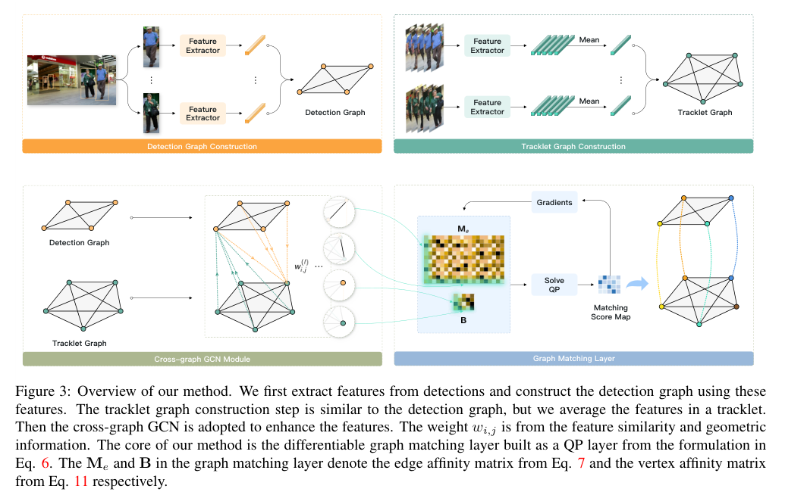

# Learnable Graph Matching for Multiple Object Tracking

> **TL;DR:** GMTracker learns appearance/context features jointly with a relaxed quadratic-programming association layer. Greedy rounding converts its scores into discrete tracklet–detection matches, followed by motion/appearance gates and IoU fallback. Its online, alternative-detector and offline-interpolation results must be distinguished; convex relaxation does not make the original discrete QAP exact.

## Motivation

Standard online matching often associates detections with tracklets using only unary appearance/motion scores. Intra-frame relations between nearby objects can provide additional information during occlusion. GMTracker represents detections and tracklets as complete graphs, uses vertex and edge similarity for association, and differentiates through the relaxed optimization to train features for that association task (Introduction, Section3).

## Contributions

- Contextual graph matching between current detections and historical tracklets, rather than only bipartite unary matching.
- A continuous convex-QP relaxation and implicit/KKT-based backward differentiation.
- Cross-graph feature enhancement and a complete tracker with appearance/motion gates and tracklet birth/death handling.
- MOT16/17 tests, three-fold validation ablations, oracle comparisons and detailed association/detection metrics.

## Methodology

**Graphs and learned representation.** Each current detection is a node; each past tracklet is represented by the mean of its detection appearance features. A pretrained ResNet50 ReID encoder supplies512-dimensional features and remains frozen after joint pretraining on Market1501, DukeMTMC and CUHK03. Two trainable512-dimensional fully connected layers and one cross-graph GCN propagation refine them. Cross-graph weights combine cosine appearance similarity with bounding-box IoU, with geometry omitted for moving cameras. Constant-velocity Kalman prediction and ECC camera compensation are classical motion components (Sections3.1,4.1–4.2,5.2).

*Original Figure3 and its entire caption, formal PDFp5/printed5303; extracted and visually checked.*

**Relaxed association.** The paper rewrites permutation-based Koopmans–Beckmann matching using adjacency discrepancy $\|A_1\Pi-\Pi A_2\|_F^2/2$ plus unary affinity, then relaxes permutation constraints to continuous normalized nonnegative matrices. Normalized concatenated endpoint features supply edge similarities and a vectorized quadratic form. Equality/inequality constraints accommodate unequal detection/tracklet counts. Training uses qpth; forward-only inference uses CVXPY. Weighted binary cross entropy and temperature-softmax sharpening supervise matching against ground-truth identities (Eqs1–15).

**Differentiation scope.** The scientific supplement derives the Lagrangian, KKT equations and an implicit-Jacobian inverse formula. Its interpretation requires the appropriate convex-QP constraint qualification and local nonsingularity/regularity for that inverse. These are statements about differentiating a relaxed optimizer, not certificates that every original discrete graph matching or every rounded tracking assignment is globally optimal (SupplementA, EqsA–E).

**Actual discrete pipeline.** The principal QP output is rounded greedily: repeatedly select the largest remaining score and exclude its row/column. Appearance similarity, Mahalanobis motion distance and nonoverlap gates can discard matches. A **separate IoU-based Hungarian association** handles unmatched candidates; new detections create tracklets and stale ones expire after100frames. The default motion gate is9.4877 and appearance thresholds are.6/.7 for moving/static settings. Optional tracklet interpolation uses later detections and is an offline postprocessing variant (Section4.4, SupplementAlgorithmA).

**Classification.** This is **specialist / constructive**: learned affinities plus an optimizer/rounding/controller construct discrete MOT associations. Kalman geometry is continuous state estimation, and the title's graph-partitioning motivation does not establish a separately tested native graph-partitioning solver. No neural editing of a complete feasible optimization incumbent or common checkpoint across distinct native tasks is demonstrated.

## Experiments

**Protocol.** MOT16/17 use public detections refined by Tracktor, with separate variants using CenterTrack detections. ReID pretraining is external; association training uses MOT labels, an RTX2080Ti, Adam learning rate$5\times10^{-5}$ and weight decay$10^{-5}$. MOT17 training sequences are divided into three validation folds. Online results, linear-interpolation results and VIVE inter/extrapolation results are reported separately (Section5).

**Validation ablations.** Without interpolation, the DeepSORT-style baseline has IDF1/MOTA **68.1/62.1**, while the complete contextual model gives **71.5/62.3**. With interpolation, the corresponding values are **68.9/62.9→73.0/63.8**. Adding individual components does not improve every metric: the appearance+GCN setting has1399identity switches, worse than the baseline1135, despite higher IDF1. Training and inference with the matching layer produces71.5IDF1 versus70.2when only used at inference and69.5when absent in both (Tables1–2).

**Online tests.** Tracktor-based GMTracker reports MOT17 **63.8IDF1/56.2MOTA**, and MOT16 **63.9/55.9**. These IDF1 improvements coexist with MOTA regressions: on MOT17, MPNTrack has58.8MOTA, and on MOT16 GSM-Tracktor has57.0. With CenterTrack detections, online IDF1 becomes66.9/68.6, so those values should not be attributed to the same detector setting (Table5).

**Offline and detailed metrics.** CenterTrack plus simple interpolation gives MOT17 **68.7IDF1/65.0MOTA** and MOT16 **70.6/66.2**. These results use offline filling of missing detections. SupplementTableB reports online Tracktor-based MOT17 HOTA49.1 versus MPNTrack49.0, but1778identity switches versus1185. VIVE variants also do not dominate every comparator metric. Neither IDF1 nor MOTA is an exact-QAP gap or a proof of correct identity assignment.

**Remaining headroom.** The oracle association validation comparator reaches **77.2IDF1 and14identity switches**, versus the model's71.5and1017, leaving substantial association error. Mean history features70.0IDF1 are close to moving average70.1, while last-frame-only features69.1 are weaker. Increasing tracklet max age to100helps graph matching, but threshold sensitivity remains explicit in SupplementFigureA. These are empirical settings rather than guaranteed recovery bounds.

## Limitations

Performance depends on detector quality, external ReID supervision, camera-specific geometry choices and handcrafted tracking gates. Convex relaxation, differentiable feature training and greedy rounding solve different parts of the pipeline; their combination does not certify the original integer optimum. The KKT inverse expression requires regularity and does not imply globally smooth differentiability for all degenerate instances.

The online tracker and offline interpolation variants have different information access. Detector changes, metric tradeoffs and oracle headroom qualify broad superiority claims. The paper provides no comprehensive runtime/large-graph scaling benchmark or multi-seed confidence analysis. Classical interpolation is not neural incumbent improvement.

## Reproducibility

**Identity and dates.** Jiawei He and Zhaoxiang Zhang list CASIA/University of Chinese Academy of Sciences; Zhaoxiang Zhang also lists HKISI CAS. Zehao Huang and Naiyan Wang list TuSimple. Formal CVPR2021 CVF pages are5299–5309, DOI[10.1109/CVPR46437.2021.00526](https://doi.org/10.1109/CVPR46437.2021.00526), publisher-deposited **June2021 month precision**. Crossref deposits pages5295–5305, distinct from this actual reading copy. Canonical arXiv[2103.16178](https://arxiv.org/abs/2103.16178) first appeared **2021-03-30**.

**Complete science.** All eleven formal pages,77main references and the four-page official CVF scientific supplement—including all twelve supplement references—were read. The QP formulas, complete gradient derivation, tracking pseudocode, all experiment tables and threshold plots were rendered and inspected. OriginalFigure3 with its complete caption physically exists under public/paper-assets and was actually viewed.

**Code and attachment inventory.** Official[jiaweihe1996/GMTracker](https://github.com/jiaweihe1996/GMTracker) was checked at commit`2a6cc6343b6f99bfae4edde4d0f58e6c9ca14cdf`,102archive members. Its full README documents Python3.6/PyTorch1.4/CUDA10+, SCS-GPU installation, precomputed features, explicit validation folds/static-moving lists, tracking/training and interpolation commands. The two notebooks identify themselves as **vendored Amos/Kolter OptNet/qpth classification/Sudoku examples**, not additional GMTracker scientific appendices; they were identified by their own headers and excluded from this paper's read-page count. No paper-specific extra PDF/ZIP/notebook science is identified.

Necessary code inspection of `GMMOT/gmatching.py`77–140confirms CVXPY/SCS inference and greedy row/column exclusion; `GMMOT/model.py`187–243confirms qpth training. The current inference code also applies appearance reranking before its unary QP term, a detail beyond the plain-cosine formulation in the paper. These are source observations; no training or benchmark rerun was performed.

**Actual internal references.** The complete bibliography directly cites[PCA-GM](learning-combinatorial-embedding-networks-for-deep-graph-matching.md)(61,p10),[CIE-H](cie-h.md)(69,p10) and[deep learning of graph matching](deep-learning-of-graph-matching.md)(71,p11). MPNTrack/OptNet are genuine external citations, but no absent catalogue target is invented for them.
