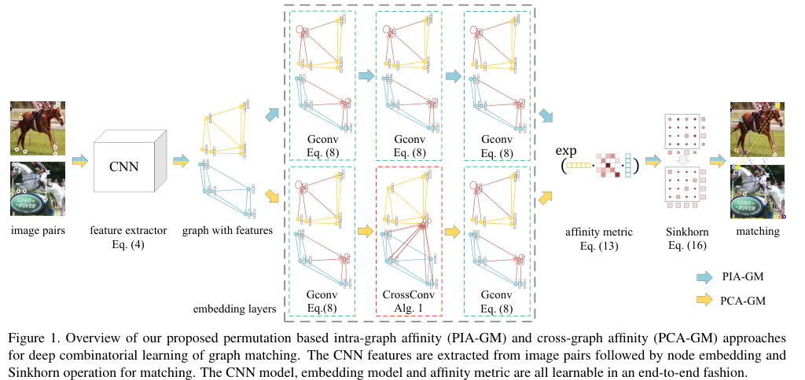

# Learning Combinatorial Embedding Networks for Deep Graph Matching

> **TL;DR:** PIA-GM and PCA-GM learn image descriptors, graph-context embeddings and matching affinities, supervised by permutation cross-entropy. Sinkhorn produces soft correspondences and Hungarian decodes the final assignment. PCA-GM adds soft cross-graph feature exchange; the2019paper also reports that a more iterative alternative hurts accuracy.

## Motivation

Even an excellent optimizer can return semantically wrong correspondences if its fixed affinity model is inappropriate. The paper emphasizes learning the matching score and structure representation alongside a correspondence-level loss. It contrasts this with shallow affinity functions and displacement losses in which an average location can be correct even when individual candidate matches are wrong (Sections1–2,3.7).

## Contributions

- A CNN–graph-embedding–Sinkhorn pipeline trained by binary cross-entropy against a ground-truth permutation matrix.
- PIA-GM for intra-graph context and PCA-GM for additional cross-graph context.
- Learned bilinear node-affinity scores that replace explicit large pairwise affinity tensors at inference.
- Synthetic, Pascal VOC and Willow tests, including cross-category transfer, component ablations and a failed iterative design documented in the scientific supplement.

## Methodology

**Visual and graph features.** A shared ImageNet-pretrained VGG16 supplies relu4_2and relu5_1features sampled bilinearly at annotated keypoints. Their concatenation enters graph layers on Delaunay graphs. Each intra-graph update combines a transformed self-feature with the mean transformed neighbor feature. The described embedding dimension is2048. PIA-GM uses three intra-graph stages; PCA-GM introduces cross-graph exchange between intra-graph processing stages (Sections3.1–3.3,4.1).

*Original Figure1 and complete caption, formal PDFp2/3057; extracted and visually checked.*

**Cross-graph exchange.** An intermediate affinity matrix is normalized by Sinkhorn. Each node receives a weighted sum of features from the other graph using this soft correspondence, then concatenates it with its own feature and applies a fully connected layer. This is exchange between continuous representations; no complete hard matching incumbent is being edited by the network (Algorithm1).

**Affinity, loss and hard decoding.** A learned bilinear score followed by exponentiation with temperature.005forms a positive matrix. Alternating row/column normalization gives a soft doubly stochastic correspondence in the convergence description. Training penalizes both matched and unmatched entries with permutation BCE. At test time, Hungarian runs on the resulting soft matrix to produce a discrete permutation. A finite implemented normalization budget should not be described as an exact convergence certificate. Hungarian optimizes the supplied linear scores; this pipeline does not certify an optimum of an arbitrary original QAP affinity matrix (Sections3.4–3.6).

**Space and scope.** Replacing an explicit N²-by-N²pairwise affinity matrix with N-by-Nnode matching scores avoids that explicit O(N⁴)storage. This is learned structural compression, not a proof that all higher-order information or optimal solutions are preserved. The models are **specialist / constructive**: one native graph-matching task across object categories and graph sizes. The cross-category experiments establish useful distribution transfer, not cross-native solver generality.

## Experiments

**Protocol.** Natural-image evaluation uses equal-size graphs whose nodes have labeled counterparts. Pascal VOC is filtered to7,020training and1,682test images, cropped to object boxes and resized256×256, with6–23inliers. This is not an unfiltered outlier-rejection evaluation. GMN is reimplemented because its source was unavailable to the authors; the HARG-SSVM baseline is adapted to known keypoint candidates. These implementation and candidate differences matter when interpreting comparisons (Sections4.1–4.3).

**Pascal VOC.** Mean accuracy is **63.8% for PCA-GM**,63.0for PIA-GM,61.6for PIA-GM trained with offset loss,57.9for GMN with permutation loss and55.3for the reimplemented original GMN. Benefits are not uniform: PCA-GM boat47.9is below PIA-GM51.9, dog61.3below62.7, and dining table63.6below original GMN72.3. The reported approximately18pairs/s on dual RTX2080Ti is **training throughput**, not a measured inference-latency comparison (Table2, Section4.3).

**Willow.** VOC pretraining excludes overlapping VOC2007car/motorbike images. PCA-GM-VOC scores100/69.8/78.6/82.4/95.1% on face/motorbike/car/duck/wine bottle. After Willow fine-tuning, scores become **100/76.7/84.0/93.5/96.9%**. The pretraining-only and fine-tuned regimes must remain distinct; these results do not come from one untouched checkpoint across all protocols (Table3, Section4.4).

**Synthetic and cross-category transfer.** Synthetic graphs perturb1024-dimensional simulated features and point coordinates; ten generated graphs are averaged per trial. The test varies feature noise and node count. A separate eight-category matrix trains one model per source category and tests each target category: PCA-GM diagonal mean65.4and all-cell mean52.4compare with GMN40.2and40.5. “All-cell” includes diagonal entries and is not itself an off-diagonal-only transfer metric. Individual categories still vary substantially (Figures3–4).

**Ablations and the negative iterative result.** The staged component ablation reports63.8with all components,63.6without learned affinity,62.1also without cross-graph embedding,54.8also without intra-graph embedding, and41.9with only frozen ImageNet features. These nested removals are not independent marginal effects. A more complex iterative cross-graph design gives63.1/61.3/60.9/54.7/45.9/46.7/46.2% for one through seven iterations, below standard PCA-GM63.8. The authors report unstable training; the one-page supplement supplies its complete algorithm. This2019negative experiment must not be conflated with the later journal IPCA-GM implementation (Tables4–5, supplement).

## Limitations

Known candidate keypoints and equal-size full correspondences simplify the evaluated task. Soft normalization and a final assignment do not by themselves solve partial matching, arbitrary unmatched-node rejection or arbitrary QAPs exactly. The offset-loss illustration demonstrates a possible geometric cancellation, rather than a universal proof that every displacement loss must fail. A single reported accuracy table without repeated-training uncertainty does not establish universal dominance. Cross-object-category transfer is real but remains within graph matching.

## Reproducibility

**Identity and dates.** Runzhong Wang, Junchi Yan and Xiaokang Yang list Shanghai Jiao Tong University and its MoE AI laboratory/AI Institute. Formal ICCV2019pages3056–3065have DOI[10.1109/ICCV.2019.00315](https://doi.org/10.1109/ICCV.2019.00315), with deposited **2019-10 month precision**. Canonical arXiv[1904.00597](https://arxiv.org/abs/1904.00597) first appeared **2019-04-01**; v3isSeptember26. All ten formal pages,48references and the separate one-page official scientific supplement were read. Algorithms, affinity/loss equations, failure illustration, all result tables, heatmaps and supplement algorithm were rendered and inspected. Original Figure1 and its complete caption physically exist in public/paper-assets and were actually viewed.

**Code and version boundary.** The canonical arXiv record links the[official PCA-GM repository](https://github.com/Thinklab-SJTU/PCA-GM), which now resolves to ThinkMatch. Its293-member archive was pinned at`9f669cb22916f3e06c214f058daa5ac349bd7e15`using git. It contains no PDF, ZIP or notebook scientific attachment. The root README, PCA-specific README, actual PCA model and Hungarian implementation were read. The current model calls Sinkhorn followed by Hungarian on its last soft matrix; the README explicitly distinguishes conference PCA-GM from the different-title TPAMI extension's IPCA-GM. Current benchmark values and later IPCA configurations are not substituted for the2019tables. No environment setup, training or benchmark reproduction is claimed.

**Actual internal references.** The bibliography directly cites [deep graph matching](deep-learning-of-graph-matching.md)[45]. Reference18cites Kool and Welling's early *Attention Solves Your TSP*, arXiv1803.08475; primary v1metadata confirms continuity with the catalogue's [Attention Model](attention-model.md), so the edge is retained with that earlier-version qualification. In contrast, the different-title TPAMI *Visual Permutation Learning*[33] is not silently treated as its earlier CVPR conference paper, and the2017workshop Sinkhorn paper[26] is not automatically mapped to a different ICLR title.
