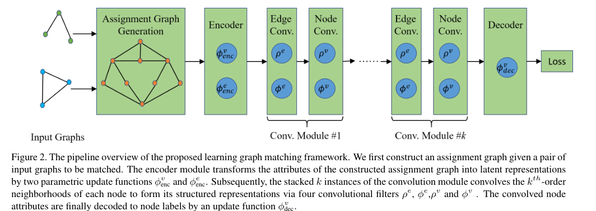

# Learning Combinatorial Solver for Graph Matching

> **TL;DR:** LCS converts candidate correspondences into assignment-graph nodes and predicts their labels through ten learned edge/node message-passing layers. Geometry alone supplies its reported inputs. The paper describes greedy/max-activation hard decoding; the unavailable original code prevents independent implementation confirmation, and the printed argmax-based constraint loss has an unresolved gradient boundary.

## Motivation

Earlier deep matching systems often learn visual affinities while retaining a fixed spectral or assignment solver. LCS instead learns correspondence classification jointly with structural representation on an assignment graph, aiming to make the correspondence-scoring process data-adaptive (Introduction).

## Contributions

- A candidate-correspondence assignment graph for learning node selection.
- Shared per-edge/per-node operations in a stack of learned graph-network modules.
- Permutation classification loss plus a proposed one-to-one constraint loss.
- Geometry-only matching experiments on synthetic points, CMU House, Willow and Pascal VOC.

## Methodology

**Assignment representation.** Each possible node pair from the two input graphs becomes a node of the assignment graph. Original-edge pairs induce its edges. Raw node/edge attributes from the two sides are concatenated. Graph construction and input feature extraction are outside the learned network. The reported model deliberately uses point coordinates and concatenated endpoint coordinates, **without image CNN appearance descriptors** (Sections3.2,4.1).

*Original Figure2 and entire caption, formal PDFp5/printed7572; extracted and visually checked.*

**Neural computation.** Separate MLP encoders embed node and edge attributes. Ten stacked convolution modules update edge representations from a learned transform of the Hadamard product of endpoint embeddings, then update node representations from summed incident-edge embeddings. Each stage has its own learned parameters, shared across the graph elements within that stage. A node MLP decodes two-class correspondence labels. Iteration refines hidden features rather than editing a complete hard matching (Eqs3–9).

**Learning and hard output.** Annotated correspondences provide two-class cross entropy. The paper additionally forms hard labels $y_i=\arg\max_kY_{i,k+1}$ and a constraint penalty $\|B(y-x^{gt})\|_2$, with a weight initially zero and gradually increased. The test-time description says a greedy/max-activation postprocessing produces a one-to-one match. It does not identify this step as Hungarian, so that decoder is not added here (Eqs10–15, Section4.1).

**Curator boundary.** As printed, the extra penalty depends on hard argmax labels. Ordinary differentiation makes it piecewise constant in the logits away from ties, with no ordinary derivative at ties. The paper supplies no explicit straight-through estimator or smooth replacement. Therefore it cannot simply be described as a verified differentiable constraint gradient. The cross-entropy term remains a genuine differentiable training signal. This narrow observation does not negate the empirical matching results or establish what an unavailable implementation did.

**Classification.** LCS is **specialist / constructive**: a neural assignment-node classifier plus described hard decoding generates correspondences. Different data sources still instantiate graph matching, and no common checkpoint across different native optimization problems is shown. Generic permutation-equivariant operators or arbitrary graph-size support do not establish generalist scope.

## Experiments

**Synthetic points.** Training uses200000random pairs,10inliers,0–10outliers on both sides and noise0–20, with random rotation/translation. The two evaluations vary noise with five outliers or vary outliers at noise20, using500test graph pairs per setting. The curves show improved robustness over the listed baselines. These are repeated problem instances, not an independently reported multi-training-seed uncertainty study (Figure3).

**CMU House.** The dataset contains111frames of one house and30tracked points. Training draws300000random pairs from the same sequence, with10–30points on one side and30on the other. Tests vary temporal gap or remove up to10points; the authors report approximately95%accuracy across the settings. This protocol does not provide a held-out scene or a strict graph-pair-disjoint manifest, so it should not be called independently established unseen-video generalization (Figure4).

**Willow.** Twenty images per class train the model;1000pairs from the remaining images test each of five classes. Average accuracy is **94.9%**, versus PCA90.2and ABPF92.3. Duck is an explicit negative case, **86.2 versus PCA93.5**. Some learning-based/HARG values are quoted from the PCA paper rather than newly rerun. Nonlearning comparators use SIFT and geometric affinities, whereas the proposed network uses geometry only; their inputs/pipelines are not identical (Table1, Section5.3).

**Pascal.** The filtered dataset has7020training/1682test images with6–23inliers and20categories. The paper draws100000same-class training pairs per category. Mean accuracy is **68.5%**, versus PCA63.8and GMN55.3. Individual categories regress: cat60.3< PCA67.4, horse64.4<68.9, dog57.5<61.3and motorbike57.6<62.8. These are matching accuracies under a particular descriptor/graph protocol, not QAP objective gaps or universal category dominance (Table2).

The formal paper contains no comprehensive runtime/memory table, isolated contribution ablation or multi-seed confidence analysis. “Lightweight”follows the architecture's omission of CNN extraction and is not a measured universal speedup over every baseline.

## Limitations

The system assumes known points and task-specific graph construction. Assignment graphs contain all candidate node pairs and can grow substantially with input size. Geometry-only cues can be ambiguous under repeated structures or transformations. Reported datasets and separately generated training sets do not establish cross-native checkpoint reuse or large arbitrary-graph scalability.

The paper describes a hard greedy decoder and asserts one-to-one output, but its exact released implementation could not be inspected at the available author-code endpoints. Neither that statement nor a training penalty certifies global QAP optimality. The printed argmax-based loss needs a specified gradient treatment to support its proposed direct training effect; the empirical tables remain separately attributed observations.

## Reproducibility

**Identity/date.** Tao Wang, He Liu, Yidong Li and Yi Jin list Beijing Jiaotong University; Tao Wang and Xiaohui Hou list HiScene Information Technologies; Haibin Ling lists Stony Brook University. Formal CVPR2020 DOI[10.1109/CVPR42600.2020.00759](https://doi.org/10.1109/CVPR42600.2020.00759) has publisher-deposited **June2020 month precision**. The actual CVF reading pages7568–7577differ from deposited7565–7574. No unverified exact day or arXiv identity is added.

**Complete science and assets.** All ten formal CVF pages and all38references were read. The pipeline, update/loss formulas, both result tables and all noise/outlier curves were rendered and inspected. CVF lists only the main PDF; the author's publication listing offers the paper and a code/data archive, without a separately identified scientific appendix. No missing scientific result/proof attachment is named in the main text. OriginalFigure2 and its complete caption physically exist under public/paper-assets and were actually viewed.

**Code access limitation.** The paper links[LearningGraphMatching.zip](https://www.cs.stonybrook.edu/~hling/code/LearningGraphMatching.zip), described by the author page as roughly1.7GBof code/data. The exact host failed certificate-chain verification in this environment; the author-listed www3/GitHub-pages paths returned404. Exact-title/source searches did not identify a verified alternative code archive. These attempts are preserved in the research cache; no archive inventory, README reading or decoder execution is claimed. Missing code is distinguished from the complete acquired scientific paper. A later related paper's code is not substituted for this implementation.

**Actual internal references.** The complete bibliography directly cites[PCA-GM](learning-combinatorial-embedding-networks-for-deep-graph-matching.md)(27,p9) and[deep learning of graph matching](deep-learning-of-graph-matching.md)(33,p9). Shared graph-network foundations and classical optimization works are not converted into unrelated catalogue citation targets.
