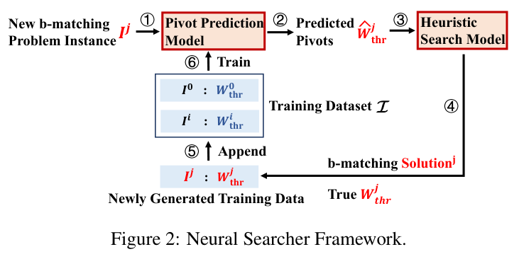

# Learning to Accelerate Heuristic Searching for Large-Scale Maximum Weighted b-Matching Problems in Online Advertising

> **TL;DR:** NeuSearcher learns an advertiser-specific edge-weight pivot from solved instances. That pivot accelerates a classical parallel heap-based matching algorithm, whose repair phase recovers the greedy baseline's solution. The experiments show roughly twofold speedups over b-suitor on billion-edge advertising graphs; equality with that approximate baseline does not mean global optimality.

## Motivation

Advertising repeatedly allocates consumers to ads subject to capacities on both sides of a weighted bipartite graph. Interests change, creating similar new instances. Sorting all neighbors and discovering the final accepted weight threshold through many proposal rounds are expensive. The paper asks whether previously solved instances can predict that threshold well enough to save sorting and search work (Sections1–3).

## Contributions

- Supervised prediction of each advertiser's terminal matching-weight threshold, using labels produced by b-suitor and subsequent solves.
- A multichannel graph encoder intended to preserve varied information from very large consumer neighborhoods.
- Parallel classical correction of overfilled and underfilled advertiser allocations after learned initialization.
- Evaluation on public rating graphs and seven consecutive days of Alibaba advertising data, including billion-edge tests.

## Methodology

**Problem.** Each positive-weight edge indicates a potential ad–consumer allocation. Binary edge variables maximize total weight, with the selected degree at every vertex bounded by its capacity. This is offline optimization of each available graph instance in a changing operational system, not an explicitly evaluated irrevocable arrival-by-arrival online matching problem (Section2).

*Original Figure2 and complete caption, formal PDFp3/3439; extracted and visually checked.*

**Predicting pivots.** At each graph layer, an MLP and row-wise softmax assign neighboring consumers softly to channels. Multiplying the transposed assignment matrix by neighbor embeddings produces a sum within each channel. Flattened channel summaries are concatenated with the advertiser embedding and passed through an MLP. After two layers, a scalar head predicts the threshold. The experiments use16channels per layer and supervised MSE against thresholds from completed matching runs. Training data are augmented as new instances are solved (Section4.1, Equations4–7).

**Discrete inference.** Each predicted pivot partitions an advertiser's neighborhood. Edges above it are proposed to consumer min-heaps, which retain the strongest proposals within consumer capacities. A classical correction loop recalls the weakest excess edges from overfilled advertisers, restores displaced proposals, and makes additional descending-weight proposals for underfilled advertisers. The algorithm stops when advertiser capacities are met or candidates are exhausted. The neural model supplies an initialization parameter; it is not called to edit each successive full matching (Section4.2, Algorithm1).

**Quality argument.** The proof sketch treats the corrected initialization as an intermediate b-suitor state and invokes that algorithm's processing-order-independent convergence to serial greedy. This is an inherited **greedy-solution equivalence** argument under the stated algorithmic processing assumptions, not a learned exact-optimization theorem. The paper cites the positive-weight greedy worst-case1/2approximation. Equality of final edge sets is also checked empirically; this note does not generalize it to arbitrary tie handling, implementation changes or early stopping (Sections4.2,5.1–5.2).

**Classification.** This is **specialist / constructive**, combining learned pivot prediction with classical matching construction and repair. MovieLens, books and advertising are datasets for the same native bipartite b-matching task, rather than demonstrated cross-native optimization tasks. The subsequent heuristic correction is classical, so it does not establish a neural improvement policy.

## Experiments

**Data and protocol.** The advertising graphs are reported at approximately236million consumers,46thousand advertisers and one billion edges per day. Days1–4train, day5validates and days6–7test. For each public MovieLens10M, MovieLens20M and RatingsBooks graph, four extra weight-perturbed copies use Gaussian noise of mean0and variance0.1: three train and one validates. Consequently, the public test is not evidence of generalization to an unseen graph topology. Default advertiser capacity is half its degree; consumer capacity is capped by degree and a global average-degree value. Tests use a Xeon E5-2682v4 system with128GB RAM, CPU-only comparison and C++11 multithreading (Section5.1, Table1).

**Objective quality.** Serial greedy, greedyMR, b-suitor and NeuSearcher return the same edge sets in all five evaluated test graphs. Their objective values reach **99.05%,98.45% and97.65%** of the Gurobi optimum on the three public graphs. Gurobi runs out of memory on the two advertising tests, so no measured optimality gap is available there. The large industrial results should not be described as certified nearly optimal (Table2).

**Online computation time.** NeuSearcher takes **15.141/35.059/14.212seconds** on MovieLens10M/MovieLens20M/Books, versus b-suitor35.889/78.588/34.627. Advertising days6/7take **199.423/201.094seconds**, versus410.270/426.359. These are ten-round mean wall-clock times for inference plus heuristic solution computation; they exclude offline training and do not include uncertainty intervals. The displayed gains over b-suitor are about2.1–2.4times, within the paper's broader2–3times summary (Table3).

**Search and encoder ablations.** On advertising day6, NeuSearcher converges in **15iterations**, compared with68for b-suitor and358for greedyMR. Replacing its multichannel encoder with a single-channel GNN raises total time from199.423to246.059seconds and correction rounds from15to29. Multichannel inference itself is slightly slower; the net saving comes from fewer correction steps. The validation-loss curves support the stated predictor comparison, not a universal representation or generalization guarantee (Figures4–5).

## Limitations

The learning setup explicitly assumes similar instances from the same distribution. Public training perturbs edge weights on the same topology, and industrial evaluation spans only two held-out days. Severe structural or capacity distribution shift is not isolated. The industrial optimum is unknown. More accurate pivots reduce search work, but classical correction is still necessary when predictions err; no learned-pivot-only feasibility or optimality guarantee is established. Offline training, labeling, data refresh and deployment overhead are not included in the reported online timing table. Private industrial data and the absence of an identified public implementation limit independent reproduction.

## Reproducibility

**Identity and dates.** The formal byline contains ten authors: Xiaotian Hao, Junqi Jin, Jianye Hao, Jin Li, Weixun Wang, Yi Ma, Zhenzhe Zheng, Han Li, Jian Xu and Kun Gai. Affiliations are Tianjin University, Alibaba Group, Huawei Noah's Ark Lab, Tianjin Key Lab of Machine Learning and Shanghai Jiao Tong University. The official IJCAI paper is3437–3443, DOI[10.24963/ijcai.2020/475](https://doi.org/10.24963/ijcai.2020/475). Identity-matched Crossref metadata supplies **2020-07 month precision**. Canonical arXiv[2005.04355](https://arxiv.org/abs/2005.04355) first appeared **2020-05-09**, with v2onMay12. The author's homepage abbreviates the author list and has a stray ICML label; the formal byline and proceedings determine identity here.

**Scientific coverage.** All seven formal pages and all25references were read. The objective, graph aggregation equations, proof sketch, full algorithm, all three tables and both convergence/ablation plots were rendered and checked. The official proceedings page links its main PDF only; the canonical arXiv record and author's paper entry were also checked. No independent scientific appendix or official NeuSearcher code link was identified, and the main paper does not delegate a required proof or experiment to an unavailable supplement. No nonexistent repository inventory, training run or benchmark replication is claimed. Original Figure2 and its complete caption physically exist under public/paper-assets and were actually viewed.

**Actual internal references.** The complete bibliography directly cites [NeuRewriter](neurewriter.md), [learning CO over graphs](learning-co-over-graphs.md), [GCN-guided tree search](../generalist/gcn-guided-tree-search.md), [Pointer Networks](pointer-networks.md) and [deep graph matching](deep-learning-of-graph-matching.md). Its Ding2019optimal-solution-prediction and classical matching references are not mapped to unrelated catalogue papers merely because they concern MIP or matching.
