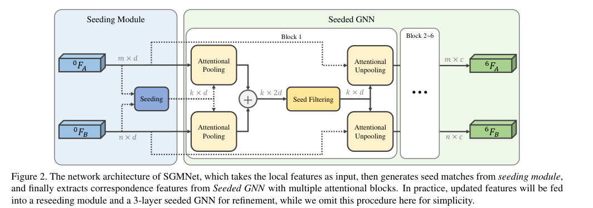

# Learning to Match Features with Seeded Graph Matching Network

> **TL;DR:** SGMNet uses a small set of tentative seed correspondences to pool, exchange and broadcast image-feature context. Sinkhorn scores, mutual selection and a confidence threshold yield discrete partial matches. Its attention blocks are cheaper than dense SuperGlue attention; initial distance computation and final dense assignment still matter, and stronger official SuperGlue checkpoints remain better on several accuracy tests.

## Motivation

Dense self/cross attention over many image keypoints is expensive, while filtering only nearest-neighbor matches cannot discover additional correspondences. SGMNet uses a sparse correspondence set as a communication bottleneck, aiming to retain contextual matching without every keypoint attending to every other keypoint (Introduction).

## Contributions

- Heuristic seeding from descriptor matches with reliability ranking and spatial suppression.
- Attentional pooling, seed filtering and confidence-weighted unpooling for sparse message passing.
- A second partial-reseeding stage and supervised matching/unmatchable-point/inlier losses.
- Image matching, localization and SfM evaluations, including runtime/memory comparisons and seed-design ablations.

## Methodology

**Seeds and representation.** The network receives keypoint coordinates and local descriptors, rather than raw images. A coordinate MLP embedding is added to each descriptor. Initial seeds are descriptor nearest-neighbor correspondences ranked by inverse distance ratio, with mutual check, ratio test and spatial nonmaximum suppression. They are tentative partial correspondences and can contain outliers (Sections3.1–3.2, SupplementA.2).

*Original Figure2 and entire caption, formal PDFp3/printed6303; extracted and visually checked. Its caption explicitly states that the second reseeding/refinement stage is omitted from the drawing.*

**Sparse message passing.** Seed features attend to the full keypoint sets, communicate through self/cross seed attention and a fused MLP, and predict seed inlier weights through PointCN/context normalization. Weighted unpooling broadcasts renewed context back to all points. Six blocks precede reseeding, followed by three refinement blocks; four-head attention is used. The second seed set selects high-confidence mutual correspondences from an intermediate assignment, not an existing complete hard feasible incumbent (Eqs2–10, Section3.4).

**Scores and hard matches.** Dense feature correlations are augmented with a learnable dustbin and normalized by Sinkhorn. The supplement specifies ten Sinkhorn iterations for reseeding and100for final scores by default. The released matcher takes mutual row/column maxima above threshold.2, producing a hard **partial** one-to-one correspondence set with unmatched points. This is a learned matching decoder, not a certificate of an arbitrary QAP optimum. Pose estimation, localization and SfM then use classical geometric estimation/RANSAC/COLMAP downstream.

**Training.** GL3D supplies about400kselected image pairs. Pair selection uses common-track ratio.1–.5and camera rotation6–60degrees; depth reprojection identifies mutual matches below3pixels and unmatched points farther than10pixels, excluding pairs with fewer than50matches. Assignment log-likelihood supervises intermediate/final scores, and seed-inlier classification has weight250. Adam starts at$10^{-4}$, decays after300kiterations and runs to900k; cross-stage gradients are blocked for the first140kiterations (Eqs13–14, SupplementA).

**Complexity and classification.** Attention changes from dense $O(N^2C)$ to $O(NKC)$ when $K\ll N$, with additional seed-to-seed work. Initial descriptor distances and final correlation/Sinkhorn remain dense, and a proportional seed schedule does not make the whole algorithm asymptotically linear. This is **specialist / constructive** visual feature matching. Partial reseeding and continuous representation refinement are not neural editing of a complete optimization incumbent; continuous geometric downstream applications do not establish different native discrete solver tasks.

## Experiments

**Comparators and protocols.** RootSIFT, ContextDesc and SuperPoint descriptors are evaluated on YFCC100M, ScanNet, FM-Bench and Aachen Day-Night. Pose/fundamental-matrix metrics follow RANSAC. The authors retrain SuperGlue/OANet on the same GL3D sequences and separately report official SuperGlue checkpoints trained on other data. Those two baselines are not interchangeable. SupplementA.3also states that its Python/OpenCV FM-Bench evaluation differs from the original MATLAB implementation and tends to give higher accuracy.

**Accuracy with negative cases.** YFCC RootSIFT AUC@20is **81.48**, below retrained SuperGlue82.26, though precision86.08is higher than81.08. SuperPoint YFCC **80.45**is below official SuperGlue84.37; ScanNet **48.32**is below official51.86. FM-Bench ContextDesc KITTI recall90.3is below SuperGlue91.1, while CPC70.8exceeds67.0. Aachen night RootSIFT accuracy70.4/85.7/98.0at the three pose thresholds exceeds the retrained comparator63.3/80.6/98.0; ContextDesc's strict-threshold75.5is below77.6, and official SuperPoint SuperGlue79.6/90.8/100.0exceeds SGMNet77.6/88.8/99.0 (Tables1–4).

**Speed accounting.** Figure5on a GTX1080shows10k-feature times **3.18→.47s without Sinkhorn**, approximately6.8times faster, but **4.39→1.58s including Sinkhorn**, approximately2.8times faster. The broad“7times”claim therefore must retain its component boundary. Test memory drops4936→2565MBat the plotted high-feature setting. At4kSIFT, ten-iteration SGMNet takes114.81ms versus458.52ms for ten-iteration SuperGlue; default SGMNet takes284.66ms. OANet/ACNe remain much faster at21.30/18.26ms but with lower displayed AUC (Figure5, Table6).

**Ablations and supplementary evidence.** Removing reseeding lowers RootSIFT AUC@20 81.48→80.41, but its matching score17.12slightly exceeds the full model17.08; no all-metric improvement is implied. Learned seeding raises seed precision39.24→51.22yet AUC@20falls81.48→81.09. The seed-number grid is explicitly searched on YFCC100M, and the synthetic seed-noise test uses ground truth to control inlier proportions. Those are controlled analyses, not unsupervised robustness certificates. The training convergence plot is empirical, not a convergence theorem (Table5, SupplementB–D).

**SfM.** On the Alamo scene's2915images,8kRootSIFT and ten Sinkhorn iterations, SGMNet registers943images/276240points versus SuperGlue916/223950. Matching takes5h37min versus42h34min; total SfM7h56min versus44h06min. However, mean reprojection error is worse, **1.10pixels versus.95**, and nearest-neighbor matching is faster still(1h13min matching/2h22min total), with fewer registered images799. Reconstruction completeness, residual error and time are different tradeoffs (SupplementTable2/Figure6).

## Limitations

Known keypoints/local descriptors, geometry-derived training labels and good enough partial seeds remain dependencies. Reseeding can propagate erroneous hypotheses, and score projection offers no optimality or monotonicity guarantee. Dense seeding/correlation/Sinkhorn limits the interpretation of sparse-attention complexity claims. Feature choice, training data and evaluation definitions materially affect accuracy.

The paper shows useful cross-dataset transfer within image matching, but has several accuracy regressions, controlled tests using ground-truth seeds and test-benchmark seed-count tuning. It reports no broad multi-seed confidence study. Pose AUC, correspondence precision, reconstruction size and reprojection error should not be collapsed into a single universal superiority claim.

## Reproducibility

**Identity and dates.** Hongkai Chen, Zixin Luo, Lei Zhou, Xuyang Bai, Zeyu Hu, Chiew-Lan Tai and Long Quan list Hong Kong University of Science and Technology; Jiahui Zhang lists Tsinghua University. DOI[10.1109/ICCV48922.2021.00624](https://doi.org/10.1109/ICCV48922.2021.00624) has **October2021 month precision**. Actual formal CVF pages6301–6310differ from the deposited6281–6290. Canonical arXiv[2108.08771](https://arxiv.org/abs/2108.08771) starts **2021-08-19**; the reading sources are the formal ten-page PDF and official six-page CVF scientific supplement.

**Complete coverage.** All main/supplement pages,66main and7supplement bibliography entries were read. Architecture, weighted-attention/assignment formulas, all tables, runtime plots, seed grids/noise plots, PointCN design and qualitative/SfM panels were rendered and inspected. OriginalFigure2 with the whole caption physically exists in public/paper-assets and was actually viewed.

**Code.** Official[vdvchen/SGMNet](https://github.com/vdvchen/SGMNet), commit`52a1ebebb33b4ba952f95d239d25e600b5b8d989`, contains85archive members without extra PDF/ZIP/notebook science attachments. Its full README documents PyTorch1.6/Python3.7, checkpoint download, feature/data generation, evaluation, cost measurement and multi-GPU training. Necessary inspection of `sgmnet/match_model.py`160–220and `components/matchers.py`48–55confirms partial reseeding, dense Sinkhorn scores and thresholded mutual hard decoding.

The README separately prints **approximate and exact AUC**; for its RootSIFT YFCC example AUC@20is approximately.818versus exact.719. The supplement's seed grid is explicitly labeled exact AUC, so its70–74range should not be compared directly with the main81.48number without reconciling the metric definitions. These are source observations; no model training or benchmark rerun was performed.

**Actual internal references.** The full main bibliography cites[DGMC](deep-graph-matching-consensus.md)(13,p9) and[PCA-GM](learning-combinatorial-embedding-networks-for-deep-graph-matching.md)(53,p10). SuperGlue is a real cited external baseline, but no absent catalogue target is invented. The seven supplement references introduce no additional current catalogue identity.
