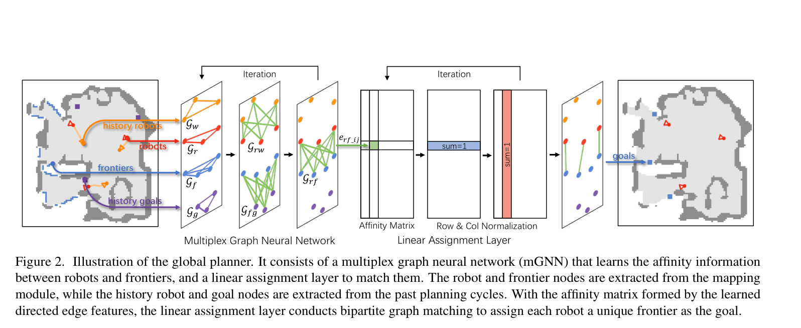

# Multi-Robot Active Mapping via Neural Bipartite Graph Matching

> **TL;DR:** NeuralCoMapping learns robot-to-frontier preferences with a multiplex graph policy and Sinkhorn normalization. Discrete frontier choices feed classical obstacle-aware path planning and action control. It reduces exploration steps in the evaluated simulations, with map completeness and assignment feasibility requiring separate qualification.

## Motivation

Nearest-frontier methods coordinate robots using myopic geodesic costs, while direct neural coordinate regression can select goals away from exploration frontiers. The paper combines frontier-based goal selection with reinforcement learning for longer-term coverage. Its combinatorial responsibility is choosing goals from frontier candidates; it does not neurally optimize every motion or reconstruct the occupancy map end to end (Sections1–4).

## Contributions

- A neural robot/frontier bipartite-assignment formulation for centralized multi-robot exploration.
- A multiplex GNN combining current robots/frontiers and historical positions/goals, with geodesic distances as input.
- PPO training through soft assignment scores, rewarding coverage increments and penalizing unnecessary steps.
- Simulated scene and robot-count transfer experiments, with classical mapping/local-control modules held common across principal global-planner comparisons.

## Methodology

**Inputs and classical mapping.** Robots receive depth images and supplied camera poses with known intrinsics. They share pose/map information; initial robots lie within3mgeodesic distance of one another. Depth observations are fused into a two-channel480×480occupancy/exploration grid, with0.01m²cells. Frontier candidates lie at explored-free boundaries of unknown space. Moving robots are marked occupied while observed and free after leaving. This assumes reliable localization and shared global mapping, rather than jointly solving unknown multi-robot localization (Section3–4.1).

*Original Figure2 and its complete caption, formalPDFp4/printed14842; extracted and visually checked.*

**Neural global planner.** Four fully connected self-graphs represent robots, frontiers, past robot positions and past goals. Three cross-graphs connect current robot/frontier, robot/history-robot and frontier/history-goal sets. Three intra/inter blocks update32-dimensional node representations through attention and residual MLPs. FMM geodesic distances enter learned cross-edge preferences. Historical positions are sampled at planning-cycle boundaries. AppendixA specifies the initialization MLP3–32–64–128–256–32, query/key/value linear32–32, node MLP64–64–32and edge MLP96–32–1 (Eqs1–6).

**Soft assignment and actual discrete decisions.** The paper describes Sinkhorn row/column normalization as a differentiable approximation to linear assignment and intends at most one robot per frontier. Sinkhorn produces a **soft transport matrix**, not itself a hard one-to-one assignment certificate. In the inspected official code, five log-Sinkhorn iterations feed per-robot categorical frontier choices: training samples and deterministic evaluation uses rowwise modes. That route does not by itself enforce distinct frontier indices across robots. No joint Hungarian decoder is asserted for the neural route; the repository's Hungarian call belongs to the CoScan comparator. This current-code distinction qualifies the figure's uniqueness wording without alleging that reported experiments are invalid (Section4.2.2; implementation evidence below).

**Path planning and control.** Every25steps, the global planner selects new goals. A classical FMM local planner replans routes with an obstacle-distance penalty; a heuristic controller moves forward6.5cmor turns12.5°. The printed Eq8 uses an `or`between the forward-angle bounds, which is true for every real angle when the threshold is positive and disagrees with the accompanying “faces the waypoint” prose; it should not be copied as a valid controller rule without resolving that notation. Neural goal assignment is separate from this classical motion layer.

**Learning and classification.** PPO optimizes reward$-.015+.005\,\Delta C$, with$\Delta C$measured in m². Twelve parallel threads/minibatches and four epochs per update use actor/critic learning rates5e-4/2.5e-5, discount.99, entropy coefficient1e-4and value-loss coefficient3. The main text calls PPO“off-policy”; this note simply identifies the implemented PPO training. **Specialist / constructive:** the neural module constructs new discrete frontier selections. Replanning a changing world is not a neural local-edit operator on a fixed complete combinatorial incumbent. Scene/robot-count transfer remains one native assignment/exploration task.

## Experiments

**Setup and metrics.** TurtleBots operate in physically realistic iGibson with collisions and action noise. The principal model trains on nine Gibson scenes with three robots, approximately one day. Classical and adapted ANS global planners share the stated mapping, local planner, controller and stopping setup where applicable. ANS variants are trained on the full Gibson dataset and compared on Matterport3D. Coverage is explored open area divided by ground-truth open area; time efficiency is **simulation steps**, distinct from wall-clock time (Section5).

**Scene results.** Gibson small/middle/large scenes give98.6/98.8/98.9%coverage and302.5/471.7/882.0steps, versus CoScan98.6/99.0/99.5%and304.2/496.1/985.0. Thus the step gains coexist with lower coverage in some bins. Matterport3D small/middle/large scenes give96.7/96.0/**92.4%coverage**and506.1/1217.3/**1874.8steps**, versus CoScan97.1/96.1/92.1%and581.7/1505.5/2781.0. The large-bin reduction is32.6%; it is not100%map completion or a universal optimality guarantee (Tables1–2).

**Stopping and cost.** Exploration stops when no **accessible** frontier remains; robots can become stuck. ANS comparisons also impose5000steps, or10,000for scenes over300m². Complete reconstruction is therefore an objective and empirical approximation, not an unconditional theorem for arbitrary environments. The paper separately reports about.04sper global planning call versus CoScan.4s. That component timing must not be equated to the simulation-step reduction or complete application runtime.

**Robot-count transfer.** Separate2/3/4-robot training models transfer to other counts. The3-trained model on4robots takes626.3steps versus614.6for4-trained, with equal96.7%coverage. SupplementTable2tests a3-trained model on2/4/5/7/9robots in Matterport scenes≥50m²: on9robots it achieves98.6%/589.7steps versus98.5%/580.8for matched-count training. The paper's“upper bound”label denotes this empirical matched-training comparator, not a proven optimum. Its100-robot test is a **single633.6m²scene**,450steps versus CoScan525, with no broad100-robot confidence study.

**Ablations and training diversity.** Full performance96.3%/661.7steps compares with geodesic-affinity96.9%/785.5, node-correlation94.3%/1045.6, no-history96.1%/729.5and no-obstacle-resistance96.8%/792.7. The full method leads steps, not every coverage value. One-scene training gives97.1%/691.3versus nine-scene96.3%/661.7. Tables report point estimates rather than full seed confidence intervals; the poster supplies further qualitative trajectories.

## Limitations

Known shared poses, centralized information, indoor frontier geometry and classical FMM/controller quality are substantial assumptions. Localization errors, communication delays, real-world safety and arbitrary outdoor exploration are not established by these simulations. Learned frontier preferences do not certify globally optimal joint trajectories, hard unique assignments or100%coverage. The current categorical decoder and printed controller condition require the implementation qualifications above.

Coverage/time tradeoffs, inaccessible-frontier termination and different training data for adapted baselines constrain the comparisons. Increased robot counts and a single100-robot demonstration do not establish scalability under every topology. This is a learned global-planning component within a larger classical stack, rather than an end-to-end general-purpose neural solver.

## Reproducibility

**Identity.** Kai Ye, He Wang and Baoquan Chen list Peking University; Siyan Dong lists Shandong/Peking; Qingnan Fan and Jue Wang Tencent AI Lab; Li Yi Tsinghua; Fei Xia Stanford. CVF CVPR2022 pagination is14839–14848. Identity-matched DOI[10.1109/CVPR52688.2022.01442](https://doi.org/10.1109/CVPR52688.2022.01442)publisher metadata gives **2022-06**. Primary[arXiv2203.16319](https://arxiv.org/abs/2203.16319)has the same title/eight authors, first posted **2022-03-30**, current v2 dated2022-04-01.

**Scientific inventory.** All ten official main pages/48references, both official supplementary pages/three references and the complete one-page author poster were read. Key equations, result tables, architectural figures and all poster qualitative panels were rendered and inspected. OriginalFigure2 with its entire caption physically exists in public/paper-assets and was actually viewed. The author-hosted appendix corroborates the official scientific attachment. The linked five-minute YouTube presentation was identified but not watched or counted as read; main text and its explicitly specified scientific appendix are complete, and no separate unexamined scientific result is claimed from that presentation.

**Code.** The author links[siyandong/NeuralCoMapping](https://github.com/siyandong/NeuralCoMapping). Its complete97-member archive at commit`b8941a444aac7de63a34288e6602f1c99bf7df72`contains no additional PDF/ZIP/notebook science. The complete README documents Python3.6/iGibson build and assets, training/evaluation scripts, datasets and pretrained weights. Necessary decoder inspection covers `utils/gnn.py`202–232,318–324(log transport/score output), `model.py`85,119–129(MultiHeatmap/action sampling or mode), and `utils/distributions.py`52–80(per-robot categorical choices). These are current implementation facts, not reconstructed historical training evidence. No simulation or training was rerun.

**Actual internal references.** The full bibliography explicitly cites[Attention Model](attention-model.md)[25]onp9,[MARVIN](marvin.md)[38]and[PCA-GM](learning-combinatorial-embedding-networks-for-deep-graph-matching.md)[42]onp10. Distinct graph-coloring and classical mapping works are not mapped to unrelated neural solver IDs merely by topic.
