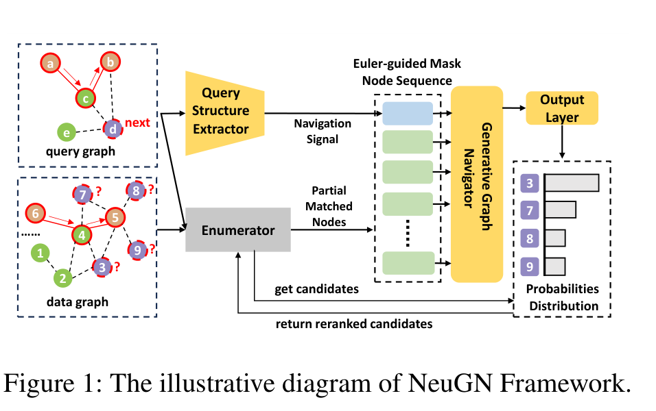

# Neural Graph Navigation for Intelligent Subgraph Matching

> **TL;DR:** NeuGN learns how to order candidate vertices inside an exact subgraph enumerator. It improves early discovery and time-limited throughput on the tested graphs while retaining completeness under explicit assumptions about the underlying search.

## Motivation

Filtering and query-vertex ordering reduce the work of subgraph matching, but the remaining enumeration can still explore many unsuccessful partial assignments. NeuGN makes this enumeration order depend on the query and the current partial match. Its task is labeled, connected, undirected **non-induced subgraph isomorphism**: an injective query-to-data map preserves labels and query edges; the definition does not require preservation of query nonedges. The stated objective is enumeration of all valid matches, rather than minimizing a learned similarity loss at deployment (Sections 1–3, read manuscript pp1–2).

## Contributions

- Combine a GCN query-structure extractor with a Transformer navigator that ranks possible extensions of a partial match.
- Serialize query structure through an edge-duplicating Eulerization and train graph-specific node-ID prediction without obtaining exhaustive match labels from a classical matcher.
- Integrate candidate reordering into eight matching algorithms and evaluate search steps, query-size transfer, and early enumeration throughput on six real data graphs.
- Prove preservation of soundness and completeness **conditional on** a sound, complete baseline with order-robust safe pruning and a full permutation of every candidate list. This is not a speed or polynomial-time guarantee (Sections 4–5; Appendix A).

## Methodology

**Neural representation.** A GCN embeds query labels and adjacency, followed by max pooling to form a query signal. Eulerization duplicates existing edges so that a traversal encodes the connected query; a cyclic reindexing supplies query-node identities within a fixed range. The navigator also has embeddings and an output vocabulary for the actual vertices of the data graph. Matched positions hold their data-node IDs, unmatched positions are masked, and class tokens identify the next node to predict. A bidirectional Transformer combines this sequence with the query signal and produces scores over data-node IDs (Sections 4.1–4.2; Figures 1–2).

*Original Figure 1, extracted with its caption from arXiv v1 PDF p3 and visually checked. The enumerator supplies candidates and receives a reordered list.*

**Training.** For each data-graph vertex, sample a random walk visiting 5–19 distinct vertices and extract the induced subgraph as a training query. Randomly mask nodes and use cross-entropy to recover a selected data-node ID. This uses known membership of sampled subgraphs, rather than exhaustive enumeration labels. The reported protocol trains for 1,000 epochs, batch size 128, embedding width 256, eight attention heads, and four Transformer layers, reduced to two for Hamster/LastFM. Training is graph-specific: both the learned vertex vocabulary and architecture settings depend on the data graph (Appendices B.4/C.2).

**Search and guarantee.** Filtering, query-vertex order, candidate generation and feasibility checks belong to the base matcher. NeuGN changes only the order of candidates at selected depths; later depths use the baseline order. Batched look-ahead amortizes neural evaluations. Appendix A assumes (A1) pruning never removes an extendable child because siblings were visited in a different order and (A2) every candidate appears exactly once. Under finite exhaustive DFS, each original solution path remains reachable. Dropping low-scoring candidates, an unsafe order-dependent pruning rule, or stopping at a finite time budget does not inherit that exhaustive completeness conclusion. Learned ranking itself provides no feasibility certificate; the classical checks do (Algorithm 1; Appendix A).

**Classification.** This is a specialist constructive solver component: the network prioritizes extensions before a complete discrete map exists, and the exact enumerator constructs/checks the matches. Tests across data graphs and different query sizes are not evidence of one unchanged checkpoint across native optimization tasks. There is no neural edit of an incumbent complete matching (Sections 4–5; Appendix C.2).

## Experiments

**Protocol and metrics.** Hamster, LastFM, WikiCS, NELL, DBLP and YouTube range from 2,421 to 1,134,890 vertices. Main defaults use 200 queries of 20 vertices and navigation depth ten. Compare QSI, GQL, CFL, VF3, CECI, CaLiG, RLQVO and RSM with/without the plugin. First Match Steps (FMS) counts enumeration steps until the first answer, and the paper reports medians to limit outlier influence. Matches Per Second (MPS) measures time-limited output throughput; these are different metrics (Tables 1–2).

**Search-step results.** Table 2 reports improvements for all printed baseline/dataset/density cells. The headline 98.2% is the across-baseline average reduction for dense WikiCS queries, not a universal reduction or a wall-clock speedup. For example, CECI on dense WikiCS changes from 675 to 35 steps, while sparse LastFM CaLiG changes from 43 to 40. Removing the query extractor worsens all six reported CECI FMS values; replacing the Transformer or Eulerian serialization also worsens those ablations (Tables 2–3).

**Size and early-time behavior.** Queries of 8/16/24/32 nodes test sizes beyond the 5–19-node training queries. On WikiCS, CECI's median FMS for 32-node queries changes from 254,460 to 8,079, a reported 96.8% reduction. The early-throughput experiment uses 32-node queries, navigation depth sixteen and a one-second enumeration budget. Table 5 reports GQL MPS gains of 17.0–52.4% and CECI gains of 9.2–37.7% on four graphs. Extended Table 8 includes smaller gains, such as CFL/DBLP 2.1% and CaLiG/DBLP 2.0%; the largest printed gain is CaLiG/WikiCS 91.6%. These are constrained early-enumeration results, not full-enumeration speedups (Tables 4–5/8; Appendix C.3).

**Compute.** Training uses four NVIDIA A40 GPUs and online inference one A40, with Xeon Gold 6342 CPUs and single-threaded classical baselines. At batch sixteen, YouTube inference takes 38.91 ms for the batch, or 2.43 ms amortized per item; at batch one it is 3.71 ms. Neither number is an end-to-end query runtime. Reported per-epoch training ranges from 0.02 minutes on Hamster to 19.30 on YouTube; the stated 1,000 epochs would correspond to about 322 GPU-server hours for the latter if sustained at that measured rate. No training run was repeated in this review (Appendix C.2–C.3, Tables 6–7).

## Limitations

**Authors' scope.** Reordering retains essentially the same exhaustive search space and does not remove worst-case combinatorial complexity. Graph-sized token/output vocabularies limit memory and transfer to new data graphs. Hierarchical tokenization and semantic matching are proposed future directions, rather than demonstrated capabilities (Appendix D).

**Curator boundaries.** The theorem is a preservation result with safe-pruning/full-permutation assumptions, not a guarantee that every integration, timeout or learned prediction is exact. Query-size transfer on a known data graph is narrower than deployment on unseen graphs. FMS improvements cannot be substituted for throughput gains. Appendix C.3's claim that sampling at every anchor prevents omission of every structural motif is stronger than the finite random-walk protocol establishes: visiting all anchors does not exhaust their possible subgraphs.

**Implementation visibility.** The technical appendix says source code accompanies supplementary materials. The linked public repository at the inspected commit contains only its README and the seven-page scientific appendix. Thus the claimed Python/C++/LibTorch implementation, checkpoints, exact query splits, and rank-tie handling could not be independently inspected or executed. The appendix's softmax-elision discussion also omits the bias shown in the main affine-output equation; removing softmax preserves ranking of the **same complete logits**, but removing a nonconstant learned bias need not. The unavailable code prevents deciding which operation is implemented (main Equation 5; Appendix C.3).

## Reproducibility

**Identity and dates.** The nine-author byline and three affiliations were checked on read PDF p1 against the official AAAI record. Formal publication is AAAI 2026, volume 40(19), pp16181–16189, DOI [10.1609/aaai.v40i19.38654](https://doi.org/10.1609/aaai.v40i19.38654). Publisher-deposited Crossref `published-online` gives **2026-03-14**; this differs from the January conference. The note's `date` is **2025-11-22**, the first arXiv posting, while `publication.date` retains the formal date. An acceptance date was not inferred.

**Actually read materials.** All fifteen pages of [arXiv 2511.17939v1](https://arxiv.org/abs/2511.17939v1), including references and integrated technical appendix, were read. The separate seven-page [author-repository appendix](https://github.com/Ying-Yuchen/NeuGN/blob/5fde722d4969895ede16668f148a198f7cfe097f/NeuGN_APPENDIX.pdf) has an anonymous-submission cover and a different layout; every page and its references were independently read. Key architecture, algorithm, completeness proof, main tables, timing tables and figure were rendered and inspected. These materials are not asserted to be byte-identical to the formal nine-page PDF.

**Supplement/code inventory.** The official PDF's public link labels this repository as “Appendix.” The complete, untruncated GitHub tree at commit `5fde722d4969895ede16668f148a198f7cfe097f` has exactly two files: `NeuGN_APPENDIX.pdf` and `README.md`; no code archive, checkpoints or additional scientific PDF is present. The public event page returned 404 during this review. No unavailable unobserved science is claimed as read, and no reproducibility run is claimed. The full main and supplementary bibliographies were compared with the 527-entry catalogue; no explicit reference to another current stable entry was confirmed, so no internal citation edge was invented.
