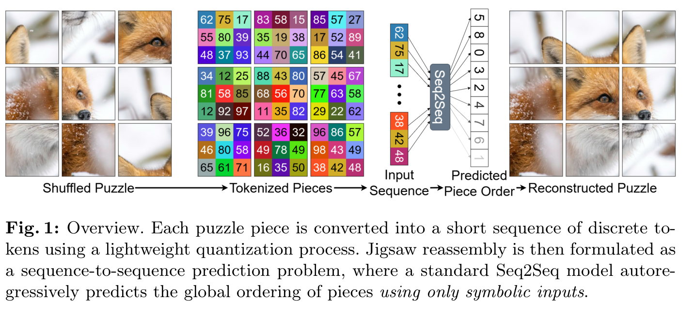

# PuzLM: Solving Jigsaw Puzzles with Sequence-to-Sequence Language Models

> **TL;DR:** A train-set PCA/k-means tokenizer compresses image-piece borders into discrete sequences. A standard encoder–decoder network then autoregressively predicts grid positions, with strong tested puzzle results but no hard permutation-validity guarantee.

## Motivation

Most jigsaw solvers process pixels or continuous visual features throughout reconstruction. PuzLM asks whether a compact symbolic interface can support accurate reconstruction with a standard sequence model. Its **symbols are quantized visual patch features**; the claim is absence of further direct pixel access after tokenization, rather than absence of visual information in the pipeline. The task assigns square, known-orientation pieces to positions in a known grid, including eroded and masked-piece variants (Sections 1–3).

## Contributions

- Reformulate grid reassembly as sequence-to-sequence prediction over discrete input tokens and output position indices.
- Design a nonneural, data-fitted tokenizer that retains clockwise border patch codes, sorts pieces lexicographically, and inserts separators.
- Evaluate encoder–decoder backbones, tokenizer choices, missing-piece handling, larger grids, shared multi-size training and cross-dataset transfer.
- Demonstrate better printed results than the compared solvers on ImageNet 3×3 and JPwLEG-5, while retaining an explicit counterexample to a universal-best claim: FCViT is stronger on JPwLEG-3 (Tables 2–5; official supplement C).

## Methodology

**Tokenizer.** Fit PCA and k-means on patches from the training split only, then freeze both. Divide each piece into B×B patches; project each patch and replace it by its nearest centroid index. Keep b=max(1,4B−4) boundary tokens in clockwise order. Sort the resulting piece “super-tokens” lexicographically and concatenate with separator tokens, giving bN+(N−1) input tokens for N pieces. Main settings are **B=4, d=2¹⁰=1,024, k=2¹²=4,096**, as verified on the rendered page, rather than the misleading plain-text extraction “210/212” (Section 3.2; supplement Algorithms 1–2).

*Original Figure 1 and complete caption, extracted from the read arXiv v2 PDF p1 and visually checked.*

**Solver and objective.** An encoder reads the full tokenized puzzle; an autoregressive decoder predicts a position index for each lexicographically ordered piece. Main experiments use BART, with T5, Pegasus, LSTM and GRU comparisons. Training minimizes target-position cross-entropy; inference chooses each next index by argmax. No dedicated used-position mask or Hungarian repair is part of the described method. The authors report that valid permutations emerge during training, and propose enforced uniqueness as future work. Accordingly, successful exact reconstructions are valid, but other outputs are not guaranteed to be bijections (Sections 3.4–3.5; supplement D.3).

**Scope.** This is **specialist / constructive**: the network builds an assignment sequence from piece tokens, without neural editing of an incumbent complete solution. The same trained multi-size model and cross-dataset transfer are positive evidence within grid-jigsaw solving, not a demonstrated shared checkpoint across different native combinatorial tasks. For missing pieces, replace their tokens by a mask and evaluate only the visible pieces; this is placement prediction, not visual generation of the missing content (Section 5.1; supplement C.2–C.3).

## Experiments

**Main metrics.** Absolute accuracy (AA) is the fraction of pieces in their correct positions; perfect accuracy (PA) is the fraction of completely correct puzzles. ImageNet 3×3 results are **92.2% AA / 87.1% PA**, versus FCViT 90.6/78.9 in the printed comparison. Some older baselines use a restricted permutation set, which the main table explicitly distinguishes from unrestricted 9! settings. On JPwLEG-3, PuzLM gives **91.9/84.5**, below FCViT **96.9/87.9**; on JPwLEG-5 it gives **72.1/32.5**, above the printed second-best VLHSA **66.9/19.0**. The prose's 87.9% PuzLM JPwLEG-3 PA conflicts with Table 4; this note uses the table's 84.5% (Tables 2/4; read v2 pp11–12).

**Missing pieces.** With one/two/three of nine pieces masked, PuzLM's visible-piece AA/PA are **86.0/71.3**, **73.8/45.1**, and **61.2/23.7%**, respectively; all exceed the listed JPDVT row. A perfect score here concerns the unmasked pieces and is not the same event as reconstructing all nine original image pieces (Table 3).

**Ablations.** JPwLEG-3 AA/PA fall from 91.9/84.5 to 81.1/67.0 without PCA, 72.2/50.3 when interior tokens are retained, and 67.6/35.0 with random input order. Alternative VQ-VAE/TiTok tokenizers perform worse in the tested downstream configuration, supporting task-specific tokenization rather than a universal result about all discrete image representations. Table 5's **under-one-million parameters and under-one-millisecond encoding concern the tokenizer**, not the entire BART solver; the supplement lists much larger sequence-model backbones (Table 5; supplement B.1).

**Additional positive transfer and scale limits.** Separate ImageNet 4×4 through 8×8 settings decrease from **91.5/85.0** to **63.1/15.0% AA/PA**. A single model trained jointly on 3×3/4×4/5×5 puzzles obtains AA 92.0/90.6/88.2 and PA 86.3/84.1/75.9. ImageNet-trained models tested on JPwLEG, with training piece sizes matched to the target, obtain **88.6/78.5** for 3×3 and **71.1/33.4** for 5×5. These are reported zero-shot dataset transfers; the main independently trained benchmark rows should not be conflated with them. Structured-image datasets are easier in the tested protocol: CelebA 6×6 reaches 96.2/88.2, for example (supplement C, Tables 3–4).

**Compute/protocol.** The supplement specifies AdamW at 10⁻⁴, weight decay 10⁻², at most 64 epochs, batch 32, and checkpoint selection by validation cross-entropy. Rounded mean training durations over six runs are three/six/twenty-one hours for JPwLEG-3/5 and ImageNet 3×3; per-puzzle sequence inference is reported below 100 ms. The sequence models use RTX6000 Ada hardware; tokenizer experiments use an RTX4070 workstation. Tokenizer preprocessing has separate fitted-codebook and inference costs, so its reported compression and encoding latency are not complete pipeline costs (supplement A.3/B).

## Limitations

**Stated extensions.** Unknown rotations, irregular fragment geometry, explicit permutation-aware decoding and image generation are future proposals. Longer sequences and large grids degrade current reconstruction. The experiments concern synthetic image-grid fragmentation, not real archaeological reassembly (supplement C.1/D/F).

**Curator boundaries.** Fixed token support does not ensure equality of train/test distributions: token frequencies, combinations and conditional solutions may shift. Noninvertible quantization discards detail but still carries appearance information; it does not establish statistical independence from pixels. The visual-token entropy/Zipf/Heaps analysis is descriptive evidence, not proof of human-like language reasoning. Likewise, PA≤AA does not imply that reducing cross-entropy must monotonically improve both accuracies.

**Feasibility and evidence.** Autoregression discourages duplicates empirically but does not enforce uniqueness. PA certifies correctness for the fully solved fraction only; it does not measure invalid-assignment frequency among the remainder. Hypotheses about why FCViT degrades on larger grids are explanations proposed by the authors, not isolated causal ablations. Removing PCA alone also cannot make a finite nearest-centroid quantizer invertible; the proposed generative extension would need additional design. No optimization approximation bound, exact search guarantee, or independent reproduction is claimed here.

## Reproducibility

**Formal identity and dates.** Springer confirms the three authors Gur Elkin, Ofir Itzhak Shahar and Ohad Ben-Shahar, their Ben-Gurion University affiliation, ECCV 2026 proceedings volume 17046, pp58–75, and DOI [10.1007/978-3-032-37281-9_4](https://doi.org/10.1007/978-3-032-37281-9_4). Both the chapter's **First Online** statement and publisher-deposited Crossref assertion give **2026-09-12**. `date` instead records **2025-11-09**, arXiv v1's first posting under the earlier title *Seq2Seq Models Reconstruct Visual Jigsaw Puzzles without Seeing Them*. The same arXiv ID, three authors and later title establish version continuity. The read main copy is explicitly **v2, 2026-03-12**, not asserted byte-identical to the formal chapter.

**Actually read material.** All eighteen main v2 PDF pages and thirteen official Springer supplementary pages were read, including both full bibliographies. The chapter's public HTML lists one electronic scientific supplement; its title/byline match the paper. Algorithms, equations, superscripted hyperparameters, main and supplementary tables, qualitative examples and Figure 1 were rendered and checked. The main v2 bibliography has 55 items, while the formal chapter webpage lists 56, so reference numbering in this note's evidence explicitly belongs to the read v2.

**Code discovery.** Supplement B.3 promises a complete release upon acceptance, but the inspected chapter/arXiv pages and PDF links provide no identifiable official implementation URL. The primary author-publication URL surfaced by search returned 404. No public code or checkpoint was therefore claimed verified, and `code_url` is omitted; the distinct PuzzleFlow repository is not mislabeled as PuzLM code. The complete supplement was available and read, so this code-availability limitation is separate from scientific reading coverage.

**Internal references.** Confirmed explicit citations are [JPDVT](solving-masked-jigsaw-puzzles-with-diffusion-vision-transformers.md) [23], [DiffAssemble](diffassemble-a-unified-graph-diffusion-model-for-2d-and-3d-reassembly.md) [35], [SD2RL](siamese-discriminant-deep-reinforcement-learning-for-solving-jigsaw-puzzles-with-large.md) [42], [ERL-MPP](https://doi.org/10.1609/aaai.v39i7.32748) [44], and [RePAIR](../studies/repair-benchmark.md) [47]. These stable identities were checked against the actual bibliography, rather than inferred from topical similarity.
