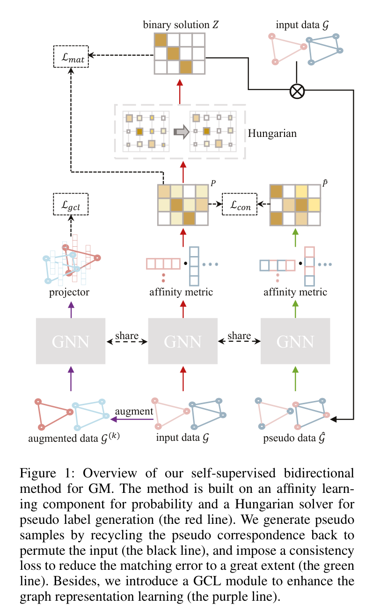

# Self-Supervised Bidirectional Learning for Graph Matching

> **TL;DR:** IA-SSGM trains graph affinities from Hungarian pseudo-labels, recycles the predicted correspondence into graph features for a consistency objective, and jointly learns contrastive representations. It improves aggregate accuracy over two self-supervised comparators on the tested visual benchmarks. Consistency alone does not certify the correct matching.

## Motivation

Many learned graph matchers require expensive correspondence annotations. IA-SSGM seeks a training signal from the model's own discrete predictions and augmented graph views. It addresses attributed graph matching by learning affinities and then constructing an injective source-to-target assignment. The mathematical introduction starts from QAP, but the implemented learned decision problem is a linear assignment over neural scores; no exact equivalence to arbitrary QAP optima is established (Introduction; Method, PDFpp1–4).

## Contributions

- Hungarian matching supplies discrete pseudo-labels for a self-supervised affinity-learning objective.
- A bidirectional recycling path exchanges source/target features according to the predicted correspondence, recomputes affinities and encourages consistency.
- Graph contrastive learning is combined with the matching and consistency objectives using an annealed weighting schedule.
- Experiments cover five visual benchmark families, target-only outliers, component ablations and comparisons with published supervised results (PDFpp2–7; official supplement).

## Methodology

**Task and encoder.** With $n_s\leq n_t$, the binary matrix has one selected target per source and at most one source per target. It is an injection, not a necessarily square bijection. Pretrained VGG16 features are bilinearly sampled from two image feature maps and concatenated; relative keypoint coordinates form edge attributes. The experiments use SplineCNN, GIN or their combination, depending on the dataset. Shared source/target encoding yields $H_s,H_t$, then $M=H_sH_t^\top$. Row-wise softmax produces $P$; its columns need not satisfy assignment constraints (Eqs1–3; Experimental Settings).

*Original Figure1 and complete caption, extracted from formal PDFp3/printed7786 and visually checked.*

**Hard assignment and training.** Hungarian assignment applied to $P$ produces a feasible injective pseudo-label $Z$. A binary cross-entropy matching loss trains the affinity network toward that label. Recycling constructs $\widehat X_s=ZX_t$ and $\widehat X_t=Z^\top X_s$, retains each graph's adjacency/edge structure and recomputes $\widehat P$. The consistency term is $-\sum_{ij}\widehat p_{ij}\log p_{ij}$. Augmented graph views feed a two-layer projection and InfoNCE-style contrastive loss. The printed joint weights are $\alpha=\beta=\tanh(m/5)$ and $\gamma=1-\tanh(m/5)$ at epoch$m$; the stated stopping criterion is a loss change below0.001 over three epochs (Eqs4–13).

**What feasibility means.** Hungarian optimizes the learned linear score matrix and enforces the injection constraints; it does not prove the maximum of the original quadratic affinity objective or recover ground truth. In the rectangular case, $Z^\top X_s$ contains zero-filled unmatched target positions. Thus the paper's phrase “permute the input” is exact for a bijection but should not silently treat target outliers as invertibly permuted source features.

**Classification.** The recycling loop is a training mechanism. At inference the learned affinity produces a fresh Hungarian assignment; it is not a learned edit policy operating on a complete incumbent. Different dataset-specific GNNs and matching regimes do not demonstrate one checkpoint across native combinatorial tasks. The appropriate classification is **specialist / constructive**, despite Hungarian being described as an improvement operator for a probability score.

## Experiments

**Data and protocols.** The supplement lists PascalVOC8,702images/20classes, Willow404/5, CUB201111,788/200, CMU-House/Hotel212/2 and IMC-PT-SparseGM25,061/16. Pascal uses7,020training and1,682test images,1–19keypoints and Delaunay graphs. Willow also uses Delaunay graphs; CUB and IMC use fully connected graphs. IMC trains on13attractions and tests Reichstag, SacreCoeur and StPetersSquare. Its reported partial rate is57.3%. INLIER keeps common keypoints; OUTLIER deletes unmatched source nodes but retains target-only outliers. This is easier than allowing outliers on both sides, an important distinction in supplementary comparisons (PDFpp5–7; supplementTables4/7).

**Metric and budgets.** The metric is mean correct source-node matching accuracy, evaluated against ground-truth correspondences. It is neither F1 nor optimality gap for the learned QAP. Training uses Adam with decaying learning rate on an Intel Xeon Gold6226R CPU and one A10040GB GPU. Main aggregate tables report point estimates, without a complete multi-seed runtime/variance study. The CUB figure's error bars summarize variation over classes rather than establishing across-run uncertainty (Experimental Settings; Figure2).

**Aggregate results.** Main Table1 IA-SSGM accuracy is **65.2/62.8%** on Pascal INLIER/OUTLIER, **98.2%** on Willow, **86.5/85.6%** on CUB, **100%** on CMU and **86.3/69.0%** on IMC. Against the stronger of IA-GM/GANN in the corresponding OUTLIER columns, gains are21.1,14.8 and1.1 **percentage points** for Pascal/CUB/IMC. CMU ties GANN100%. Two-stage contrastive pretraining is better than the full joint method on IMC OUTLIER, **71.5 versus69.0%**. Table2's Pascal INLIER mean is65.3, differing slightly from Table1's65.2; both printed values are retained as a reporting discrepancy.

**Class-level and ablation exceptions.** SupplementTable5 has IMC Reichstag INLIER95.2 versus IA-GM98.1 and StPetersSquare OUTLIER66.9 versus GANN68.1. Willow Duck is92.1 versus IA-GM98.0, although the overall mean improves. Adding consistency without contrastive learning also lowers CUB INLIER from69.9 to68.8 and OUTLIER from64.5 to56.2. Full joint learning is strongest across the aggregate ablation columns except CMU ties. Hence neither every category nor each isolated component improves unconditionally (mainTable3; supplementTables5–6).

**Supervised reference quality.** SupplementTable7 collects comparator numbers from their original papers. IA-SSGM65.2 on Pascal INLIER remains below BBGM80.1 and DLGM-G83.8. Its62.8 OUTLIER number cannot be treated as a controlled win over BBGM61.4, because the asterisk explicitly says that comparator permits outliers on both sides, a harder protocol. Different supervision and protocols limit direct ranking. The16qualitative supplementary examples include incorrect matches and illustrate behavior, rather than proving universal recovery.

## Limitations

**Consistency is not a correctness certificate.** Proposition2 shows that the specified correct assignment gives zero $J=\|\widehat P-P\|$ under its proof setup; the subsequent claim that minimizing$J$ forces the correct assignment is stronger. A constant-zero permutation-equivariant encoder makes both matrices uniform, so $J=0$ even if Hungarian selects an incorrect tied permutation. For a concrete two-node isomorphic pair with features$(1,2)$ and$(2,1)$, the true feature correspondence swaps nodes, while an identity tie-breaking assignment is wrong and still has$J=0$. This curator example refutes the inverse/uniqueness inference, not the stated sufficient direction or the empirical utility of the complete training loss. It does not claim that the overall cross-entropy/contrastive objective is zero or that optimization necessarily converges to that encoder.

**Assumptions and printed proof scope.** The supplement derives relations using exactly isomorphic square graphs with $X_s=Z^*X_t$ and $A_s=Z^*A_tZ^{*\top}$. General permutation equivariance alone does not imply these identities for noisy, nonisomorphic or rectangular partial-matching instances. Its Eq15 prints$X_t$ where the adjacency relation requires$A_t$; subsequent Eq16 uses$A_t$. Supplement sections refer to Propositions2/3 and old equation numbers that do not align with the two propositions in the final main text. The main spectral-bound discussion also heuristically substitutes the learned probability matrix for a spectral eigenvector; this is not a demonstrated QAP approximation guarantee for the full learned algorithm.

**Operational limits.** Pseudo-label confirmation can reinforce wrong correspondences, and a low consistency error may reflect uninformative representations. ImageNet-pretrained features supply external supervised information even though correspondence training is self-supervised. The visual tasks, dataset-dependent encoders and target-only-outlier protocol limit claims of general native-task transfer, arbitrary partial matching or guaranteed outlier robustness.

## Reproducibility

**Identity and dates.** Wenqi Guo, Lin Zhang, Shikui Tu and Lei Xu are at Shanghai Jiao Tong University. The formal paper is AAAI2023,37(6),pp7784–7792, DOI[10.1609/aaai.v37i6.25943](https://doi.org/10.1609/aaai.v37i6.25943). Identity-matched publisher-deposited Crossref `published`/`issued` records **2023-06-26**, distinct from the February conference dates. No matching arXiv identity was established from the official author/repository and targeted search, so no preprint URL/date is invented; `date` uses the supported formal publication date.

**Actual source provenance and coverage.** The publisher PDF endpoint was inaccessible. A complete nine-page formal-layout public mirror was retrieved and checked against the official title, all four authors, affiliation, AAAI copyright/header and printed page range; the ledger records its real retrieval URL and SHA, without claiming byte identity to inaccessible primary bytes. All nine pages, including the entire bibliography, and all three official author-repository supplement pages were read. The supplement supplies algorithms, extra proof steps, statistics, numerical and supervised comparisons, and qualitative results. Key formulas/tables and every qualitative panel were rendered and checked. Original Figure1 with the complete caption physically exists under the public assets directory and was actually viewed.

**Official code and inventory.** The author homepage links[CMACH508/IA-SSGM](https://github.com/CMACH508/IA-SSGM). Its complete untruncated162-entry tree at`83ef28a796650009845da4e4e0c709bed9a384f3` contains the scientific `Supplementary_material.pdf` and README, with no other PDF/ZIP/notebook supplement. The full README was read, including Python3.8/PyTorch1.10/CUDA11.3, PyG/DGL/PyGCL dependencies and five-dataset preprocessing. Some convenience links are incomplete (`https://` for preprocessed data and an empty Docker pull command). An indexed Underline poster/presentation entry was checked as an additional presentation lead, without obtaining or claiming to read an independent scientific document.

**Current implementation differences.** `GSSL/joint_matching.py` implements feature recycling and Hungarian assignment. `train_joint.py`96 uses **tanh(epoch/100)**, whereas printed Eq13 uses epoch/5; the code loops to configured epochs and evaluates after every epoch rather than implementing the stated three-epoch convergence stop. It sets the consistency criterion to PyTorch `CrossEntropyLoss`313 and passes already normalized probabilities as input117; that API interprets its first argument as logits and therefore is not literally the printed $-\widehat P\log P$ expression. These observations describe current source, not a demonstrated invalidation of historical results. No training, installation or benchmark rerun was performed.

**Actual internal citations.** The complete bibliography cites [GLSearch](glsearch.md), [DGMC](deep-graph-matching-consensus.md), [BBGM](deep-graph-matching-via-blackbox-differentiation-of-combinatorial-solvers.md), [PCA-GM](learning-combinatorial-embedding-networks-for-deep-graph-matching.md), [CIE-H](cie-h.md), [DLGM](deep-latent-graph-matching.md), [GMN](deep-learning-of-graph-matching.md), [Deep Graphical Feature Learning](deep-graphical-feature-learning-for-the-feature-matching-problem.md) and [IA-GM](ia-gm-a-deep-bidirectional-learning-method-for-graph-matching.md). The GANN-related entry instead names a different-title four-author TPAMI submission, and the NGM entry names its journal extension; neither is automatically merged into an earlier conference stable ID.
