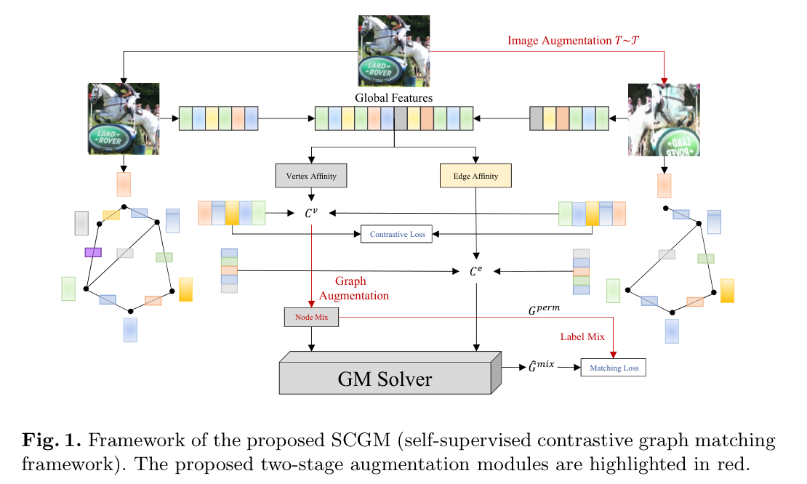

# Self-Supervised Learning of Visual Graph Matching

> **TL;DR:** SCGM pretrains visual graph-matching networks using augmented copies of the same image, graph-feature/label mixing and node-level contrastive learning. Cross-image correspondence labels are unnecessary for that stage; supervised fine-tuning is evaluated separately. The discrete decoder is inherited from BBGM or NGMv2.

## Motivation

Annotated matches between different images are expensive. SCGM generates two views of a single image, tracks the corresponding landmark identities through augmentation and trains on these automatically known relationships. Thus pretraining need not select matchable cross-image pairs or use object-category labels. Known keypoint positions and image preprocessing remain inputs, and this correspondence-label-free setting must be separated from later supervised fine-tuning (Sections1–4).

## Contributions

- A self-supervised pretraining framework requiring neither manual cross-image correspondences nor category-based pairing.
- Two-stage augmentation of raw images and graph features, with consistent mixed matching targets.
- A node-level contrastive objective focused on landmark features rather than arbitrary background pixels.
- BBGM/NGMv2 experiments on filtered and outlier-containing matching, dataset transfer and labeled-data fine-tuning.

## Methodology

**Augmented correspondence supervision.** Two raw-image views undergo crops, flips and appearance perturbations; node coordinates identify the landmarks retained in both. Within one view, a random node permutation mixes features as$(1-\lambda)x_i+\lambda x_j$. Its matching loss combines the original and permuted synthetic targets with the same weights. These are generated self-correspondences, rather than unknown ground truth inferred between independently sampled objects (Eqs4–5).

*Original Figure1 and entire caption, official ECVA accepted-copy PDFp6; extracted and visually checked.*

**Contrastive learning.** A projection head on visual feature maps provides node features at known landmark positions. The intersection of nodes visible in both augmented views supplies positives; other retained nodes in the same and opposite views provide negatives. The symmetric node contrastive loss is combined with backbone-compatible matching loss, with default$\alpha=.2$and mixing$\lambda=.4$. InfoNCE alignment/uniformity and vicinal-risk arguments motivate the design; the paper establishes no approximation guarantee for discrete graph matching (Eqs6–12).

**Backbone and discrete output.** SCGM changes representation training while retaining the underlying solver: the released BBGM configuration uses a neural feature/affinity model plus **LPMP graph-matching solver** and Hamming loss; NGMv2 uses neural association-graph scores, Sinkhorn and **Hungarian decoding**, with permutation loss. The released VGG backbone initializes through torchvision `pretrained=True`. Consequently“label-free”describes the matching pretraining labels, not proof that the entire visual system has never used external supervised pretraining. No new universal exact decoder or optimality certificate is introduced.

**Classification.** **Specialist / constructive.** Neural features/affinities support construction of fresh visual correspondences. A classical optimizer's iterations do not make this a neural incumbent-edit policy. BBGM and NGMv2 variants are separately trained; transfer between visual datasets remains the same native graph-matching task.

## Experiments

**Protocol.** Images are cropped to annotated object boxes and scaled to256×256; Pascal landmarks number6–23. Willow has256images in five categories with ten landmarks per object, as described in the paper. Intersection filtering keeps landmarks common to both images and reports matching accuracy/recall. With all landmarks retained, outliers can occur on both sides and **F1**is reported. These metrics/settings are distinct. The ThinkMatch protocol retains keypoints outside object boxes, so its BBGM numbers can differ from the original BBGM paper. Hardware is XeonE5-2678v3 and eight RTX2080Ti GPUs (Section5.1).

**Correspondence-label-free Pascal.** SCGM+BBGM reaches **57.1%filtered accuracy and35.9%unfiltered F1**, versus the tested two-graph GANN31.5/24.3. SCGM+NGMv2 gives54.3/33.3. The stronger fully supervised baselines remain substantially higher: NGMv2 reaches80.1%filtered accuracy and BBGM55.4%unfiltered F1. GANN additionally uses matchable/category-related graph sets, so the available-information comparison differs. These results support the stated pretraining setting, not superiority over every supervised method (Tables1–2).

**Willow transfer.** Pascal-pretrained models are adapted using Willow data, as explicitly described in Section5.3; the table places them in its correspondence-label-free group. SCGM+BBGM/NGMv2 averages are **91.3/91.0%**, below GANN92.0%. BBGM-variant duck73.0is below GANN89.8, while car/face/motorbike/winebottle are stronger. Excluding duck gives95.9%versus92.6%for those four categories, a conditional comparison that must not replace the whole-dataset mean. Fully supervised BBGM/NGMv2 are97.2/97.5% (Table3).

**Supervised fine-tuning.** On Pascal, full labeled-data fine-tuning after SCGM gives80.6%filtered BBGM accuracy versus79.0, and about80.2%NGMv2 versus80.1. In the all-keypoint setting, Table5gives **57.76%F1**after Pascal pretraining versus BBGM55.40; pretraining on SPair-71k raises that to59.52. At20%labeled data, Pascal-pretrained51.72remains below the full-data baseline55.40. The labeled-data fractions and pretraining datasets must remain visible; these are not zero-label downstream results. Some prose rounds or gives55.3where the displayed baseline is55.40, so the tabulated values are used (Figure3; Table5).

**Ablations and uncertainty.** The default all-keypoint F1 is35.9. Varying$\alpha$gives33.0–35.9over the displayed range, while$\lambda>.5$degrades strongly:25.8at.6and21.6at1. Figure4's left-hand removal sequence is **cumulative**, as its caption states, rather than independent leave-one-component-out tests. Both image and graph augmentation help relative to no augmentation. Main tables are point estimates without a complete multi-seed confidence study; all fifty qualitative image-pair panels were inspected, including failures with zero correct matches.

## Limitations

Keypoint locations, object crops, augmentation tracking and visual-backbone initialization remain prerequisites. Matching labels removed from one training stage should not be confused with removing every annotation or external training signal. Augmentation copies from the same image do not exhaust real cross-instance variation, and performance is sensitive to feature-mixing strength.

Pretraining-only accuracy is much lower than strong supervised baselines; Willow's full mean does not beat GANN, and low-label downstream fine-tuning can remain below full-label training. Unknown outliers and partial semantic overlap remain difficult. The framework inherits the feasibility/quality limits of its chosen decoder and provides no semantic correctness or combinatorial-optimality theorem. Runtime or data-efficiency claims require the stated hardware, solver and labeled-data budget.

## Reproducibility

**Identity and publication.** Chang Liu, Shaofeng Zhang, Xiaokang Yang and Junchi Yan all list Shanghai Jiao Tong University. The official[Springer chapter](https://link.springer.com/chapter/10.1007/978-3-031-20050-2_22), DOI10.1007/978-3-031-20050-2_22, gives **First Online/Published28October2022**, LNCS13683,pp370–388. This exact primary date takes precedence over year-only Crossref metadata. Scientific reading uses the complete **17-page official ECVA accepted copy**, with different layout/pagination; publisher-byte identity is not claimed. No unverified arXiv identity is introduced.

**Scientific coverage and figure.** Every ECVA page, all59references, formulas, tables, training curves and qualitative panels were read and inspected. The official ECVA/Springer chapter entries and complete source archive were checked; no separate scientific supplement is listed or explicitly required by the main paper. OriginalFigure1 with its entire caption physically exists in public/paper-assets and was actually viewed.

**Official code.** The paper links[ThinkMatch-SCGM](https://github.com/Thinklab-SJTU/ThinkMatch-SCGM), whose actual default branch is **ssl**, not main/master. The complete200-member archive at commit`ec7a6d5765ac83934e5f9f130354a5770a2c6be4`has no PDF/ZIP/notebook attachment. Its full short README names the BBGM and NGMv2 configuration files. Necessary configuration/backbone/decoder inspection confirms the LPMP/Hungarian routes and pretrained VGG. Current NGMv2 configuration uses contrastive ratio.1and `USE_GLOBAL: True`, differing from the main text's blanket default.2and node-level description; these are current configuration facts, not proof that historical results used the same settings. The printed Gaussian-blur“rate25”is retained in both configs and should be resolved against actual augmentation code before rerunning, rather than silently read as a probability. No training/benchmark rerun was performed.

**Actual internal references.** The full bibliography cites[DGMC](deep-graph-matching-consensus.md)[10],[BBGM](deep-graph-matching-via-blackbox-differentiation-of-combinatorial-solvers.md)[31],[PCA-GM](learning-combinatorial-embedding-networks-for-deep-graph-matching.md)[37],[GANN](gann.md)[38],[CIE-H](cie-h.md)[53],[deep learning of graph matching](deep-learning-of-graph-matching.md)[54],[deep graphical features](deep-graphical-feature-learning-for-the-feature-matching-problem.md)[57],[IA-GM](ia-gm-a-deep-bidirectional-learning-method-for-graph-matching.md)[58], and the[IJCAI learning-graph-matching survey](../studies/learning-for-graph-matching-and-related-combinatorial-optimization-problems.md)[52]. CIE-H's preprint-year identity maps to the same formal paper. The distinctly titled NGM journal extension[39]is not merged with a different-title earlier conference paper.
