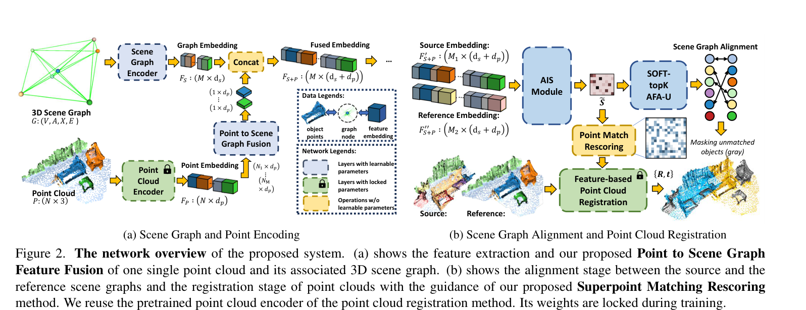

# SG-PGM: Partial Graph Matching Network with Semantic Geometric Fusion for 3D Scene Graph Alignment and Its Downstream Tasks

> **TL;DR:** SG-PGM learns a partial one-to-one correspondence between semantic object nodes, using frozen point-cloud features and learned scene-graph features. These discrete node matches guide a separate continuous registration pipeline; the registration metrics are not graph-assignment optimality guarantees.

## Motivation

Repeated semantic objects and partially overlapping scans make 3D scene-graph alignment ambiguous. A geometric registration model may distinguish objects better than a separate weak object encoder, while partial matching can avoid registering every plausible object pair. SG-PGM therefore shares a frozen geometric backbone, learns a semantic/geometric correspondence model, and masks/rescores point matches before registration (Sections 1–3).

## Contributions

- A partial scene-graph matching network combining GATv2 semantic features with geometric features from a pretrained registration backbone.
- Point-to-Scene-Graph fusion: neighborhood aggregation on points followed by object-indexed max pooling.
- Learned matching cardinality using Soft-topK/AFA-U, with a hard partial assignment decoder.
- Parameter-free superpoint rescoring and overlap-region registration, evaluated on alignment, overlap checking, registration, mosaicking and scene changes (Sections 3–4).

## Methodology

**Neural representations.** Encode object-node and relation-edge attributes with MLPs and three GATv2 layers with learned skip connections. Reuse fine-level KPConv-FPN features from GeoTransformer pretrained on 3DMatch, keeping that registration backbone frozen during matching training. Aggregate k-nearest point neighbors with GATv2, max-pool by known point-to-object labels, and concatenate the resulting geometry with scene-graph embeddings (Sections 3.1–3.2; Supplement A).

**Partial correspondence construction.** Compute learned bilinear semantic/geometric affinities, normalize them, and use Sinkhorn with an added dummy row/column. AFA-U predicts a similarity/cardinality fraction from weighted bipartite information with zero and one-hot initial node features. Soft-topK suppresses outlier matches. The inspected implementation uses Hungarian decoding followed by ranked, row/column-exclusive greedy selection to construct a hard partial assignment. At inference the predicted fraction is multiplied by the smaller graph size, whereas training uses ground-truth cardinality for the Soft-topK operation and an MSE target for the cardinality head. Thus test-time cardinality is predicted, not given by an oracle. A relaxed matrix alone is not a hard matching (Section 3.1; `sg_pgm.py`188–223).

*Original Figure 2 and complete caption from formal PDF p3, printed p28403; extracted and visually checked.*

**Training and printed formula.** Train with correspondence supervision and cardinality MSE weighted by ten. The public matching loss is mean negative log probability at ground-truth pair indices. The paper's printed Equation 5 reverses the roles inside/outside the logarithm; this must be distinguished from the actual implementation, as detailed below. Supplement A specifies ten epochs, Adam with learning rate 0.0001, and a factor0.1 reduction every four epochs.

**Downstream geometry.** Convert object correspondences to a point-level prior and add it to superpoint matching scores with gamma=0.2. Mask unmatched objects and register the potential overlap regions in one pass using pretrained GeoTransformer and its local-to-global estimator; a separate variant adds Graph-Cut RANSAC. This is additive rescoring, rather than a new jointly trained geometric registration network (Sections 3.3–3.5).

**Scope.** Specialist / constructive is appropriate: the neural graph matcher builds its first hard partial correspondence, and does not edit a complete incumbent. Reusing that alignment for overlap classification or continuous registration demonstrates downstream utility within scene alignment; it does not establish a fixed checkpoint across distinct native combinatorial problems.

## Experiments

**Data and comparisons.** The authors regenerate 3RScan subscene pairs, obtaining 15,277 training and 1,882 validation samples, plus 1,882 nonoverlap pairs for overlap checking. Their random data generation differs from SGAligner's original split, so they distinguish reproduced **SGA*** from numbers copied from the original **SGA** paper. Tests include identity and random relative transformations, overlapping ranges, changed scenes, semantic noise and predicted scene graphs. These are principally validation-set experiments on one dataset, rather than an independently held-out multi-dataset generalization study (Section 4; Supplement A/C).

**Ranking versus hard matching.** With identity transforms, the final matching variant gives MRR98.6, Hits@1=97.5 and **F1=89.4%** versus SGA*96.3/94.3/89.3. Geometry alone increases ranking accuracy but has F1=79.0; adding partial matching largely supplies the precision/recall improvement. Ranking metrics do not account for false-positive assignments in the same way as hard-decoded F1. In the random-transform experiment, low-overlap10–30% F1 is **74.86**, compared with **95.21** at overlap60%+, despite low-overlap Hits@1=91.23. Overall random-transform F1/Hit1 are88.18/96.16 versus SGA*79.46/77.69 (Table 1; Supplement Table 12).

**Overlap and continuous registration.** Top-three-score overlap checking reaches F1=95.21 versus reproduced SGA*91.79; using only the learned cardinality fraction has F1=93.28 and lower precision89.94. Under random transforms, the full registration pipeline reports rotation error1.5668, translation error3.51 in the table's units, FMR99.47, registration recall98.72 and semantic correspondence consistency92.59, versus GeoTransformer1.9398/4.96/98.37/98.37/86.90. The identity-transform table contains an exception: FMR99.73 is below original SGA99.85. The stated fourfold speedup is an author-reported pipeline comparison without a detailed runtime table or hardware breakdown in these scientific PDFs (Tables 2–4; Supplement Table 14).

**Mosaicking, changes and adverse cases.** On143 selected scenes, mosaicking F1 is99.80, or99.86 with RANSAC, versus SGA93.58. Supplement Figure10 nevertheless explicitly includes a failed reconstruction. Under changed-scene scenario(ii), SG-PGM Hits@1=90.0 is below SGA*90.6, even though most other ranking results improve. Wrong object labels lower F1 from88.39 to69.71/69.05 in the controlled-noise study. The predicted-graph experiment reports F1=86.0, but the authors explicitly cannot ensure a fair comparison to SGAligner's copied predicted-graph results because that code/model was unavailable (Tables 5–6; Supplement Tables 8–9/Figure10).

**Ablation quality.** The registration-strategy study in main Table7 uses ground-truth graph alignment: its overlap-to-overlap improvement is an oracle-region ablation, not the learned matcher's accuracy. The practical learned O2O method is separately compared to object-per-object alternatives in Supplement Table10, where the best listed OPO rotation error3.9634 remains above O2O0.6252. Fine-level geometric features beat the tested middle/coarse choices; rescoring improves low-overlap semantic consistency87.60 versus81.85 without rescoring. These observations do not imply every metric improves in every setting.

## Limitations

**Printed loss and actual code.** Rendered main Equation5 sums −S-tilde(i,j) log(S(i,j)) only over nonzero entries of binary ground truth S. Those entries equal one, so the displayed nonempty-ground-truth loss is identically zero. It cannot literally supply the stated correspondence supervision. The public `SceneGraphMatchingLoss` instead takes −log(predicted probability+epsilon) at ground-truth pairs, a meaningful supervised objective. This is a precise formula/implementation discrepancy, not evidence that the reported historical experiments trained with the zero formula.

**Decoder and evaluation boundaries.** A hard row/column-exclusive partial assignment guarantees its structural matching constraints, but not semantic correctness, subgraph isomorphism, optimal QAP value or correct registration. The low-overlap F1 drop shows remaining false positives. The printed cardinality expression uses reference-graph size, whereas the implementation uses the minimum of the two sizes. Registration performance also depends on supplied semantic object labels, pretrained geometry and threshold choices.

**Metric implementation difference.** Supplement B.3 defines registration error using root mean squared displacement. The inspected evaluator instead computes the mean of Euclidean point displacements for its variable named `rmse` before comparing with the0.2 threshold (`modules/loss/loss.py`114–117). Those statistics differ, so the implemented recall threshold should not be silently equated with the printed RMS definition. Ranking metrics are computed from soft scores, while matching F1 uses recovered hard correspondences. No rerun established how these differences affected any published value.

## Reproducibility

**Formal identity and chronology.** Yaxu Xie, Alain Pagani and Didier Stricker are affiliated with the German Research Center for Artificial Intelligence. The formal CVPR2024 paper occupies pp28401–28411, DOI [10.1109/CVPR52733.2024.02683](https://doi.org/10.1109/CVPR52733.2024.02683). Identity-matched IEEE Crossref metadata records publication-print/issued **2024-06-16**. `date` records first [arXiv2403.19474](https://arxiv.org/abs/2403.19474) posting, **2024-03-28**; these are distinct metadata events.

**Scientific material and assets.** All eleven formal CVF pages, including all56 references, and all five official supplementary pages were read. Every main/supplement result table, key equation and qualitative failure panel was rendered and checked. The official supplement supplies complete SectionsA–E, Tables8–14 and Figures8–10. The complete untruncated author repository has no extra scientific PDF/ZIP; its README and extension documentation were read. The README also links an external presentation video, whose viewing endpoint was throttled; it is disclosed as unattained, not counted as read or as PDF coverage. No independent unprovided result appendix is claimed by the scientific text. Original Figure2 with complete caption exists in the correct public directory and was actually viewed.

**Software and practical reproduction.** The PDF links [dfki-av/sg-pgm](https://github.com/dfki-av/sg-pgm), inspected at tree `233d852cbc8e40de051352da55d49b3e4466461f`. It provides model, loss, decoder, data-generation and inference scripts, environment configuration and a public folder listing `sg-pgm_best_model.pth`; weights were inventoried rather than used for a benchmark rerun. GeoTransformer weights and 3RScan data are external dependencies. The README corrects data-generation reproducibility through seed42, but its training command says `script/train.py` while the actual path is `scripts/train.py`; the dataset root in the JSON also needs local configuration. Actual code confirms frozen geometry, predicted test cardinality, the nonzero correspondence loss and exclusive hard decoding. It is not claimed byte-identical to the authors' historical experiment environment.

**Actual internal references.** The bibliography directly cites [Deep Graph Matching Consensus](deep-graph-matching-consensus.md) [11], [Learnable Graph Matching for tracking](learnable-graph-matching-incorporating-graph-partitioning-with-deep-feature-learning-f.md) [15], [SIGMA](sigma-matching.md) [22], [Gumbel-Sinkhorn](../studies/gumbel-sinkhorn.md) [27], [Interpretable Neural Subgraph Matching](interpretable-neural-subgraph-matching-for-graph-retrieval.md) [33], [PCA-GM](learning-combinatorial-embedding-networks-for-deep-graph-matching.md) [43], [differentiable Top-K partial matching](deep-learning-of-partial-graph-matching-via-differentiable-top-k.md) [44], and [Deep Learning of Graph Matching](deep-learning-of-graph-matching.md) [52]. Eight edges reflect these exact identities; continuous registration references outside the catalogue are not turned into unrelated solver edges.
