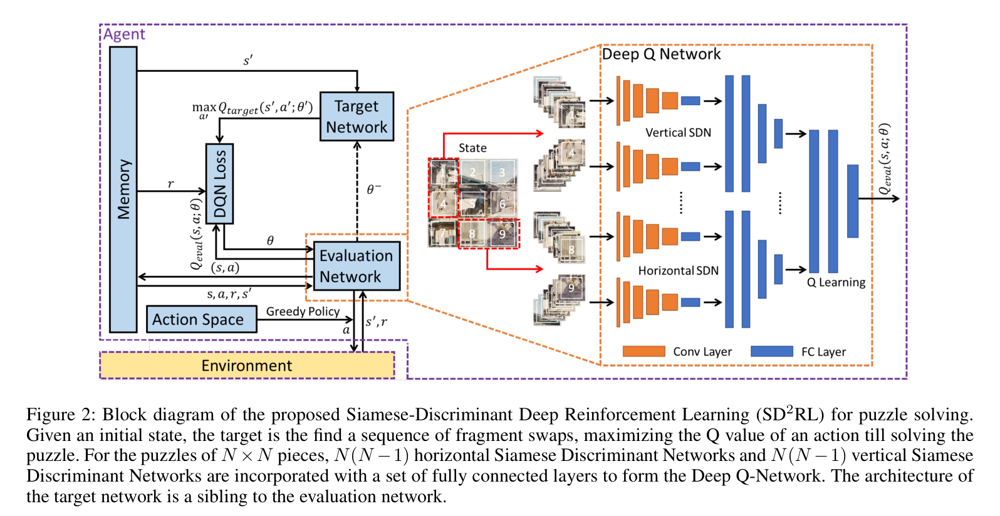

# Siamese-Discriminant Deep Reinforcement Learning for Solving Jigsaw Puzzles with Large Eroded Gaps

> **TL;DR:** SD2RL learns which two fragments to swap in a complete square-grid arrangement. Horizontal and vertical Siamese networks provide visual adjacency features; a DQN uses them to choose successive swaps. It improves the tested JPwLEG results, while only5.1% of25-piece puzzles are perfectly solved.

## Motivation

Large eroded gaps remove the boundary cues used by traditional jigsaw solvers. A center-fragment classifier also provides weak support for distant pieces. SD2RL argues for combining learned neighboring relations with a learned reassembly strategy. The paper explicitly finds that its visual-evidence objective does not rank the true assembly highest for43.4% of tested puzzles, motivating training with ground-truth-derived rewards rather than treating a noisy visual score as a correctness oracle (Introduction; PDFp3).

## Contributions

- An MDP over fragment permutations with pairwise swaps that preserve a complete placement.
- A DQN incorporating horizontal and vertical Siamese Discriminant Networks and neighboring-fragment evidence.
- Prioritized experience replay and shaped rewards based on absolute/relative placement correctness.
- JPwLEG-3 and JPwLEG-5 benchmarks with large gaps, comparisons against fixed-budget classical search and Deepzzle, and image-source breakdowns (PDFpp2–7).

## Methodology

**State, action and feasibility.** A state is a complete ordering of all fragments in a known square grid. The center piece is fixed; an action swaps two distinct noncenter pieces. Thus every state remains a bijective fragment-to-slot assignment, although it may be visually incorrect. The method is **specialist / improvement**: its neural action directly edits a complete discrete incumbent. Supporting two puzzle sizes is not evidence of a shared trained model across native tasks; the architecture has size-dependent neighboring relations and action outputs (Eqs1–4; MDP definition).

*Original Figure2 with complete caption, extracted from formal PDFp4/printed2306 and visually checked.*

**Visual model and Q-learning.** Two VGG16 branches with shared weights form each Siamese network. Horizontal and vertical relation scores feed fully connected layers to estimate swap-action Q values. For an$N\times N$ puzzle, Figure2 specifies$N(N-1)$ horizontal and the same number of vertical relations. The target and evaluation networks have sibling architectures; parameters are copied periodically. Training uses epsilon-greedy actions and prioritized experience replay, with a squared temporal-difference target$r+\gamma\max_aQ_{\theta^-}(s',a)$. Evaluation selects the action with the largest learned Q value (Figures2–3; Algorithm1).

**Reward and stopping.** The printed reward is$R=\alpha L_t+(1-\alpha)H_t+b+C_t$, combining numbers of absolutely and relatively correct pieces/pairs, a constant term and a full-solution bonus. The settings give$\alpha=0.8$, $b=1$, $C_t=1000$, despite calling$b$a penalty in the prose. This sign should be reproduced as printed rather than silently changed to$-1$. Training permits20,000steps per episode and evaluation50, with termination also described when the true layout is reached. Correctness-based termination can be implemented in an annotated benchmark environment; a deployment without ground truth needs an independently specified stopping/detection rule. The paper does not show such a detector (PDFpp4–6).

**Optimization scope.** Greedy selection of the largest learned Q is not exhaustive search over the permutation space. Reward-based training aims at true placements, whereas inference consumes visual observations and learned parameters. Neither a swap nor a complete Q-learning trajectory is proved to monotonically improve puzzle accuracy, maximize the original noisy evidence objective, or find the correct assembly.

## Experiments

**Data.** Both benchmarks derive from12,000MET museum painting, engraving and artifact images, split9,000/1,000/2,000 for training/validation/test. JPwLEG-3 uses398×398 square-cropped images, nine96×96fragments,48-pixel gaps and random horizontal/vertical offsets up to7pixels. JPwLEG-5 uses534×534 images,25fragments of96×96,12-pixel gaps and offsets up to3pixels. These are synthetically eroded square puzzles with a known fixed center, rather than unknown-shape archaeological fragment reconstruction (PDFp5).

**Metrics and budgets.** Perfect is the percentage of entirely correct puzzles; Absolute is the percentage of correctly located pieces; Horizontal and Vertical measure correct neighboring relations. They are separate metrics. The DQN uses batch32, replay capacity200,000, target update interval100, epsilon1 down to0.05, learning rate0.0003 and Adam; the settings also list$\lambda=0.995$. The evaluated DQN has a50-swap limit. Deepzzle is limited to$10^6$search steps with a0.05branch-cut threshold; Tabu has list size10 and100iterations; GA has256individuals and50iterations,80%crossover,20%mutation and duplicate-fitness decay. These are algorithm-specific budgets, not an equal-runtime comparison. The paper does not provide a complete training hardware/time or inference runtime study (PDFpp5–6).

**JPwLEG-3.** SD2RL reports **59.7% Perfect,81.6% Absolute,76.4% Horizontal and76.6% Vertical**. The center-only SD2RL-C variant gives47.8/75.1/68.6/69.1, supporting the benefit of neighboring-relation inputs in this setting. Deepzzle-C gives44.9/74.0/67.2/59.0, so the Perfect improvement is14.8**percentage points**. Among the stronger neighbor-based comparators, GA-P reaches55.5Perfect and79.6Absolute; SD2RL's improvement is4.2 and2.0points. Comparison only with Deepzzle-C would overstate the isolated benefit over the best shown baseline (Table1).

**Source breakdown.** Perfect accuracy for painting/engraving/artifact is37.3/67.5/74.3%, and Absolute70.0/84.2/90.5%. SD2RL is highest among the displayed methods for all six source/metric columns, while painting remains much harder. Representative qualitative examples show successful assemblies; they do not establish that all puzzles reach a solution (Table2; Figure4).

**JPwLEG-5.** Results are **5.1% Perfect,40.3% Absolute,26.5% Horizontal and26.2% Vertical**. GA has0.0/25.1/12.4/12.3; Greedy is the only listed comparator with nonzero Perfect,0.1%. Thus the learned search improves the displayed baselines but still leaves **94.9% of puzzles incompletely solved**. Its40.3% piece accuracy must not be described as40.3% fully solved puzzles. The paper provides no all-size scaling or missing-piece/rotation evaluation (Table3).

## Limitations

The fixed center supplies positional information. The action/output and repeated-relation architecture depend on grid size; cross-size transfer of one checkpoint is not demonstrated. The method assumes every fragment is present, axis aligned and assigned to a known legal slot, so arbitrary rotations, unknown puzzle dimensions, irregular fragment geometry and multiple simultaneous puzzles are outside the experiment.

The explicitly supervised placement rewards, terminal bonus and adjacency training signals should be distinguished from unsupervised inference. A learned Q value is not an observable ground-truth reward at test time. The correctness-based stop condition and the positive printed$b$term need clarification for exact reproduction; no unavailable code was used to infer a correction. Finite-sample DQN training supplies no optimality/convergence guarantee here. The20,000training versus50evaluation step limits and weaker large-puzzle accuracy also constrain claims of reliable large-scale solving.

Main result tables provide point estimates rather than a reported multi-seed uncertainty analysis. Classical search budgets differ, and no common wall-clock comparison is given. The reported gains are therefore accuracy comparisons under the stated implementation budgets, not established speedups or universal superiority over all puzzle solvers.

## Reproducibility

**Identity and dates.** Xingke Song, Jiahuan Jin, Chenglin Yao and Shihe Wang are at the School of Computer Science, University of Nottingham Ningbo China; Jianfeng Ren and Ruibin Bai also list its Beacons of Excellence Research and Innovation Institute. Formal AAAI2023,37(2),pp2303–2311, DOI[10.1609/aaai.v37i2.25325](https://doi.org/10.1609/aaai.v37i2.25325), records publication **2023-06-26** on the official indexed article page and identity-matched publisher-deposited Crossref metadata. This differs from the February conference dates. No matching arXiv identity was established, so no preprint date or URL is invented.

**Actual source and scientific coverage.** The publisher PDF was inaccessible locally. A complete nine-page formal-layout public mirror was retrieved: title, all six authors, both affiliations, AAAI copyright/header and printed pagination were checked. Its actual retrieval URL and SHA are retained in the ledger, without pretending that inaccessible publisher bytes were compared. All main, method, algorithm, experiments, acknowledgments and bibliography pages were read; architectures, reward equation, all tables and qualitative panels were rendered and checked. The full original Figure2/caption exists under the public paper-assets directory and was actually viewed.

**Supplement and code inventory.** The complete paper does not point to an additional scientific appendix or supplement. The official indexed article page exposes a PDF entry; the local primary page/repository access attempts and targeted exact-title/SD2RL code/supplement/arXiv searches were recorded. Public GitHub repository search for SD2RL returned no entries; an exact author/paper-linked code release was not identified, so no `code_url` is fabricated. The Nottingham institutional repository endpoint was inaccessible. An Underline poster/presentation listing was identified, but no additional scientific PDF was retrieved or counted as read. These are transparent inventory outcomes, not a claim to have ruled out every unknown private artifact. No benchmark or training rerun was performed.

**Actual internal references.** The full bibliography explicitly cites [the eroded-boundary solver](solving-jigsaw-puzzles-with-eroded-boundaries.md), [NeuRewriter](neurewriter.md), [learning-to-rank distillation](an-efficient-combinatorial-optimization-model-using-learning-to-rank-distillation.md) and [MAPDP](mapdp.md). The distillation entry has malformed venue information but its distinctive title and Woo/Lee/Cho authors identify the AAAI2022 target. These are actual references, rather than inferred influences from similar method names.
