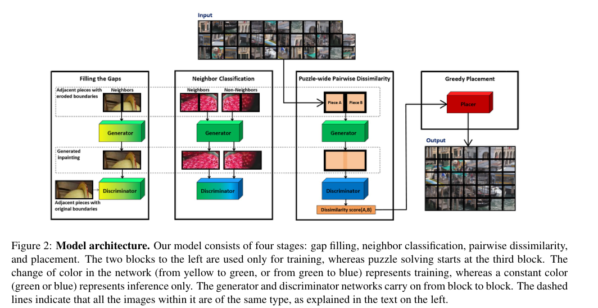

# Solving Jigsaw Puzzles with Eroded Boundaries

> **TL;DR:** A GAN fills the missing gap between two puzzle pieces, and its discriminator is subsequently trained to score whether the pieces are true neighbors. Negative-log scores guide a classical greedy placer. The complete pipeline constructs discrete puzzle arrangements, but heavier erosion sharply reduces adjacency and perfect-reconstruction performance.

## Motivation

Many puzzle solvers compare boundary pixels, which become uninformative when those pixels are missing. The paper hypothesizes that plausible completion between true neighbors is easier to distinguish from completion between unrelated pieces. It turns gap-generation quality into an adjacency signal, then uses that signal for placement (Introduction).

## Contributions

- A rectangular-gap inpainting GAN adapted to paired puzzle pieces.
- Reuse of the trained discriminator's architecture and weights for neighbor/nonneighbor classification.
- A learned directional dissimilarity measure feeding classical greedy puzzle placement.
- Tests on70-,88- and150-piece puzzles with two controlled erosion levels and explicit failure examples.

## Methodology

**Input and assumptions.** The input is an unordered collection of equal-size square image pieces. The maximum erosion width is known; optional unknown orientation is mentioned, but the results do not isolate a separate random-orientation evaluation. The task is discrete placement of pieces, not simply restoring a known assembled image (Section3).

*Original Figure2 and its complete caption, formal PDFp3/printed3528; extracted and visually checked. The first two blocks are training stages; inference starts at pairwise scoring.*

**Gap filling.** A six-level U-Net-like encoder/decoder with skip connections receives a pair of pieces separated by a rectangular missing region. Known pixels are copied directly to the final output, so the network changes only the gap. Vertical neighbors are rotated to fit the paired-image layout. A center-cropped three-layer Markovian discriminator averages36patch scores. Generator training combines adversarial BCE with gap-pixel L1weighted100. GAN training uses45000examples from157random DIV2K images,48epochs, batch1and generator/discriminator learning rates.0002/.0001 (Section4).

**Neighbor training and scoring.** The generator is retained while the same discriminator continues training on balanced inpainted true-neighbor/nonneighbor pairs. Inpainted true neighbors, previously labeled fake during GAN training, now receive positive adjacency labels. This second stage uses127different DIV2K images,40epochs and learning rate.0002. At inference, directional dissimilarity is $-\log D(G(I_{xyd}))$, computed for all piece pairs and four relative directions. The discriminator's average output is a scoring statistic, not automatically a calibrated adjacency probability or classification accuracy (Sections5–6).

**Actual discrete solver.** A cited classical greedy placer repeatedly chooses a candidate piece compatible with the partial board, accounting for both its pair score and the distinctiveness of alternatives; placed pieces add their compatible neighbors to the candidate pool. The network supplies pairwise scores, while classical placement builds the arrangement. There is no reported exactness, approximation-ratio or monotone-correction guarantee for a wrong early placement (Section3).

**Classification.** This is **specialist / constructive**: a learned compatibility component combines with a classical discrete placer for one native jigsaw task. GAN optimization is offline representation training, and inpainting modifies continuous pixels; neither is neural editing of a complete discrete incumbent. The paper's suggested applications beyond puzzles do not constitute cross-native shared-model solver evidence.

## Experiments

**Protocol.** Three standard datasets each contain20images. Images are cut into64×64pieces, creating70-,88- and150-piece puzzles. Erosion levels are7%and14%of piece size. The primary comparison adapts the cited Paikin–Tal regular/missing-piece solver by treating the outermost surviving pixels as the boundary. This is a specific comparator adaptation, not a comprehensive common-protocol evaluation of all later eroded-puzzle methods (Section6).

**Seven-percent erosion.** Mean neighbor accuracy is **84.6/76.9/76.3%** for70/88/150pieces, versus68.4/66.2/65.9. Direct-position accuracy is86.0/70.7/66.7versus42.9/43.4/42.2. Perfect reconstructions number **4/7/2out of20** per dataset, versus1/3/0. Adjacency fraction, absolute position fraction and perfectly solved puzzle count are separate metrics (Table2).

**Fourteen-percent erosion.** Neighbor accuracy falls to **57.1/51.1/51.3%**, direct accuracy to50.5/35.2/35.4and perfect reconstructions to **1/0/0out of20**. The comparator remains lower on the displayed metrics, but the low perfect counts show that an empirical relative gain does not imply reliable complete recovery. Figures5–8explicitly show misplaced smooth sky, sand and bushes, including an unsuccessful150-piece puzzle (Table3).

**Discriminator analysis.** On11000positive-neighbor examples, reusing GAN discriminator weights gives mean output87.9%, versus83.7%for a fresh discriminator on inpainted pairs and75.9%without inpainting. Negative-pair means are approximately2%with inpainting versus43.5%without it. These are output averages supporting the design, not full confusion matrices or calibrated probability/error guarantees. Table1also shows score separation worsening as erosion grows.

**Runtime.** On a GTX1080Ti, complete solve times are approximately **62/98/286seconds** for70/88/150pieces, including all-pairs dissimilarity computation. These costs should not be presented as just the lightweight greedy placement step. The paper gives no broad training-seed confidence analysis, objective-gap certificate or scaling experiment far beyond150pieces.

## Limitations

The method assumes equal square fragments and known maximum damage. All-pairs learned scoring is costly and plausibility-based inpainting can invent convincing but incorrect connections. Repeated or smooth textures remain ambiguous, and a classical greedy error can persist without a neural repair mechanism. Results come from controlled erosion of natural photographs, not an independently validated collection of real archaeological damage patterns.

Larger gaps strongly reduce absolute success. The discriminator transfer experiment is an empirical scoring comparison, and the reported figures do not establish universal calibration or correct placement. NP-completeness does not mean every nontrivial instance is impossible to solve exactly; that stronger introductory phrasing is not adopted as a theorem here.

## Reproducibility

**Identity/date.** Dov Bridger and Ayellet Tal list Technion; Dov Danon lists Tel Aviv University. Formal CVPR2020 DOI[10.1109/CVPR42600.2020.00358](https://doi.org/10.1109/CVPR42600.2020.00358) has **June2020 month precision**. The actual CVF reading pages3526–3535differ from deposited3523–3532. Canonical arXiv[1912.00755](https://arxiv.org/abs/1912.00755) first appeared **2019-12-02**; its eight-page comment describes that earlier version, whereas ten formal CVF pages were actually read.

**Scientific coverage.** All ten formal pages and all40references were read. Architecture, GAN/classifier losses, the score histogram, all three tables, reconstruction comparisons and failure examples were rendered and inspected. CVF lists main/arXiv only. The author's primary publication page lists the formal PDF, without a code or independent scientific-supplement link. Exact-title/code/supplement searches did not identify an official repository or extra scientific appendix. No nonexistent code inventory or benchmark rerun is claimed. OriginalFigure2 with its whole caption physically exists under public/paper-assets and was actually viewed.

**Citation audit.** The complete bibliography was compared with the current catalogue. Its classical placer, GAN/inpainting foundations and earlier image-reassembly references are genuine external citations, but no matching current internal-paper identity was found. The relationship graph therefore adds no invented internal citation edges for this entry.
