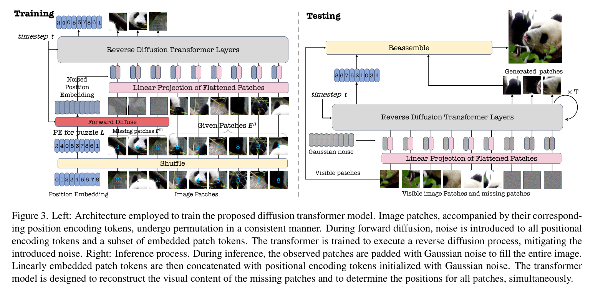

# Solving Masked Jigsaw Puzzles with Diffusion Vision Transformers

> **TL;DR:** JPDVT generates positional encodings conditioned on shuffled image patches or video clips, then greedily assigns them to distinct legal positions. It can jointly synthesize missing visual content. Image and video models are trained separately; missing-content generation is plausible reconstruction, not recovery guaranteed to equal the unseen original.

## Motivation

Permutation classification grows factorially with puzzle size, while direct position classifiers can struggle with missing pieces. JPDVT treats the unknown locations as conditional generation targets. It separates observed content from its unknown position, allowing both reordering and inpainting. The target discrete problems are square-image patch assignment and temporal clip permutation; it does not solve arbitrary shaped-fragment geometry or a weighted graph-matching objective (Sections 1–3).

## Contributions

- Conditional diffusion of positional encodings for both spatial and temporal puzzles.
- A joint missing-content/position formulation that generates absent patches or frames while reordering the observed elements.
- Separate image diffusion-transformer and video diffusion-network implementations, with experiments on eroded, missing and larger puzzles.
- Comparisons against image reassembly and video-ordering methods, with explicit puzzle/fragment accuracy and temporal ranking metrics (Sections 3–4; Supplement Sections 6–8).

## Methodology

**Representation and denoising.** Associate each visible piece with content features and a positional encoding. Noise all positional encodings; when pieces are missing, also noise their content variables, while conditioning on the visible content. Train a noise predictor with squared-error denoising loss under a linear schedule with1,000 steps. At inference, pad the missing entries with noise and reconstruct positions and, optionally, missing content together. The paper also permits a separate inpainting algorithm once missing locations are known (Section 3).

**Image and video networks.** The image model modifies a ViT/DiT with timestep-dependent adaptive normalization; the supplement specifies12 layers, hidden width768, MLP3072 and12 attention heads. The paper describes32-dimensional2D positional encodings. Low-resolution video operates in pixels; high-resolution video uses VAE latents, with256×256×3 frames encoded to32×32×4. The video model modifies a pseudo3D U-Net by removing temporal convolution and temporal positional embeddings, and uses16-dimensional temporal encodings. These are separate architectures and training runs, rather than one image/video checkpoint (Section 3.2; Supplement7).

*Original Figure3 with complete caption, extracted from formal PDFp3, printed p23011, and visually checked.*

**Hard decoder and paradigm.** Supplement7.1 explicitly constructs the legal position-encoding set, assigns a generated encoding to the nearest available legal encoding using L2 distance, and removes each used position. This collision-avoidance step constructs a discrete permutation; continuous denoising itself does not enforce that constraint. It is constructive generation, without neural edits of a complete feasible incumbent. Its greedy assignment need not minimize total encoding distance or reconstruct the true puzzle. The current public sampler uses a different distance/sentinel implementation, disclosed below.

**Scope.** Specialist is appropriate despite the common formulation: the paper explicitly trains image models separately for different puzzle sizes/settings, and uses separate video networks/datasets. A shared conceptual design and support for missing pieces are not evidence of a single trained cross-native-task solver. The temporal evaluation fixes the first frame as an anchor before shuffling the remaining clips (Sections4.3–4.4).

## Experiments

**Data and budgets.** Image experiments use ImageNet-1K and JPwLEG-3; the latter has9,000 training,1,000 validation and2,000 test images, each with nine96×96 fragments and48-pixel gaps. The ImageNet erosion protocol resizes to255×255, divides into85×85 patches, and crops64×64 content, using center crops at test time. Temporal tests use MovingMNIST, CLEVRER, UCF101 and QST, with clips of one or more consecutive frames. Image training is stated as batch256/300 epochs; video training as batch32/250,000 steps, learning rate0.0001. Dataset-specific temporal downsampling and baseline budgets are detailed in the supplement, including2,000 epochs for J-VAD with more than ten pieces (Section4.1; Supplement7).

**Image accuracy.** On eroded3×3 ImageNet puzzles, JPDVT reports **68.7% perfectly solved puzzles** and **83.3% correctly placed pieces**, versus Deepzzle48/78. Without erosion, the corresponding values are99.4/99.6. With one/two/three missing pieces and erosion, puzzle accuracy drops to41.5/21.4/14.9 and piece accuracy to72.0/61.8/54.1. Missing-piece reconstruction therefore remains substantially harder; qualitative successes should not be generalized to every puzzle (Tables1–2).

**Large puzzles and the JPwLEG metric correction.** The150-piece7%-erosion comparison gives piece/puzzle accuracy **75.9/45%**, versus SJP-ED66.7/10. On JPwLEG-3, Table4 explicitly labels **71.3% as piece-level accuracy**, compared with Siamese59.7. The adjacent prose instead calls71.3 puzzle-level. This note follows the labeled table and does not turn the11.6-percentage-point piece gain into an asserted whole-puzzle success improvement (Tables3–4).

**Temporal metric and negative cases.** Table5 reports normalized Kendall distances multiplied by1,000, where lower is better. MovingMNIST20-piece JPDVT is0.7 in those displayed units versus STP1.4; UCF16-piece is4.2 versus J-VAD164.3. However, CLEVRER16-piece is0.17 versus STP0.15, and CLEVRER8-piece is0.04 versus STP0. QST also favors STP: its16/8/4-piece entries are all0 versus JPDVT3.0/0.19/0.04. Thus superiority is conditional, with ties and losses as well as gains. The paper's ordinary NKD description and the current script's reversal convention should be read separately (Table5; implementation discussion below).

**Reference quality, runtime and masking.** The authors give STP ground-truth object coordinates for MovingMNIST/CLEVRER, explicitly acknowledging an input advantage; QST uses PCA pixel features instead. STP cannot practically run the32-piece setting in their evaluation, reportedly taking over30 minutes/video, versus about10 seconds for JPDVT. VCOP/J-VAD take about one second, so JPDVT is slower than those learned comparators. These are reported timing comparisons without a detailed hardware breakdown. Masked-video plots show increasing ordering error with more missing clips, while missing-content quality and temporal super-resolution are mainly illustrated qualitatively (Section4.4; Supplement Figures10–13).

## Limitations

**Uncertainty and feasibility.** Generative inpainting cannot identify arbitrary unseen content uniquely. The discrete decoder provides distinct intended locations, rather than a semantic correctness or optimization guarantee. Denoising loss is not a bound on puzzle-level accuracy or Kendall distance. The1,000-step process and separate models also limit claims of instantaneous inference, universal size transfer or one unified trained policy.

**Metrics and reporting.** Besides the JPwLEG piece/puzzle mismatch, the main displayed Kendall set mixes ranks from different sequences within each inequality, unlike the standard pairwise-disagreement expression. The actual code computes within-sequence comparisons, then takes the smaller error against forward and reversed ground-truth orders. This reversal-invariant convention is additional to the main text's first-frame anchor and ordinary NKD description. It changes what constitutes a correct temporal order and should be stated for a reproducible comparison; it does not establish that every historical table was produced with the current sampler.

**Equivariance scope.** Self-attention without fixed slot encodings is permutation equivariant when content and associated variables are permuted consistently. That algebraic property does not prove correct puzzle recovery. The current image model also adds a fixed input-slot `pos_embed`, so strict shuffle equivariance of that entire implementation is not established by the supplement's attention-only identity.

## Reproducibility

**Identity and dates.** Jinyang Liu, Wondmgezahu Teshome, Mario Sznaier and Octavia Camps are at Northeastern University; Sandesh Ghimire is at Qualcomm. The formal CVPR2024 paper is pp23009–23018, DOI [10.1109/CVPR52733.2024.02171](https://doi.org/10.1109/CVPR52733.2024.02171). Identity-matched IEEE Crossref metadata records publication-print/issued **2024-06-16**; the title's deposit asterisk is a funding-footnote marker. `date` records first [arXiv2404.07292](https://arxiv.org/abs/2404.07292) posting, **2024-04-10**.

**Scientific coverage and figure.** All ten official CVF pages, all36 references, and all five official supplement pages were read. The supplement contains expanded diffusion/attention mathematics, complete image/video setup and baselines, decoder details, masked-video examples and temporal super-resolution. All result tables, key equations, architectures and qualitative panels were rendered and checked. The primary CVF page links the PDF and scientific supplement; the complete untruncated author-repository tree has no additional scientific PDF/ZIP/notebook. Its full README was read. Original Figure3 with complete caption exists under the correct public paper-assets directory and was actually viewed.

**Official code availability.** [JinyangMarkLiu/JPDVT](https://github.com/JinyangMarkLiu/JPDVT) was inspected at tree `ae5f8f73a1f31e49a821584c66a9a9a58661dd91`. The README explicitly says the repository is still being organized and fully functional code is forthcoming; its Testing section is empty. It supplies separate image/video training and sampling source, but the inspected tree/README and empty releases API do not supply the promised pretrained checkpoints. The README's MET training command also uses1,000 epochs rather than the supplement's generic300-epoch image statement. No training or benchmark rerun was performed.

**Concrete implementation differences.** The image sampler uses eight-dimensional2D position encodings and Manhattan distance, whereas the paper describes32 dimensions and the supplement's decoder specifies L2. Used candidates receive the finite penalty2024, rather than being literally deleted; preventing reuse then depends on that penalty exceeding remaining candidate distances. `models.py`250 adds fixed input-slot encodings. The current video sampler hardcodes12 missing frames, greedily decodes encodings, and evaluates min(forward,reverse) Kendall error; when masking is active it separately sorts the predicted/true missing-position subsets before combining them. These are current-script protocol choices, not a faithful documented recipe for every reported mask ratio. Their effect on the published results was not rerun or inferred.

**Actual internal citations.** The bibliography explicitly cites [Solving Jigsaw Puzzles with Eroded Boundaries](solving-jigsaw-puzzles-with-eroded-boundaries.md) [3] and [Siamese-Discriminant Deep RL](siamese-discriminant-deep-reinforcement-learning-for-solving-jigsaw-puzzles-with-large.md) [24]. The complete catalogue comparison confirms two internal identities; general generative/backbone references are not converted to unrelated solver edges.
