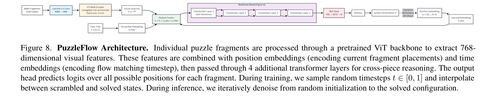

# The Missing GAP: From Solving Square Jigsaw Puzzles to Handling Real World Archaeological Fragments

> **TL;DR:** GAP introduces synthetic, irregularly masked grid puzzles inspired by real archaeological fragment shapes. PuzzleFlow repeatedly revises complete grid permutations using a ViT and a conditional Transformer; its gains on GAP coexist with very low complete-solution rates on the 25-piece setting.

## Motivation

Square-piece benchmarks often preserve boundary cues that disappear under erosion. This work learns fragment silhouettes from real archaeological masks and applies them to museum images, creating a harder controlled benchmark. The resulting solver task remains a **discrete assignment of all known pieces to a known square grid**. It is neither arbitrary physical fragment placement nor free continuous translation/rotation recovery on actual excavated artifacts (Sections 1–3).

## Contributions

- Release GAP-3 and GAP-5: 20,000 synthetic puzzles each, with nine or twenty-five irregularly masked image fragments.
- Generate masks with a VAE trained on 958 RePAIR fragment silhouettes, then fill holes, retain the largest component, and apply morphological closing.
- Introduce PuzzleFlow, which conditions visual fragment features on their current discrete positions and flow time, predicting a revised bijection through greedy assignment.
- Compare adapted classical and learned baselines, quantify piece/puzzle/spatial accuracy, and supply architecture and square-benchmark ablations (Sections 3–5; supplementary Sections 8–11).

## Methodology

**Dataset.** Split 40,000 distinct MET Open Access images between two grid sizes. Each grid cell contributes a textured fragment with its own VAE-generated mask. GAP-3 uses a 384×384 canvas; GAP-5 uses 640×640; each cell is 128×128. Each dataset has 14,000/3,000/3,000 training/validation/test puzzles, with disjoint source images. The mask generator uses a 64-dimensional latent space and four convolutional/downsampling and transposed-convolution/upscaling stages. Its geometric checks compare generated and real masks after normalization, rather than reconstructing complete real objects (Section 3; supplementary Section 8).

**Neural predictor.** A learned 1×1 convolution maps RGBA fragments to three channels, including alpha-mask information. Resize to 224×224 and extract a 768-dimensional CLS feature from pretrained ViT-Base, fine-tuned for this task. Add a learned discrete-position embedding and a sinusoidal time embedding projected from 192 to 768 dimensions. Four additional pre-normalized Transformer layers model relationships between pieces; a 768→3072→N head predicts position logits. These are the main-paper/current-code specifications; the authors explicitly identify different entries in supplementary Table 5 as discarded earlier settings (Sections 4.3–4.4; author repository README).

*Original supplementary Figure 8 and complete caption, extracted from supplementary PDF p5 and visually inspected.*

**Training states.** Sample a random initial permutation and the target permutation; independently choose each piece's target versus initial position with probability t versus 1−t. Cross-entropy predicts target positions from the resulting discrete state and time. This is what main Equation 2 and released `flow_matcher.py` implement. Supplementary Equation 7 instead describes a real-valued linear interpolation; those two descriptions should not be silently equated.

**Inference and classification.** Start from a complete random permutation. For twenty steps, run the predictor conditioned on the current placement and assign each piece, in sequence, to its highest-logit unused position. This produces a complete bijection at every inference step; the next neural pass revises that complete solution. Accordingly, this note classifies it as **specialist / improvement**, with no claimed monotonic improvement or optimality certificate. The O(N²) greedy decoding cost describes that assignment stage, not the complete ViT/Transformer pipeline. Separate GAP-3/GAP-5 checkpoints and separately trained square-benchmark models do not establish a shared cross-task generalist (Section 4.5; released `vit_flow.py` lines241–320).

## Experiments

**Metrics and setup.** Perfect Accuracy (PA) is the percentage of puzzles with every piece correct; Absolute Accuracy (AA) measures correctly placed pieces; Spatial Relationship Accuracy (SRA) measures preserved directional grid-neighbor relationships. Each GAP test set has 3,000 puzzles. The reported training configuration uses thirty epochs, AdamW at 10⁻⁵, batch eight, mixed precision and RTX4090 GPUs; final PuzzleFlow inference uses twenty steps. The compared neural baselines were retrained on GAP, with RGB input adaptations; PuzzleFlow additionally uses alpha masks (Section 5.1; supplementary Section 9).

**Formal Table 2.** PuzzleFlow obtains PA/AA/SRA of **28.5/62.9/55.7% on GAP-3** and **0.3/29.1/19.8% on GAP-5**. The strongest other GAP-3 row, FCViT, has 25.2/60.7/47.6%; on GAP-5, DiffAssemble has 0/21.9/14.7%. Thus the solver improves the printed single-run comparison but still leaves approximately 71.5% and 99.7% of puzzles incompletely solved. The seven baselines include JigsawGAN, JPDVT, PuzLM and classical greedy/GA methods. These results do not establish state of the art for all jigsaw settings (Section 5.2).

**Ablations and square benchmarks.** On GAP-3, direct prediction gives 22.6% PA, frozen ViT 7.4%, no extra Transformer layers 10.1%, and post-training replacement of the learned RGBA adapter by RGB slicing 9.2%, versus 28.5% for the full model. The alpha experiment changes preprocessing after training, so it is not an independently retrained, controlled comparison of equally adapted RGB and RGBA architectures. On separately trained JPwLEG-3/5 models, PuzzleFlow gives AA/PA **72.6/43.7%** and **29.0/0.0%**. Supplementary Table 7 shows stronger alternatives, including SD2RL, ERL-MPP and PuzLM; this is positive cross-dataset evaluation with retraining, not zero-shot transfer (Section 5.3; supplementary Section 10/Table 7).

**Author updates, separate from the formal tables.** The public GAP dataset card at revision `184118071402c75a883f93c34dc82c4a887e658b` (last modified 2026-09-28) says the formal GA/GAP-5 row accidentally repeats GAP-3 values: its corrected AA/SRA are **4.0/3.4%**, instead of the formal 11.1/8.5%. The same author card adds three-run results, labeling the paper's original numbers single runs. PuzzleFlow's GAP-3 AA is then **60.9±1.9%**, versus FCViT **61.0±0.5%**, while its PA/SRA remain stronger in that table. These are author-provided later results, not reruns performed in this review or new numbers printed in the proceedings. [Author dataset card](https://huggingface.co/datasets/Ofirish/GAP/blob/184118071402c75a883f93c34dc82c4a887e658b/README.md).

## Limitations

**Authors' stated boundaries.** Large piece counts, grid topology, missing fragments and non-grid physical constraints remain limitations/future work. Mask-shape statistics and PCA overlap are evidence about synthetic silhouette properties; they do not establish full joint distribution equality or successful real archaeological reconstruction (Section 6; supplementary Section 8).

**Curator mathematical boundary.** Independent per-piece interpolation need not remain in the permutation group. For a nine-piece grid, let the initial permutation swap positions zero and one and the target be identity. Selecting the target for the first piece and the initial position for the second puts both at zero with positive probability t(1−t). Thus the training distribution is over potentially conflicting position vectors, even though its endpoints and greedily decoded inference states are permutations. This limits the phrase “flow over permutations”; it does not invalidate the supervised objective or demonstrate that the reported empirical gains disappear (main Equation 2, supplementary Equation 7; released interpolation code).

**Comparison and reporting boundaries.** The alpha-input advantage and post-training alpha ablation limit causal attribution of all gains to flow matching. Main text and supplementary Table 4 print different shape-summary statements, and supplementary Table 5 is explicitly corrected by the authors' repository; the note retains their identities rather than combining them as one consistent specification. No statistical significance claim or global optimization guarantee is inferred from a single best row. Greedy decoding enforces one-to-one positions but need not maximize the summed logits as Hungarian would, nor guarantee image correctness.

## Reproducibility

**Identity/dates.** The CVF record and read PDF confirm Ofir Itzhak Shahar, Gur Elkin and Ohad Ben-Shahar, affiliated with Ben-Gurion University of the Negev, and CVPR 2026 pp3186–3196. The read copy is CVF's eleven-page open-access accepted version, explicitly marked as identical to the accepted paper except for the watermark. Its record exposes publication year only, so `publication.date` remains 2026 without inventing a day from the conference schedule. `date` is **2026-05-12**, the first posting of [arXiv2605.12077](https://arxiv.org/abs/2605.12077).

**Read coverage and supplements.** All eleven main pages, including all 66 references, and all eight pages of the official linked scientific supplement were read. Key equations, Tables 2–7, shape/PCA illustrations, architecture and qualitative success/failure panels were rendered and inspected. The official CVF page links one PDF supplement. The full, untruncated [author repository](https://github.com/OfirShahar/puzzle-flow-matching/tree/32021bb58331459872049ed47aeb14d9ff83ec47) has no additional scientific PDF or ZIP. Its scientific README material and linked dataset/fragment-generator cards were read, including architecture corrections and later multi-run results.

**Available artifacts and practical gap.** The author Hugging Face tree lists the six dataset splits, labels/metadata, VAE generator code/weights, two separate PuzzleFlow weights/configurations, an independent loader and evaluator. Their presence was checked through the primary API; multi-gigabyte datasets and checkpoints were not downloaded or executed. The inspected GitHub tree lacks the `src.data` module imported by its training and prediction scripts (train line170; predict line85), despite that module appearing in the README's directory diagram. The standalone Hugging Face loader may help reconstruction, but is not silently assumed to satisfy that missing import. The current release therefore requires integration work before the documented commands can run unchanged; this does not by itself refute the paper's experiments.

**Internal citations.** Explicit references confirm [Eroded Boundaries](solving-jigsaw-puzzles-with-eroded-boundaries.md) [4], [PuzLM](puzlm-solving-jigsaw-puzzles-with-sequence-to-sequence-language-models.md) [12], [JPDVT](solving-masked-jigsaw-puzzles-with-diffusion-vision-transformers.md) [29], [DiffAssemble](diffassemble-a-unified-graph-diffusion-model-for-2d-and-3d-reassembly.md) [44], [SD2RL](siamese-discriminant-deep-reinforcement-learning-for-solving-jigsaw-puzzles-with-large.md) [49], [ERL-MPP](https://doi.org/10.1609/aaai.v39i7.32748) [52], and [RePAIR](../studies/repair-benchmark.md) [55]. Reference [12] uses the earlier title of arXiv2511.06315; the primary arXiv history/current title and identical three-author Springer record establish continuity to the PuzLM conference paper, rather than a distinct journal extension.
