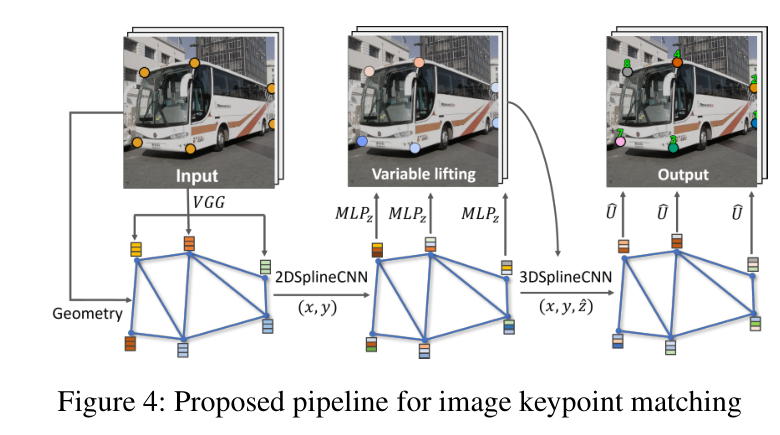

# Universe Points Representation Learning for Partial Multi-Graph Matching

> **TL;DR:** URL maps every graph independently into a shared set of learned universe-point prototypes, then composes these discrete assignments into cycle-consistent partial pairwise matchings. A learned third coordinate improves features. Its98.9% Willow transfer result instead uses the transferred encoder with an external HiPPI solver, without the learned universe.

## Motivation

Independent pairwise matchers can produce contradictory correspondences across an image collection. Synchronizing pairwise predictions also scales with the collection, while a geometric-template universe may require explicit3D reconstruction. URL learns abstract universe-point representations and maps each graph to them. It targets semantic image-keypoint matching with occlusions and both-sided missing keypoints, rather than arbitrary graph similarity regression or recovery of a physical3D shape (Sections1–2).

## Contributions

- A supervised object-to-universe neural representation that supports cycle-consistent partial multi-graph matching.
- Learned universe prototypes trained jointly with a graph feature encoder, without an explicit3D template.
- Virtual coordinate lifting, feeding a predicted third variable into3D SplineCNN processing.
- Synthetic partiality/size tests, visual partial and full matching experiments, a feature-transfer study and component ablations (Sections3–4; integrated SupplementS1–S2).

## Methodology

**Assumptions and supervision.** Input graphs represent objects from a known semantic class. Inference uses that class information; universe prototypes are trained separately per class. Ground-truth training correspondences, or equivalent semantic keypoint labels, define supervised graph-to-universe assignments and an upper bound$d$on universe size. The method is not an unsupervised discovery of arbitrary unseen semantic identities (Section3; SupplementS2).

**Neural representation and hard decoder.** ImageNet-pretrained VGG features are interpolated at keypoints. Delaunay edges and relative coordinates supply geometry. A2D SplineCNN block produces features, an MLP predicts a virtual third coordinate, and3D SplineCNN updates representations using lifted relative coordinates. Dot products between node features and$d$learned prototypes are row-softmax normalized. An **Auction linear-assignment solver** then assigns each graph node to exactly one universe point, with at most one node per universe point within that graph. Node-level cross-entropy against known universe labels trains the representations; Eq8's centroid observation is a fixed-feature squared-distance minimizer, not a global-optimality theorem for the trained neural model (Eqs2–8; Figure4).

*Original Figure4 with complete caption, extracted from the author-hosted main PDFp5 and visually checked.*

**Exact scope of cycle consistency.** Let$X_i$be the hard injective graph-to-universe assignment and form$X_{ij}=X_iX_j^\top$. Shared universe identities guarantee identity/symmetry and **partial transitivity**$X_{ij}X_{j\ell}\leq X_{i\ell}$, as defined in the paper. Equality is not generally required: an intermediate graph may lack a universe point shared by the other two. This structural guarantee requires the hard injective assignments, rather than merely independently row-softmaxed scores. It does not certify that assigned universe labels are semantically correct. Partiality means pairwise unmatched nodes are permitted even though every node is assigned somewhere in the universe (Definition1/Lemma1/Eq6).

**Transfer variant and classification.** For Pascal-to-Willow transfer, the authors discard the learned universe, retain the pretrained feature encoder, compute node similarities and invoke LAP or HiPPI. HiPPI additionally uses adjacency affinities from distances in the lifted coordinates. The resulting cycle property is local to the considered collection, unlike the reusable fixed-universe formulation. All studied problems remain graph matching, and class-specific prototypes and dataset-specific training are explicit. The entry is **specialist / constructive**: neural features precede construction of a discrete assignment, with no neural editor of a complete incumbent (Node Feature Transfer; SupplementS1).

## Experiments

**Synthetic protocol and size.** An anchor universe supplies1024-dimensional uniform random features and2D coordinates. Generate200training and100testing graphs by feature noise, random affine coordinate transformations, coordinate noise, Delaunay triangulation and binomial visibility. Defaults are feature-noise standard deviation1.5, coordinate-noise10, visibility0.8 and universe size25. Partiality experiments vary visibility with25universe points; size experiments vary universe size up to1,000with visibility0.8. Thus “1,000”is a universe-size setting, with expected visible nodes about800, not a claim that every test graph has exactly1,000nodes. URL retains near-perfect F1 in the shown size sweep while BBGM-Multi degrades; BBGM-Multi-3 training above300universe points exceeds48GBGPU memory (Figure2; SupplementS1).

**Metrics and visual partial matching.** Unfiltered partial-to-partial matching uses F1, whereas intersection-filtered full matching uses accuracy. URL reports **71.7% pairwise F1** on PascalVOC and **95.1% F1** on CUB, versus BBGM-Multi-5's62.8 on Pascal and GANN-MGM's82.6 on CUB. The **82.9% Pascal F1** in parentheses is measured directly against universe labels, not pairwise F1. Likewise81.8% is full two-graph accuracy and88.7% is its universe-label counterpart. These metrics must not be collapsed into one success number (Tables1–2).

**Negative comparisons.** GLAM's Pascal full-pair accuracy is86.2, above URL81.8, even though URL has a different cycle/partial-matching design. Per-class PascalTable4 also has losses: dining-table F1 is44.6 versus JointMGM3D57.8, train73.6 versus BBGM78.0, and TV82.1 versus BBGM-Multi-5 83.4. Thus the strong overall partial-matching mean does not establish every-class or every-setting superiority.

**Willow transfer and adaptation.** On reduced-Pascal-pretrained features without fine-tuning, URL-LAP reaches95.0% accuracy and **URL-HiPPI98.9%**, versus BBGM94.5. These test the encoder plus external solvers, not the learned universe decoder. SupplementTableS1 separately reports full URL trained from scratch on Willow **97.5%**, below NMGM-v2 98.2, and reduced-Pascal pretraining followed by Willow fine-tuning **98.3%**. Willow uses only20training images per class, relatively consistent orientations and no missing keypoints. The protocols are separate experiments, not three measurements of one unchanged end-to-end solver.

**Ablations and uncertainty.** Five-seed Pascal F1 is71.7±0.5 for the complete architecture,67.6±1.0 without3D lifting,55.1±0.6 without graph processing, and55.4±0.6 when replacing the universe component with the alternative matching pipeline. Reported differences are4.1,16.6 and16.3**percentage points**. The authors report a Mann–Whitney U test. These are changes to specific complete configurations, not isolated proofs that a component must improve every instance (Table5).

**Runtime and model selection.** SupplementS1 reports about6.5hours of Pascal training on a TitanXp12GB, and inference about13images/second on a laptop GTX1050Ti4GB, with approximately$10^3$keypoints/second stated. Figure2's timing is seconds per synthetic graph, not an all-pairs collection runtime. Crucially, the supplement explicitly states that hyperparameters are selected according to performance on a **given test set**, citing prior protocols for comparability. This permits test-informed selection; these results should not be presented as a fully untouched held-out evaluation. Reported fixed hyperparameters are main learning rate7e-4, backbone rate1.527e-4, weight decay3e-7, dropout0.35, label smoothing0.4 and augmentation probability0.8 (SupplementS1).

## Limitations

The paper itself identifies required training labels, known object classes, class-specific universes and noninterpretable lifted coordinates as limitations. The third coordinate is trained for matching and need not equal physical depth. Matching into a universe with a sufficient known upper bound differs from unrestricted open-set semantic alignment. A cycle-consistent wrong match is still wrong; cycle consistency constrains contradictions rather than supplying semantic correctness or QAP optimality.

The factorized method avoids a graph-count-dependent synchronization stage for obtaining universe assignments. Materializing every pairwise$X_{ij}$still entails a quadratic number of graph pairs, so linear per-graph feature/assignment processing should not be advertised as linear cost for explicitly outputting all pairs. Synthetic plots show runtime rising substantially at larger universe sizes, despite strong F1. Memory failures of the comparator also prevent extrapolating controlled comparisons beyond their feasible range.

Test-set hyperparameter selection limits claims of independent generalization estimates. Transferred features, learned-universe models and fine-tuned models use different decoders/protocols, and reference numbers are drawn from methods that do not always support the same partial setting. The available evidence supports the stated comparisons with these conditions, rather than unrestricted universal matching performance.

## Reproducibility

**Identity and dates.** Zhakshylyk Nurlanov lists Bosch Center for Artificial Intelligence and University of Bonn; FrankR.Schmidt lists Bosch, and Florian Bernard lists Bonn. Formal AAAI2023,37(2),pp1984–1992, DOI[10.1609/aaai.v37i2.25290](https://doi.org/10.1609/aaai.v37i2.25290), has publication date **2023-06-26** in the official indexed article and identity-matched publisher-deposited metadata. `date` uses first[arXiv2212.00780](https://arxiv.org/abs/2212.00780) posting **2022-12-01**. The independently read extended version is arXivv2,2022-12-07, preceding the cutoff.

**Sources and complete science.** The official publisher endpoint was inaccessible. The coauthor's publication page links an undated nine-page author-hosted main copy and the matching arXiv identity. Both that complete main copy and all12pages of arXivv2 were independently read, including both main bibliographies and its three-page SupplementS1–S2/extra references. The source ledger records both real hashes; neither is falsely labeled byte-identical to the inaccessible publisher PDF. The supplement resolves the explicit main-text leads to synthetic details and extended Willow results, and adds model-selection settings, runtime and limitations. All architecture/equation/result plots/tables/qualitative panels were rendered and viewed. Original Figure4 with its full caption physically exists in the public assets directory and was actually viewed.

**Supplement/code inventory.** Both author publication pages were inspected. The coauthor page provides its main PDF and arXiv link; the first-author page links the arXiv paper but no code for this entry. The linked extended arXiv version includes its scientific supplement. No separate additional scientific attachment or exact author-linked code release was identified from these primary entries; the public GitHub user-repository API check returned403 and is recorded as unsuccessful, rather than treated as an exhaustive repository inventory. Accordingly no `code_url` is invented. Training and solver execution were not rerun.

**Actual catalogue references.** The complete bibliography directly cites [DGMC](deep-graph-matching-consensus.md), [BBGM](deep-graph-matching-via-blackbox-differentiation-of-combinatorial-solvers.md), [PCA-GM](learning-combinatorial-embedding-networks-for-deep-graph-matching.md), [GANN](gann.md), [LCS](learning-combinatorial-solver-for-graph-matching.md), [JointMGM3D](joint-deep-multi-graph-matching-and-3d-geometry-learning-from-inhomogeneous-2d-image-c.md), [CIE-H](cie-h.md) and [GMN](deep-learning-of-graph-matching.md). DGMC's bibliography has an incorrect venue label, but its exact title and five-author identity match the ICLR2020 work. CIE-H uses its preprint year. The different-title NGM journal extension is not collapsed into a separate conference identity.
