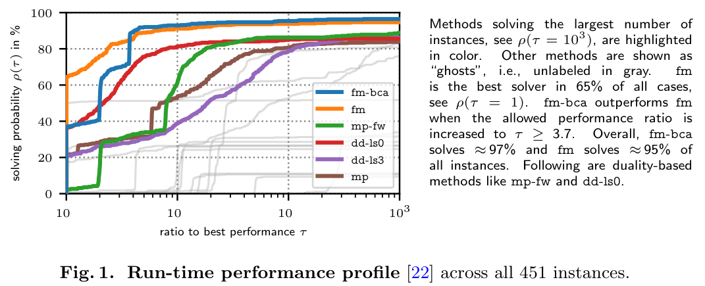

# A Comparative Study of Graph Matching Algorithms in Computer Vision

> **TL;DR:** This benchmark standardizes451visual/bio-imaging graph-matching cost instances and compares20open-source optimization variants. It finds that strong classical fusion/dual methods often outperform customary baselines. The paper explicitly excludes learning the costs or neural models; fixed-target success and certified optimality must remain distinct.

## Motivation

Matching papers often evaluate different costs, instance subsets and time budgets, even when they start from the same images. This obscures the performance of the underlying optimization algorithm. The study separates that question from learning and feature modeling by distributing actual cost instances in a common format and applying common measurements (Introduction).

## Contributions

- A collection of451existing graph-matching instances grouped into11datasets.
- A technical taxonomy and comparison of20available solver variants, including classical primal heuristics and Lagrangian dual methods.
- Compatible model transformations, standardized wrappers and fixed-time/fixed-target protocols.
- A public benchmark website, code and container setup intended to make the comparison reproducible and extensible.

## Methodology

**Optimization task.** The base formulation minimizes general Lawler quadratic costs over binary assignments with at most one match per node on either side. It permits unmatched nodes. Complete/bijective, injective and incomplete formulations are distinguished. Costs can be sparse and may forbid particular assignments, unlike dense factorizable Koopmans–Beckmann instances often used in QAPLIB (Sections1–2).

**Compared methods.** Primal methods include linearization/IPFP/Frank–Wolfe, graduated assignment, spectral and norm relaxations, random-walk/probabilistic methods, convex–concave path following and randomized fusion moves. Nonintegral outputs are rounded by a linear assignment problem where specified. Dual methods decompose the objective into graphical-model and assignment subproblems, with different dual updates and primal reconstruction rules. A higher dual lower bound is distinct from a better feasible assignment; block-coordinate dual ascent can stop at a suboptimal dual fixed point (Section3, Tables1–2).

**Model transformations and theory.** The scientific supplement constructs polynomial reductions between incomplete general graph matching and complete general QAP. Dummies allow completion with unchanged original costs; the reverse reduction shifts costs so completion is preferable and all complete assignments share the same additive change. This is a complexity-equivalence construction, not a polynomial-time solver. The practical nonpositive-cost transformation first converts incomplete instances to bijective form before shifting fixed-cardinality terms. An arbitrary constant shift must not be assumed to preserve a partial matching objective with variable cardinality. The supplement also documents unary-to-pairwise conversion, asymmetric versus symmetrized graphical models and sparse dd-format input (supplement SectionsA1–A4).

**Classification.** This is **study / benchmark**, retained as a reference. The authors explicitly restrict the paper to the optimization stage and put modeling/learning outside its scope. Neural graph matching motivates the importance of solver selection, but the paper contributes no newly trained neural solver, shared checkpoint or neural improvement policy.

## Experiments

**Instances.** The collection includes hotel, house-dense, house-sparse, car, motor, OpenGM, flow, Caltech-small/large, worm-atlas and worm-to-worm matching. Small graphs have at most52source nodes; larger bio-imaging cases reach565source nodes and more than1,000candidate labels. Dataset counts and cost sparsity vary substantially. The prepared objective, rather than the original image alone, is the comparison unit (Section4, Table3).

**Measurement.** Fixed-time tests report feasible objective E, lower bound Dwhere available, known-optimum attainment and ground-truth correspondence accuracy. Main budgets are1/10/100seconds; the supplement extends to300seconds. Fixed-target profiles measure time to within0.1%of the reference objective. **If the true optimum is unknown, the reference is the best value achieved across compared methods**, so attaining it is not a proof of global optimality. Ground-truth accuracy is computed only on annotated nodes for partially labeled datasets (Section4, supplementA5/A8).

*Original Figure1 and complete caption, accepted PDFp12; extracted and visually checked. Its “solving” probability uses the paper's fixed-target definition, including best-known references where optima are unavailable.*

**Timing scope.** Reported runtime is the **minimum of five trials** on AMD EPYC7702 2.0GHz hardware. Random seeds for fusion methods are fixed. Timers exclude input-format conversion, file loading, parsing and necessary cost transformations. These are optimizer timings, not end-to-end neural image-matching latency or means with uncertainty intervals. MATLAB/C++implementation differences remain part of the evaluated software comparison (Section5, supplementA6–A7).

**Overall observations.** Fusion moves are fastest to the reference target in approximately65%of cases. With a sufficiently larger allowed performance ratio, fusion plus dual BCA reaches approximately97%of instances, versus approximately95%for fusion alone. The authors conclude that several popular small visual-cost datasets are too easy to distinguish strong optimizers, and that comparisons against only customary spectral/random-walk baselines can be misleading. This does not imply that all QAPs or all learned visual matching problems are easy (Figure1, Conclusion).

**Important counterexamples and tradeoffs.** Fusion/BCA often has strong primal values while its dual bound is weaker than other dual approaches. On Caltech-large at300seconds, mp-fw has mean objective−34287, better than fm-bca−34082, while dd-ls3has a much tighter lower bound−34911than fm-bca−48217. On worm pairs at300seconds, fm-bca has objective−65958and accuracy58%, whereas dd-ls3has worse objective−64556but accuracy60%. Thus lower optimization cost does not invariably mean more correct correspondences. The worm-atlas table reports93%known-optimum attainment for fm-bca, not100%; difficult Caltech/pairs cases remain unresolved (mainTables4–5; supplementTablesA3–A13).

## Limitations

The comparison covers public implementations and the collected visual/bio-imaging cost distributions. Methods without open code are excluded. It does not directly evaluate neural cost learning, modern end-to-end matching accuracy, learned-policy generalization or dense factorizable QAPLIB performance. A common cost format improves comparability but does not erase solver-language, parameter and implementation differences. Minimum-of-five timing with fixed seeds is not a distribution of stochastic performance. Best-known targets, rounded objectives and averaged bounds must not be elevated into per-instance certificates. Small datasets can be easy for optimization while their modeling/semantic-accuracy problem remains difficult.

## Reproducibility

**Identity and dates.** The eight authors are Stefan Haller, Lorenz Feineis, Lisa Hutschenreiter, Florian Bernard, Carsten Rother, Dagmar Kainmüller, Paul Swoboda and Bogdan Savchynskyy. The byline lists Heidelberg University, University of Bonn, Max Delbrück Center Berlin and Max Planck Institute for Informatics. Springer records **2022-10-28** first online for DOI[10.1007/978-3-031-20050-2_37](https://doi.org/10.1007/978-3-031-20050-2_37), LNCS13683pages636–653. Canonical arXiv[2207.00291](https://arxiv.org/abs/2207.00291) first appeared **2022-07-01**. The actual main reading copy is the official18-page ECVA accepted PDF, with its identity/version recorded separately from Springer pagination.

**Scientific coverage.** All18main pages,69references and18official supplement pages were read. Reduction formulas/diagrams, transformation algorithms, model equations, method/dataset tables, main performance profile and all detailed supplemental result tables/profiles were rendered and inspected. The independently downloaded Springer scientific attachment is byte-identical to the ECVA supplement and is recorded as an alias, not counted twice. Original Figure1 with its full caption physically exists in public/paper-assets and was actually viewed.

**Code.** The[official companion site](https://vislearn.github.io/gmbench/) links the[benchmark repository](https://github.com/vislearn/gmbench). Its112-member archive at git-resolved commit`dd13db1841e679d357c113d5f16734a12e38ba13`contains no independent PDF, ZIP or notebook science attachment. The full README and representative fusion container definition were read, confirming wrappers, container builds, SLURM support and pinned solver-source retrieval. The README explains MATLAB licensing requirements and log processing; the fusion container pins libmpopt separately. No container build, solver benchmark or independent reproduction was run.

**Actual internal reference.** Bibliography reference51directly cites [BB-GM](../specialist/deep-graph-matching-via-blackbox-differentiation-of-combinatorial-solvers.md), matching its six-author ECCV2020identity. Classical solver, data and source-code references are not converted into invented neural-paper edges.
