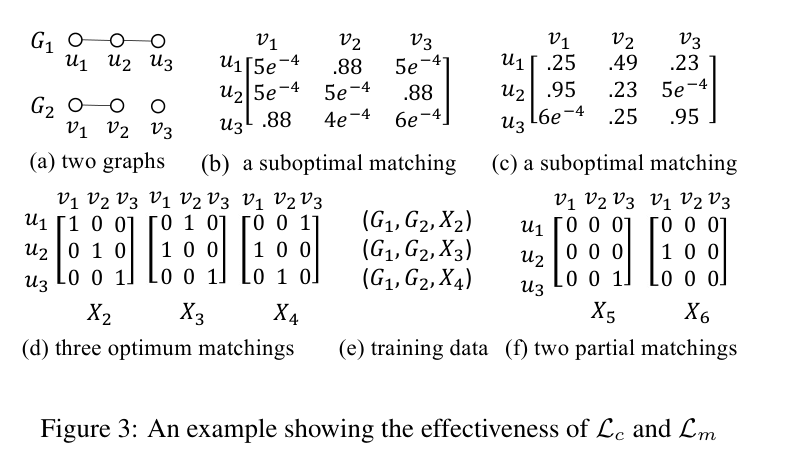

# Graph Edit Distance Learning via Modeling Optimum Matchings with Constraints

> **TL;DR:** This paper studies GED regression with auxiliary matching supervision: partial optimal-match labels avoid overpenalizing alternative optima, and two complementary penalties encourage assignment structure. The reported output is a learned scalar GED, not a decoded edit path. Its scalar-prediction contribution is preserved as reference analysis rather than presented as a verified discrete neural solver.

## Motivation

Several different node permutations can induce the same optimal graph edit distance. Supervising a single permutation can penalize other equally good correspondences, while a generic GED-regression loss does not explicitly teach matching constraints. The paper introduces partial-match supervision and complementary constraint penalties to guide an association-graph network (Introduction).

## Contributions

- Positive-only supervision from a partial optimal node matching, allowing multiple compatible full optima.
- Random rollouts along a known optimal branch-and-bound path to choose a partial-label subtree.
- A combined row/column-sum and conflict-product regularizer.
- Association-graph GED regression and ablations on AIDS, LINUX, IMDB and PTC.

## Methodology

**Problem and labels.** Undirected labeled graphs use unit node/edge insertions, deletions and relabelings. Dummy padding equalizes graph sizes. Binary assignments have a quadratic edit-cost objective with one-to-one constraints. A squared row/column-sum penalty gives a penalized binary formulation; the penalty's equivalence to constrained optimization depends on a sufficiently suitable weight, and does not automatically transfer to arbitrary continuous predictions (Section3, Eqs1–7).

*Original Figure3, all six panels and entire caption, formal PDFp4/printed1537; extracted and visually checked. This is the paper's illustrative training example, not an architecture or optimization guarantee.*

**Partial optimal-match supervision.** Given a known optimal assignment and its branch-and-bound path, the method performs random completions from candidate prefixes. A higher fraction of optimal completions gives a better prefix score; equal scores prefer the larger subtree nearer the root. The positive-only loss $L_m=-\sum P_{ik}\log\hat X_{ik}$ constrains the ones in the selected partial matrix without penalizing every zero. Compatible full optima are therefore allowed by this partial label. Finite random rollouts do not enumerate all optimal assignments or certify globally optimal prefix selection over every possible branch (Section4.2).

**Constraint penalty.** $L_{qip}$ penalizes deviations of row/column sums from one. $L_{cr}$ sums products of conflicting entries sharing a row or column. Their sum $L_c$ has permutation matrices as its common zero set on the nonnegative normalized setting. This conditional zero-set fact is distinct from showing that finite-weight neural training reaches zero. The combined objective is GED MSE plus weighted $L_c$ and $L_m$ (Eqs8–11).

**Network and actual output.** An association-graph node represents a candidate original-node match; edges encode edit-cost interactions. Typed graph convolutions distinguish whether node labels agree. The reported model has two32-dimensional ReLU layers and degree one-hot initialization. Node embeddings feed sigmoid auxiliary correspondence predictions. Separately, the **mean of all node embeddings feeds a fully connected scalar GED regressor**. The formal parameter settings and released forward/evaluation paths do not supply a hard assignment/edit-path decoder or compute the reported GED as the cost of such a decoded path (Section4.3, ParameterSettings).

**Classification.** This is retained as **reference analysis of GED learning**. Auxiliary soft correspondence supervision is scientifically relevant to neural combinatorial optimization, but the actual evaluated scalar-regression pipeline is not silently promoted into an exact or approximate discrete solver. Lower MSE can coexist with an estimate below the true GED, without a feasible-path upper-bound interpretation.

## Experiments

**Data/protocol.** Four graph datasets are partitioned by size. The primary experiment samples6000training/2000validation/2000test graph pairs with at most30nodes; exact GEDs/optimal matchings are generated by a cited exact solver. The text specifies pair sampling, rather than an independently verified graph-disjoint split. Training uses batch1, Adam initial learning rate.005decayed.96every5epochs,600epochs, and selects the checkpoint with lowest validation GED MSE. Experiments use a Xeon Gold6230R,768GB RAM and TeslaK80 (Section5).

**Prediction error.** Table2reports MSE **1.32/1.16/67.55/5.27** on AIDS/LINUX/IMDB/PTC, versus GraphSim13.96/35.14/363.20/547.19. The advertised4.2–103.8times improvements are ratios of errors under these settings, not optimality ratios or matching-accuracy multipliers. IMDB is a counterexample to universal superiority over heuristics: Beam MSE **64.16**is lower than67.55. The AIDS rank metrics are Spearman.89/Kendall.85/p@10.73versus GraphSim.86/.81/.61 (Table2and text).

**Cost.** Inference takes **18.17/21.95/20.33/18.51ms**, slower than both GraphSim6.70/6.03/6.12/6.22and the displayed classical heuristics. The network's association graph has$n^2$nodes and$O(n^3)$edges on sparse original graphs, versus the compared models' reported quadratic scaling. The paper trades computation for prediction quality; it does not establish a universal speed improvement (Table3).

**Ablation qualification.** Both penalties are not always best. Table4's full $L_d+L_m+L_c$ gives **1.32/1.44/67.55/6.79**, whereas $L_d+L_m$ alone gives1.73/**1.16**/97.12/**5.27**. Thus Table2's LINUX/PTC best values match the no-$L_c$ setting; they must not all be attributed to a single universally superior full-regularizer configuration. The prose's claim about $L_c$ being best on LINUX is inconsistent with its printed table.

**Larger graphs.** AIDS31–50-node pairs produce MSE5.27versus GraphSim30.9, with37.2ms versus10.8ms inference. Training pairs have at most30nodes, but **both validation and test pairs come from the larger distribution**. Combined with validation checkpoint selection, this is not zero-exposure large-graph generalization. Exact label-generation cost also limits the studied size range (Table5, Section5.3).

## Limitations

The method predicts a scalar distance with auxiliary soft assignments; it does not demonstrate a feasible decoded edit path or an optimization certificate. Multiple-optimum supervision needs costly exact GED/matching information, and random rollouts offer a finite-sampling heuristic rather than exhaustive representation of every optimum. A soft penalty encourages but does not guarantee a permutation after finite training.

Association-graph cost grows cubically for sparse inputs and can be worse for dense graphs. Dataset-specific hyperparameters, nonuniform ablation winners, a heuristic IMDB counterexample and larger-distribution validation limit broad claims. No multi-seed uncertainty study or isolated analysis of total exact-label/rollout preprocessing cost is reported.

## Reproducibility

**Identity/date.** Yun Peng, Byron Choi and Jianliang Xu list Hong Kong Baptist University. Formal IJCAI2021 pages1534–1540, DOI[10.24963/ijcai.2021/212](https://doi.org/10.24963/ijcai.2021/212), have **August2021 month precision** in official/deposited metadata. No unverified exact day or arXiv identity is added.

**Complete science.** All seven formal pages and all21references were read. The constrained/penalized objectives, partial-label/constraint examples and all five tables were rendered and inspected. The publisher page, institutional record and full official code archive were checked; no independent scientific appendix is identified. OriginalFigure3 with all six panels and the complete caption physically exists under public/paper-assets and was actually viewed.

**Code.** Official[csypeng/graph_edit_distance_learning](https://github.com/csypeng/graph_edit_distance_learning), commit`f555f6416a6a873cecff7dee24d1bb558d12b4b1`, contains15archive members without PDF/ZIP/notebook scientific attachments. The full README documents association-graph preparation, exact-solver label generation, DGL.5.3/PyTorch1.6 and input paths. It also adds constraint nodes to its described association graph, a released implementation detail. Necessary inspection of `main.py`219–294shows auxiliary sigmoid probabilities and an independent `dgl.mean_nodes→fc3`GED head;428–433evaluates scalar MSE. The current forward uses typed-neighbor counts rather than simply the printed degree initialization. No hard edit-path output is inferred, and no training/benchmark rerun was performed.

**Actual internal references.** The full bibliography directly cites[DGMC](../specialist/deep-graph-matching-consensus.md)(Fey2020),[CIE-H](../specialist/cie-h.md)(Yu2020) and[the graph-matching survey](learning-for-graph-matching-and-related-combinatorial-optimization-problems.md)(Yan2020), all on PDFp7. Wang2019a explicitly cites the differently titled NGM hypergraph/multiple-graph preprint, which is not substituted for an earlier conference entry. Scalar-similarity baselines are not mapped to unrelated discrete-solver catalogue identities.
