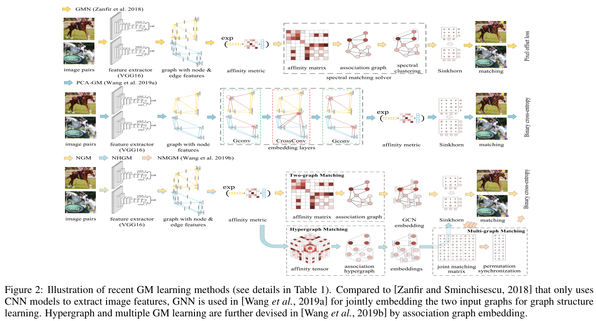

# Learning for Graph Matching and Related Combinatorial Optimization Problems

> **TL;DR:** This IJCAI Survey Track article reviews where learning can enter graph matching: node descriptors, structural embeddings, affinity functions and matching decisions. It connects those choices to broader neural combinatorial optimization and advocates hybrid classical/neural pipelines. It introduces no new solver or experimental benchmark.

## Motivation

Combinatorial solvers encode rich mathematical structure, while neural models learn useful representations from data. The survey asks how to combine those strengths, using weighted graph matching as its main example. It emphasizes that optimizing an affinity accurately is different from choosing an affinity that corresponds to the desired real-world matches (Introduction, Section2).

## Contributions

- A selective review of classical, shallow-learning and deep-learning graph matching.
- An organization of neural matching methods by feature extraction, graph embedding, affinity model and training loss.
- Discussion of reinforcement learning, joint matching tasks and multi-graph consistency.
- An outlook on learning within classical solvers, prediction–optimization integration and transfer/meta-learning.

## Methodology

**Formulations and classical context.** The review introduces Lawler and Koopmans–Beckmann quadratic matching, unary affinities, higher-order tensors, spectral/doubly stochastic/semidefinite relaxations and multi-graph consistency. Its displayed two-graph constraints are injective: every source is assigned while each target is used at most once. A square complete permutation is a special case, and this formula should not be read as unrestricted partial matching on both sides. The tensor and relaxation discussion describes existing methods, rather than establishing a new optimization guarantee (Section2.1).

**What can be learned.** The survey separates local visual features learned by CNNs, structural features propagated by GNNs, affinity scoring, and direct decision scoring on an association graph. Its Table1compares representative architectures and losses. Learned node embeddings can support a simpler linear-assignment decoder, but that learned replacement is not an exact polynomial reduction preserving arbitrary original QAP optima (Sections2.2–2.3,3.1).

*Original Figure2 and complete caption, formal PDFp5/4992; extracted and visually checked. This is the survey's illustration of cited methods, not a newly trained architecture.*

**Continuous representations and discrete responsibility.** Sinkhorn alternates row/column normalization to produce a soft matrix; Hungarian can convert appropriate soft scores into a hard assignment. These are separate responsibilities. Differentiability of a soft layer does not itself certify the original integer objective or preserve every higher-order relation. Moreover, a survey schematic does not override a cited method's actual decoder: original GMN, for example, evaluates soft coordinate voting and a row-maximum variant, as documented in its own note (Figure3, Section2.3).

**Multi-graph matching.** The review distinguishes iterative reuse of pairwise solvers, composition paths, spectral/low-rank synchronization and distributed methods. Cycle consistency can improve coherence but does not make a misspecified cost semantically correct. Exact-recovery statements belong to the cited formulations under their assumptions; they are not unconditional guarantees for all learned multi-graph matchers (Section2.1).

**Reinforcement and hybrid learning.** Early RL examples select correspondence pairs sequentially, with the survey explicitly noting simple unattributed synthetic settings. The outlook proposes more work on multi-graph RL, meta-learning, learning solver components from experts, differentiating through classical solvers and integrating uncertain predictions with optimization. These are research directions and interpretations, not experiments performed by this survey (Sections2.4–4).

**Classification.** This is **study / survey**, included as a reference. It has no trained model, common checkpoint, solution-construction policy or neural incumbent editor of its own; a specialist/generalist solver label and solver paradigm would therefore be misleading.

## Experiments

The paper reports **no new training runs, controlled solver comparison or independent quantitative benchmark**. Table1is an architectural comparison of cited work, and Figures1–3illustrate affinity construction, existing network families and Sinkhorn normalization. They must not be presented as results of a new solver.

The text cites successes on routing, graph coloring, branching, decision TSP and visual matching to motivate its discussion. Such numbers and guarantees remain attributable to those original papers and their protocols. The survey's claim that two-graph matching was “largely solved” is a2020author assessment. It is not a theorem of exact QAP tractability, a comprehensive outlier/generalization result or a conclusion validated by new common-protocol experiments here.

The discussion itself acknowledges that learned methods can lag well-designed classical competitors, and highlights constraints and structure as obstacles to directly applying continuous networks. The useful outcome is a conceptual map of methods and open directions, rather than an empirical ranking.

## Limitations

The review is explicitly selective and reflects the literature available around2020. It is neither an exhaustive paper count nor a current state-of-the-art benchmark. Some broad claims about computational efficiency, transferability and the maturity of two-graph matching are qualitative or prospective. Learning a linear scoring model, optimizing a continuous relaxation, producing a discrete correspondence and predicting geometric locations are distinct operations whose guarantees should be read in the original sources.

Bibliographic details also need normalization without changing identity. For example, the Attention Model entry prints ICLR2018although its formal conference is2019; Bello is cited in its2016arXiv version. A genuine preprint-to-formal continuation can link to the same stable paper, whereas a different-title substantive journal extension or unrelated clustering method cannot be silently merged into an earlier conference identity.

## Reproducibility

**Identity and dates.** Junchi Yan lists Shanghai Jiao Tong University; Shuang Yang lists Ant Financial Services Group; Edwin Hancock lists University of York. The formal paper is explicitly labeled **IJCAI2020Survey Track**, pages4988–4996, DOI[10.24963/ijcai.2020/694](https://doi.org/10.24963/ijcai.2020/694). Identity-matched deposited publication metadata supplies **2020-07 month precision**. The York/White Rose institutional record confirms an accepted author copy and the same DOI; its acceptance/deposit information is separate from formal publication. No canonical arXiv first-submission date was identified, so none is invented.

**Scientific coverage.** All nine formal pages and87bibliography entries were read. Matching formulations, the architectural taxonomy table, all three figures and the outlook were rendered and inspected. The official IJCAI page links the complete main PDF only. The institutional repository lists an accepted copy rather than an independent scientific appendix. No required scientific supplement, associated solver repository or new experimental artifact is identified in these primary entries. No code inventory or experiment reproduction is claimed for a nonexistent new model. Original Figure2 with its complete caption physically exists in public/paper-assets and was actually viewed.

**Actual internal references.** The bibliography cites [Bello's neural combinatorial optimization](../specialist/neural-combinatorial-optimization.md), [GCNN branching](../specialist/gcnn-branching.md), [learning CO over graphs](../specialist/learning-co-over-graphs.md), [Attention Model](../specialist/attention-model.md), [Pointer Networks](../specialist/pointer-networks.md), [Decision TSP](learning-to-solve-np-complete-problems-a-graph-neural-network-for-decision-tsp.md), [GMN](../specialist/deep-learning-of-graph-matching.md), [PCA-GM](../specialist/learning-combinatorial-embedding-networks-for-deep-graph-matching.md), [CIE-H](../specialist/cie-h.md), [DGMC](../specialist/deep-graph-matching-consensus.md) and [blackbox differentiation](blackbox-backprop.md). Each edge follows a complete bibliography identity. The distinct AAAI2020clustering-aware matching paper is not mapped to NeurIPS2020GANN, and the different NGM journal-style preprint is not treated as an unrelated conference alias.
