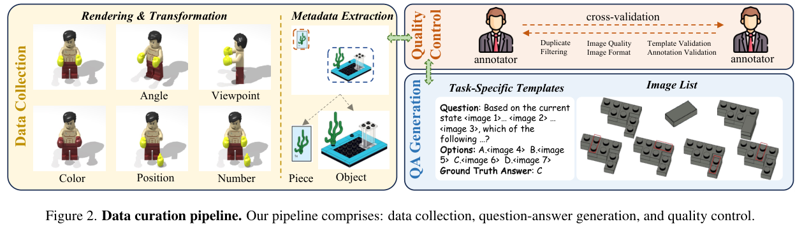

# LEGO-Puzzles: How Good Are MLLMs at Multi-Step Spatial Reasoning?

> **TL;DR:** A LEGO assembly benchmark tests elementary visual reasoning, selecting and ordering intermediate assembly states, and generating assembly images. The read v4 evaluates 29 MLLMs and shows a large human gap and rapidly degrading long-horizon performance. This is a benchmark/reference study, without a newly trained neural combinatorial solver or an optimization guarantee.

## Motivation

Perceiving a single spatial relationship does not establish the ability to imagine several consecutive assembly actions. The authors seek a controlled testbed that moves from elementary visual questions to complete intermediate-state plans. Rendered LEGO structures permit controlled changes of color, position, viewpoint and assembly order while retaining interpretable geometric dependencies (v4 Sections 1–3).

## Contributions

- An Elementary set of 1,100 questions, balanced across 11 tasks and derived from 407 LEGO building instructions.
- A Planning set that asks models to select and order intermediate assembly states, with increasing horizon and distractor states.
- Image-generation evaluations, including complete multi-turn trajectories and five elementary transformation/assembly tasks.
- Human comparisons, detailed evaluation prompts and rubrics, qualitative failure analyses, and an examination of GPT-4o as an automatic image judge.

## Methodology

**Elementary tasks.** Spatial understanding contains Height, Adjacency, Rotation and Multiview. Single-step sequential reasoning contains Rotation Status, Position, Next-Step and Dependency. Multi-step sequential reasoning contains Backwards, Ordering and Outlier. Each task has 100 examples. Although one sentence says “over 1,100,” the balanced task definition and reported totals specify 1,100. Studio rendering supplies controlled views and transformations; sequence metadata and task-specific human templates produce questions and answers, followed by annotation cross-checks and quality control (v4 Sections 3.1/3.3; formal supplement Sections 1.3–1.4).

**Planning as constrained selection and ordering.** Plan-k-Step-VQA supplies initial state x0 and target state x(k+1), along with 2k candidate intermediate states: k correct states and k distractors. The model must choose k states and place them in order. Here k counts the intermediate states, rather than every initial-to-final transition. The evaluation uses 20 cases for each k from 1 through 8. Exact sequence accuracy, selected-set accuracy and partial set overlap measure different aspects of success (v4 Sections 3.2/5.1).

**Generation protocol.** Multi-turn generation conditions each predicted image on the previous history. Topological expansion enumerates legal assembly trajectories, including the requirement to install lower parts before upper parts. Per-step MSE associates generated images with candidate states; the resulting associations must form a complete legal trajectory. This is the paper's automatic trajectory metric, rather than a proof that generated geometry is physically executable. Separate single-turn image tasks are rated by five human experts on 0–3 Appearance Similarity and Instruction Following rubrics (v4 Sections 5.2/6.2; formal supplement Sections 1.5–1.8).

*Original Figure 2 with complete caption, arXiv v4 PDF p5; extracted and visually checked. It depicts data collection, QA generation and quality control.*

**Classification.** This is **study / benchmark**, retained as a reference. It evaluates existing multimodal models on visual reasoning and planning outputs. It does not introduce a trained generalist/specialist solver, neural local-search operator, objective-gap certificate or new end-to-end optimization algorithm. LEGO dependency reasoning motivates the combinatorial connection; image generation itself is not evidence of certified discrete assembly optimization.

## Experiments

**Version and elementary performance.** All numerical results below refer to the read **arXiv v4**, not the older 20-model public README. Its Table 1 evaluates 29 models zero-shot. GPT-5 scores 72.0 overall, o3 scores 69.1, and Gemini-2.5-Pro scores 68.8. The paper uses rule-based answer extraction and an LLM fallback; chance thresholds are task-specific binomial significance thresholds, not a familywise benchmark guarantee. Height and Rotation remain particularly difficult, with 21/29 and 16/29 models respectively below the displayed above-random threshold (v4 pp 6–8).

**Human comparison.** LEGO-Puzzles-Lite contains 220 questions, 20 per task. Thirty human experts obtain 93.6 overall; GPT-5 obtains 71.8 on this same subset, a **21.8 percentage-point gap**. Comparing human Lite 93.6 directly with full-set GPT-5 72.0 would mix populations. The gap is not at least 20 points on every individual task. Height is ambiguous enough that the reported human baseline is 70%; the appendix's 100% after an attention reminder is a separate intervention, not the original baseline (Table 2; formal supplement Section 1.2).

**VQA planning.** GPT-5 exact sequence accuracy falls from 90% at k=1 to 0% at k=8; all tested models fall below 50% when k>2. Qwen3-VL and InternVL3 reach 0% at k>5. Proprietary models can retain roughly 65% partial overlap at longer horizons even when the whole sequence is wrong. Five human planning participants—not the 30-person Lite cohort—solve all tested horizons correctly, with approximately 85 minutes total reported completion time (v4 Figure 3/Section 5.1).

**Generative trajectories.** Figure 4 reports nonzero success at k=2: GPT-5 and Nano Banana 2 each achieve 0.6, while Nano Banana Pro achieves 0.4. All three are at 0 for k=3,4,5. The adjacent prose saying that none succeeds is therefore too broad if applied to every evaluated horizon. The same paragraph states 50 cases and 10 per horizon, while listing only the four horizons 2–5; this arithmetic discrepancy is unresolved, and this note does not invent an extra horizon or a corrected sample total (v4 p 9; Figure 4 actually rendered and inspected).

**Single-turn generation.** Five tasks with 20 questions each form 100 cases. Nano Banana Pro obtains 2.52 Appearance/1.99 Instruction Following, compared with GPT-5 2.25/1.88. Appearance similarity, instruction adherence and full-trajectory accuracy are distinct metrics. Very weak GILL/Anole outputs receive near-zero scores, but agreement on these obvious failures does not establish judge reliability on stronger outputs. For GPT-4o-generated images, GPT-4o-as-judge has Appearance Pearson correlation−0.443 with human ratings; for Gemini-2.0-Flash outputs it is 0.133 (v4 Table 4/appendix Tables 5–6; formal supplement Tables 1–2).

**External comparison.** The reported correlations with natural-image 3DSRBench are 0.93 for Height and 0.98 for Adjacency, with p-values 0.00723 and 0.00046. These are correlations across the compared model performances on two related tasks. They do not demonstrate causal transfer to robotics, physical execution or every spatial reasoning task (v4 Section 6.1/Table 3).

## Limitations

The benchmark uses rendered images, controlled assembly sequences and specific answer/generation protocols. It does not evaluate robot execution, continuous control, optimal assembly cost, end-to-end solving time or global optimization certificates. Exact sequence accuracy can be zero despite partial correctness; conversely, image appearance alone cannot establish a legal plan. Model rankings depend on the tested versions and extraction protocol. Human Lite evaluation, planning evaluation and generation annotation use different cohorts and rubrics. The formal supplement says unresolved annotation disagreements are removed, which should be considered when interpreting human scoring.

Two v4 reporting inconsistencies remain explicit: nonzero k=2 success versus the unqualified failure prose, and 50 total generative cases versus 10 cases across four stated horizons. They do not erase the observed zero accuracy at k≥3. The automatic judge is unreliable for fine distinctions among stronger generations; near-zero agreement on obvious failures does not resolve that limitation. Neither this benchmark nor its correlations provides a general impossibility theorem for multimodal planning.

## Reproducibility

**Identity and dates.** The nine authors, in formal/v4 order, are Kexian Tang, Junyao Gao, Yanhong Zeng, Haodong Duan, Yanan Sun, Zhening Xing, Wenran Liu, Kai Chen and Kaifeng Lyu. Affiliations are Tsinghua University, Tongji University and Shanghai AI Laboratory. Tang/Gao contribute equally; Zeng/Duan are project leads and Lyu is the corresponding author in the read version. Springer lists **First Online 12 September 2026**, LNCS 17020 pp 1–19, DOI [10.1007/978-3-032-37553-7_1](https://doi.org/10.1007/978-3-032-37553-7_1). Canonical [arXiv2503.19990](https://arxiv.org/abs/2503.19990) first appeared **2025-03-25**. These are distinct preprint and formal publication dates.

**Reading versions and coverage.** The actual main reading copy is explicit [arXiv v4](https://arxiv.org/pdf/2503.19990v4), dated 2026-08-09: all 24 pages, 52 references and its integrated appendix were read. This is an authorized pre-cutoff fallback, not a claim of byte identity with Springer's 19-page chapter. All 16 pages of the independently obtained official Springer scientific supplement, including its 12 references, prompts, annotation rubrics, judge results and qualitative examples, were separately read. Its distinct pagination/layout was not silently deduplicated. Main task diagrams, data pipeline, complete model/human tables, planning plots, generation results, judge tables and qualitative cases, and their supplemental counterparts, were rendered and inspected. Original Figure 2 with the complete caption physically exists and was actually viewed.

**Public artifacts and version boundary.** The [official project](https://tangkexian.github.io/LEGO-Puzzles/) links the [repository](https://github.com/Tangkexian/LEGO-Puzzles) and [dataset](https://huggingface.co/datasets/KexianTang/LEGO-Puzzles). The pinned 516-member repository archive at `1413d2c236879573cc0afff646bae5e3d04023bd` contains no additional scientific PDF/ZIP. Two notebooks are generic AI2D preprocessing/MMBench visualization utilities, rather than separate LEGO scientific results. The README and dataset card were read; both describe an older 20-model release with older byline order/affiliations. Formal/v4 primary sources control this note's metadata and 29-model results.

The LEGO dataset class and relevant multiple-choice evaluation implementation were read. They provide the public TSV loader, interleaved-image prompts, rule extraction and optional LLM matching, but the older ordering extraction prompt explicitly assumes four options. Their presence does not establish that this checkout reproduces every v4 variable-horizon or topology-expanded image-generation experiment. The Hugging Face API inventories only the data TSV, README and attributes file; project/publisher/repository checks identified no further independent scientific attachment. The 142 MB TSV, model APIs and experiments were not executed or independently reproduced.

**Actual internal reference.** Main bibliography 29 and formal supplement bibliography 5 explicitly cite [PhyBlock](phyblock.md), matching its title and author identity. This single article-level edge has evidence from both bibliographies. Other multimodal-model reports or spatial benchmarks are not converted into internal edges merely because they share a topic.
