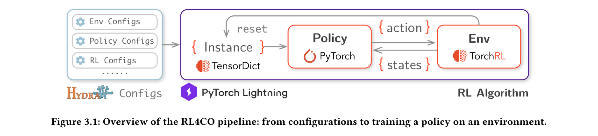

# RL4CO: An Extensive Reinforcement Learning for Combinatorial Optimization Benchmark

> **TL;DR:** RL4CO is a modular library and benchmark for neural combinatorial optimization: environments, policy components, RL algorithms and decoding/search budgets can be varied within one framework. The paper reports **27 environments and 23 baselines**, with routing, scheduling, discrete device placement and graph-selection studies. These counts do not mean that one trained model solves 27 tasks, or that the paper introduces 23 new neural models.

## Motivation

NCO results are difficult to compare when implementations differ in environment definitions, neural components, reward handling, training effort and test-time search. Reimplementing those details also raises the cost of testing a new idea. RL4CO separates the scientific choices from the surrounding training/data infrastructure, so researchers can exchange components and inspect quality, runtime, sample efficiency and generalization under documented protocols (formal Sections 1–2).

## Contributions

- A taxonomy of **environments, policies and RL algorithms**, distinguishing autoregressive/non-autoregressive construction, incumbent improvement and transductive test-instance adaptation.
- Batched environments and reusable feature embeddings, encoders, decoders, training modules and decoding strategies, implemented around PyTorch, TorchRL, TensorDict, Lightning and Hydra.
- A benchmark spanning routing, scheduling, multiple-decap placement, facility location and maximum coverage. The reported environment total includes **16 combinations of vehicle-routing constraints**; the baseline zoo mixes policy architectures, RL algorithms and active-search procedures.
- Studies of baseline choice, sampling/augmentation, heterogeneous scheduling encoders, constructive initialization of improvement methods, large routing instances and software efficiency. The long manuscript provides substantial additional experiments and implementation details.

This is a **benchmark study included in the main NCO collection**. Its research object is neural combinatorial solvers. A shared software interface or reusable architecture is distinct from one shared trained neural checkpoint; neither is required for a benchmark resource to qualify (formal Sections 3–5; arXiv Appendices B–E).

## Methodology

**Problem interface and solver responsibility.** Environments provide instance generation, reset/step, feasible-action masks, rewards, validity checks and optional classical local search. The policy and environment exchange batched TensorDict states. A constructive autoregressive policy chooses successive feasible actions; a non-autoregressive model predicts a heuristic/heatmap from which classical or sequential construction produces a discrete solution. Improvement policies act on complete incumbent solutions through their specified operators. Active search instead adjusts neural parameters for a test instance. Those mechanisms should not be collapsed into a claim that every output is a direct neural end-to-end solution (formal Sections 3–4; arXiv Appendices C–D).

**Modular policies and learning.** Initial node/edge embeddings and dynamic context embeddings translate problem-specific features into a policy representation. Encoders and decoders can then be exchanged, such as replacing the FJSSP HGNN encoder with MatNet and its MLP head with a pointer decoder. REINFORCE baselines, A2C and PPO are separate learning choices. Logit clipping, feasibility masking, temperature, top-k/top-p filtering, sampling, multiple starting actions and symmetry augmentation are separately controllable inference choices. The environment owns the relevant transition/feasibility logic; replacing an embedding does not prove transfer of a trained decision policy (formal Figure 4.1; arXiv Appendices C–D).

*Original formal Figure 3.1 with complete caption, PDF p5. The configuration layer controls the policy, environment and RL training loop. Extracted from the identified formal reading copy and visually checked.*

**Task definitions.** Routing includes TSP, CVRP, OP, PCTSP, a precedence-constrained **uncapacitated pickup-and-delivery TSP**, and the 16 MTVRP constraint combinations. Scheduling includes JSSP, FJSSP and FFSP. The EDA task selects decap locations on a discrete power-distribution grid, with electromagnetic reward evaluation at multiple probing ports; max-sum and max-min objectives have separately trained policies. This is distinct from continuous chip floorplanning. Graph experiments use Euclidean k-median-style FLP (100 candidate locations, choose 10) and weighted MCP (200 items, 100 candidate sets, choose 10). Appendix B.5 explicitly distinguishes additional implemented environments from the 27-environment benchmark; their presence in the library is not evidence of a full experimental evaluation.

**Experimental control.** Main routing instances use unit-square coordinates and documented distributions; validation/test sets contain 10,000 instances with seeds 4321/1234. Equal optimizer-step budgets do not necessarily imply equal numbers of reward evaluations across multistart and other training methods. Test-time budgets range from one greedy rollout to 1,280 samples, augmentation, best-of-64 graph sampling, active search or hybrid classical subsolvers. These budgets are part of each result (arXiv Appendices B, D and E).

## Experiments

**Main modularity and baseline studies.** For FJSSP 10×5, formal Table 5.1 reports mean makespans **111.82 → 103.91 → 101.17 → 98.31** when changing HGNN+MLP to MatNet+MLP, then MatNet+Pointer, then 128-sample decoding. The final improvement includes additional inference effort. The 20×5 sequence is 211.21 → 197.92 → 196.30 → 192.02. These main experiments and Appendix E.3 use different test-set blocks and should not have their numbers interchanged.

Formal Table 5.2 also exposes task dependence. POMO has 0.89%/3.99% gaps on TSP/CVRP, but **14.26%/11.61%** on OP/PCTSP, worse than the Attention Model's 4.40%/2.46%. Forcing every start node is poorly aligned with tasks that select only a subset of nodes. Sym-NCO performs well on the reported Euclidean problems, while Euclidean symmetry augmentation does not automatically extend to arbitrary non-Euclidean or scheduling tasks.

**Distribution and scale.** Multitask training improves several CVRPLIB sets but has negative cases: on models trained at N=50, MTPOMO has gaps **3.20% versus POMO 3.13% on Set A**, and **4.06% versus 3.41% on Set B**; the multidistribution variant reaches 23.69% on Set X versus POMO 16.80%. Appendix D.3.4 specifies augmentation as well as multistart decoding. The larger N=100 comparison likewise has sets where multitask models are worse; generalization is empirical and task/distribution dependent.

The reimplemented GLOP obtains CVRP7K cost **190.9 in 2.0 seconds** with an AM subsolver, or **190.1 in 3.9 seconds** with LKH-3 (formal Table 5.4). Larger appendix comparisons preserve a quality/time tradeoff: at 10K/20K customers HGS gives lower costs 108.1/182.7 in 4.01/6.03 hours, versus GLOP-LKH 111.4/191.4 in 5.06/17.9 seconds. A 35K-customer visualization is one example, not a uniform performance guarantee.

**Construction, improvement and adaptation.** On TSP50 the reported primal integrals are 2.99/2.26 for DACT/NeuOpt from random initialization and 0.08 for POMO sampling. Initializing the improvement methods with POMO changes these to **0.08/0.04**, improving early anytime quality. However, on PDP50 a constructive N2S initialization improves primal integral (2.234 versus 5.580) while random initialization eventually achieves a better final gap. Jointly training constructive and improvement policies is a proposed direction, not an experiment completed here (formal Figure 5.2; arXiv Figure E.12).

AS/EAS can improve out-of-distribution quality at substantial cost. AS runs out of memory at TSP1000 in the reported setup; EAS remains at 52.89%/67.63% gaps for the POMO/Sym-NCO policies there. In ACO experiments on 128 TSP1000 instances, GFACS/DeepACO/classical ACO have gaps **2.87%/3.03%/5.65%** in approximately 20.7/20.7/19.8 seconds, while Concorde supplies the zero-gap reference in 108.3 seconds. These are method-specific quality/budget comparisons (arXiv Tables E.3 and E.5).

**Scheduling, decap and graph results.** Scheduling ablations show that both representations and decoding effort matter. Appendix E.9's FJSSP 20×10 makespan 192.00 is 2.7% below the time-limited OR-Tools incumbent 197.24, whose optimality rate is 0%; it does not beat a certified optimum. FFSP50 is slightly worse than the original MatNet result (51.6 versus 51.5). Dense rewards help the tested FJSSP setup but hurt all three listed TSP sizes (Table E.12).

For max-sum/max-min decap objectives, the trained rollout models score 12.21/11.26 versus GA 11.93/11.07 with 100 online evaluations. The critic baseline scores only 10.89/9.51. “Zero-shot” here excludes additional online search, not offline neural pretraining. In MCP, not every best-of-64 neural configuration beats deterministic greedy: the in-distribution SAGE/Critic score 676.919 is below 680.205, and **all** out-of-distribution best-of-64 neural scores are below greedy's 1367.224. EAS often improves these results, but ordinary AS can deteriorate them (arXiv Tables E.13, E.15 and E.17).

**Foundation routing and implementation efficiency.** Appendix E.8 trains on six routing variants and tests 16 known constraint combinations, with size-specific models. It does not demonstrate zero-shot handling of a new constraint definition or one general model across routing, scheduling and EDA. At N=100, some open/backhaul combinations retain roughly 14–15% neural gaps while OR-Tools is near 3%. The software measurements show reductions in training/inference memory/time for selected reproduced methods; for CVRP100, FP16 mixed precision changes reported training time/memory from 35.09 seconds/13.47 GiB to 25.11 seconds/8.14 GiB. This does not establish bit-identical numerical results or universal speedups (arXiv Tables E.18–E.23).

## Limitations

The benchmark is broad but remains largely synthetic and RL-focused. Some original baselines are reimplemented with changed representations, normalization, rewards or inference budgets, so a measured improvement cannot always be assigned to one component. Foundation-model and novel-environment claims are bounded by the demonstrated task templates. Training hardware is heterogeneous; the main inference setup uses one GPU, and cross-hardware PassMark normalization is an approximation. CPU solver time limits and batched GPU inference are not equivalent compute allocations. Best-known-solution gaps, including negative gaps against a limited incumbent, are not certificates of optimality (formal Section 6; arXiv Appendices D–E).

**Curator checks of printed details.** These are local source discrepancies, not claims that the reported experiments are invalid:

- **Top-p formula:** rendered arXiv p34 Equation 37 retains descending-ranked tokens only while their cumulative probability is ≤p. That excludes the threshold-crossing token and can produce an empty set when the largest probability exceeds p, conflicting with the prose's smallest mass-exceeding set. Current pinned code instead removes an ascending lower-probability tail and retains the crossing/high-probability candidates. The current implementation is not asserted byte-identical to the paper's 2025 experiment code.
- **FLP gap columns:** rendered Table E.14 has “Sample (Best)” gap 3.82% and “Sample (Mean)” gap 0.54% for GCN/Critic; GAT rows contain similar inversions. For the same 64 sampled solutions, the best minimization cost cannot exceed their mean on any instance, so an identically defined positive-reference relative gap should obey the same order. The printed gap labels/numbers need clarification; no replacement values are inferred. MCP tables also vary gap signs, so objective values are safer for the comparisons above.
- **Training settings:** Appendix D.3.3 states learning rate 10⁻⁴ whereas E.1 states 0.001. Those source settings are preserved rather than silently reconciled. Equality of optimizer steps should also be separated from equality of reward evaluations.

## Reproducibility

**Identity and provenance.** The formal KDD 2025 article is DOI [10.1145/3711896.3737433](https://doi.org/10.1145/3711896.3737433), pp 5278–5289, with **33 authors**; the formal byline and publisher-deposited Crossref metadata control this entry. The first four authors contribute equally. Crossref records published-online **2025-08-03**. The canonical [arXiv record](https://arxiv.org/abs/2306.17100) first appeared **2023-06-29**; the separately read long version is **v6, 2025-07-21**. The older preprint and workshop history do not change the formal publication identity. Current repository/homepage BibTeX lists only 30 authors, omitting Qingfu Zhang, Joungho Kim and Kevin Tierney; it is not used to overwrite the formal byline.

**Scientific reading.** The actual formal reading copy is the [12-page NTU-hosted ACM-layout manuscript](https://dr.ntu.edu.sg/server/api/core/bitstreams/1ac5ccd4-7cd1-4381-99a8-12db10c375cc/content), identified by its DOI, title, 33-author byline and pagination. Its Appendix B explicitly directs readers to the long arXiv manuscript. All **58 v6 pages**, including expanded references and Appendices A–E, were independently read as well. Complete-page text/pixel comparison found no exact duplicate pages between the two sources; 70 actual pages are logged. All 93 formal and 161 long-version bibliography entries were read. Key architecture diagrams, mathematical definitions, result tables and curves were rendered and viewed; the original Figure 3.1 asset physically exists and includes its caption. The ACM landing page returned 403, without bypassing the challenge.

**Code and supplementary inventory.** The paper links [ai4co/rl4co](https://github.com/ai4co/rl4co) and its [documentation](https://rl4co.ai4co.org). The complete untruncated 541-entry tree and pinned codeload archive were inventoried at commit `dbd18e7a06ef9c8e35f54ab93adf6136ceeffad0`. README, all 15 tutorial purposes/headings, environment reset/step responsibilities and the actual logit/top-p implementation were inspected. The tutorials concern usage, training, custom environments, libraries and decoding rather than a separate identified scientific supplement; no extra science PDF/archive was found there. Current tutorials/features are not retroactively counted as 2025 results. The library is MIT-licensed, while third-party instances/solvers retain their own terms. No neural training, electromagnetic simulation or solver benchmark was rerun.

**Catalogue references.** Internal edges are grounded in explicit body/table/appendix references plus complete bibliography entries. Relevant implemented methods include [AM](../specialist/attention-model.md), [POMO](../specialist/pomo.md), [Sym-NCO](../specialist/sym-nco.md), [MatNet](../specialist/matrix-encoding-networks.md), [DevFormer](../specialist/devformer.md), [DeepACO](../specialist/deepaco.md), [GFACS](../specialist/gfacs.md), [GLOP](../specialist/glop.md), [DACT](../specialist/dact.md), [NeuOpt](../specialist/neuopt.md), [MTPOMO](../generalist/mtpomo.md) and [MVMoE](../generalist/mvmoe.md). Earlier cited versions are explicitly retained: BQ-NCO's Generalizable title, the eight-author 2024 RouteFinder preprint and the six-author SIL precursor. Their distinct older experiments are not replaced by later formal-version results. References to software or papers absent from the active catalogue do not generate invented internal edges.
